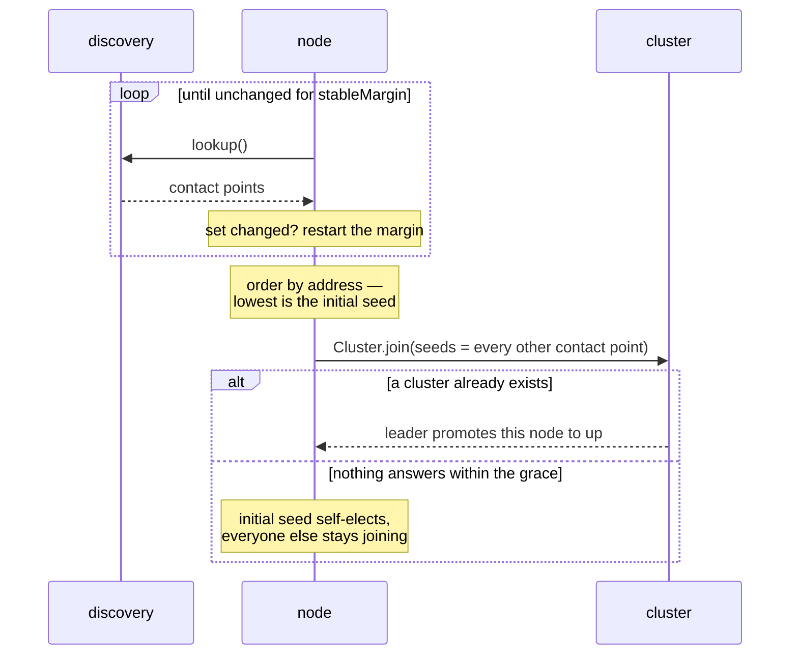

import { Aside } from '@astrojs/starlight/components';

A cold start asks every node the same question at the same moment —
*"is there a cluster yet?"* — and discovery answers it differently on
each of them.  DNS has not fully propagated; a pod is `Ready` before
its IP is in the headless service; the Kubernetes API returns a partial
pod list.  Act on the first answer and each node forms a cluster out of
the subset it happened to see.

Gossip never repairs that.  The results are separate clusters with the
same name, each with its own leader, its own singletons and its own
shard allocations.

**Cluster bootstrap** is the phase that runs *before* `Cluster.join` and
makes sure at most one cluster comes out of a simultaneous start.

## The two rules



**1 — Stable observation.**  Poll the seed provider on
`pollIntervalMs` and require the returned set (plus this node) to be
*byte-identical* for `stableMarginMs` before acting on it.  Any change
restarts the margin.  A failed lookup is *not* an empty set — it does
not count as an observation at all, so a DNS outage can never be
mistaken for "I am alone".

**2 — Deferred self-election.**  Order the settled set by address.  The
lowest is the **initial seed** — but it does not form a cluster on the
spot.  Every node, winner included, joins with the *other* contact
points as its seeds; only the winner also gets a deadline
(`selfElectionGraceMs`) after which it will form a cluster if nobody
has promoted it.

<Aside type="tip" title="Why the winner still dials its seeds">
  Addresses are handed out by the platform, so a node that starts
  *later* can perfectly well sort *first* — a scaled-up pod, or a
  restarted one with a recycled IP.  Letting the election winner
  self-elect immediately would have it form a second cluster beside the
  running one.  Because self-election is only a deadline, the running
  cluster's leader promotes it within a gossip round or two and the
  deadline never fires.
</Aside>

## Turning it on

The one-line path — `bootstrapCluster` runs the phase for you:

```ts
import { bootstrapCluster, ClusterBootstrapOptions } from 'actor-ts/cluster';

const bootstrapOptions = ClusterBootstrapOptions.create('my-app')
  .withHost(process.env.POD_IP!)
  .withPort(2552)
  .withDiscovery('kubernetes')
  .withStableObservation(true);
const { cluster, shutdown } = await bootstrapCluster(bootstrapOptions);
```

Pass an object instead of `true` to override the timings:

```ts
const bootstrapOptions = ClusterBootstrapOptions.create('my-app')
  .withHost(process.env.POD_IP!)
  .withDiscovery('kubernetes')
  .withStableObservation({ requiredContactPoints: 3, stableMarginMs: 8_000 });
```

## Driving it yourself

If you call `Cluster.join` directly, run the observation and feed both
of its outputs into the options — the seed list **and** the
`selfElection` policy:

```ts
import {
  Cluster,
  ClusterOptions,
  NodeAddress,
  StableObservation,
  StableObservationOptions,
} from 'actor-ts/cluster';

const selfAddress = new NodeAddress('my-app', process.env.POD_IP!, 2552);

const observationOptions = StableObservationOptions.create()
  .withSeedProvider(seedProvider)
  .withSelfAddress(selfAddress)
  .withRequiredContactPoints(3);
const observation = new StableObservation(observationOptions);
const targets = await observation.resolveJoinTargets();

const clusterOptions = ClusterOptions.create()
  .withHost(selfAddress.host)
  .withPort(selfAddress.port)
  .withSeeds(targets.seeds.map((address) => address.toString()))
  .withSelfElection(targets.selfElection);
const cluster = await Cluster.join(system, clusterOptions);
```

`resolveJoinTargets()` returns the settled set, whether this node won
(`isInitialSeed`), and the `selfElection` value to pass on.  Deriving
that value yourself is the one mistake that reintroduces the split
brain, so the observation does it for you.

## Settings

| Setting | Default | What |
| --- | --- | --- |
| `stableMarginMs` | 5000 | How long the contact-point set must stay unchanged. |
| `pollIntervalMs` | 1000 | How often the seed provider is polled. |
| `maxWaitMs` | 60000 | Total budget; exceeding it throws. |
| `requiredContactPoints` | 1 | Fewest contact points a settled observation may contain. |
| `selfElectionGraceMs` | 10000 | How long the elected node waits before forming a cluster. |

Same keys under `actor-ts.cluster.bootstrap.*`, with the usual
precedence — **explicit options > HOCON > built-in defaults**:

```hocon
actor-ts.cluster.bootstrap {
  stable-margin           = 5s
  poll-interval           = 1s
  max-wait                = 60s
  required-contact-points = 3
  self-election-grace     = 10s

  discovery {
    method       = "kubernetes"
    service-name = "my-app"
  }
}
```

The `discovery` sub-block is read by **every** `bootstrapCluster` call, not
only the stable-observation one: it is the `discovery:` option in config form,
so a deployment can move the choice of provider and the name of the service
out of the application source.  A `method` outside `auto | config | dns |
kubernetes` is refused rather than ignored.  The providers' own settings —
the DNS cache, SRV mode, the address pins, a static seed list — live under
[`actor-ts.discovery`](/reference/configuration/#actor-tsdiscovery).

`requiredContactPoints` is the one worth changing.  The margin catches
discovery that is *slow*; only a required count catches discovery that
is **stably wrong** — a resolver that consistently returns two of your
three pods will settle happily on the wrong set.  The default of `1`
exists so single-node development needs no configuration; in production
set it to the replica count you expect.

### What the options forward, and what stays in HOCON

Beside its own settings — discovery, stable observation, readiness,
`newClusterEnabled`, the signal handlers, the receptionist —
`ClusterBootstrapOptions` carries a fixed set of fields of the two option
types a node is built from, under the names they have there:

| Forwarded to | Fields |
| --- | --- |
| `ActorSystem.create` | `logger`, `otelLogs`, `logSinks`, `logLevel`, `config`, `configFile`, `persistence` |
| `Cluster.join` | `host`, `port`, `advertisedHost`, `advertisedPort`, `transport`, the seeds (`seeds`, or what discovery found), `roles`, `appVersion`, `failureDetector`, `failureDetectorAutoDown`, `gossipIntervalMs`, `downing`, `splitBrainResolver`, `shutdownAfterUnsuccessfulJoinMs` |

Each one travels **only when it is set**, and then outranks the
configuration the way an explicit option does everywhere.  A field left
unset is not forwarded as a default: the system or the join reads its own
key, so `actor-ts.cluster.app-version`, `split-brain-resolver.stable-after`
or `actor-ts.logger.sinks.*` in the file decide exactly as they would on a
direct `Cluster.join`.

```ts
import { ClusterBootstrapOptions, KeepMajority } from 'actor-ts/cluster';

const bootstrapOptions = ClusterBootstrapOptions.create('my-app')
  .withDiscovery('kubernetes')
  .withDowning(new KeepMajority())
  .withSplitBrainResolver({ stableAfterMs: 20_000 })
  .withShutdownAfterUnsuccessfulJoinMs(60_000);
```

Every other field of `ClusterOptions` and `ActorSystemOptions` — the
φ-accrual detector, the seed-retry and tombstone timings, the promotion
thresholds, the wire's caps and timeouts, dead-letter and diagnostics
settings — is **HOCON-only** on this path: set it under `actor-ts.cluster.*`,
`actor-ts.remote.*` or the system's own block, in `application.conf` or
through `withConfig`.  Nothing is lost by that, because the system and the
join read those keys themselves, with the precedence they have on a direct
join.  What the bootstrap gains is staying a short list of what an
application decides in code — the node's identity, its membership, how
failures are handled, the join's deadline and where the logs go — instead of
a second copy of two option types, where every forwarded field is one more
place a change has to remember and a forward that is missed fails silently.
What HOCON cannot express — a dispatcher instance, a scheduler, startup
tasks — needs `ActorSystem.create` and `Cluster.join` directly.

## The node's own address

The election orders on this node's address, so the bootstrap resolves the
address before it observes anything — from the layers `Cluster.join` reads,
with the environment appended at the bottom:

```
explicit options  >  actor-ts.remote.tcp.*  >  CLUSTER_HOST / POD_IP / HOSTNAME, CLUSTER_PORT  >  0.0.0.0, 2552
```

A port in `application.conf` therefore wins over `CLUSTER_PORT`, and the
variable still answers on a node whose file names none: `reference.conf`
publishes neither leaf, so an unconfigured file leaves the layer empty.  The
identity peers dial — `advertised-host` / `advertised-port` in the same block
— resolves the same way, and the election, the seed filter and discovery all
use it before the join, so the address a node is elected on is the address
it announces.  See [`actor-ts.remote`](/reference/configuration/#actor-tsremote).

## Waiting for readiness

A resolved `bootstrapCluster` means a **ready** cluster: this node is a
full member (`up`) and at least `minimum-members` members are up.  When
that is not reached within the budget, the bootstrap runs the
coordinated-shutdown pipeline and rejects with a
`ClusterReadyTimeoutError` naming self's status, the up count and the
bar — it never resolves for a node that is still `joining`.

```ts
const bootstrapOptions = ClusterBootstrapOptions.create('my-app')
  .withHost(process.env.POD_IP!)
  .withDiscovery('kubernetes')
  .withStableObservation(true)
  .withAwaitReady({ minimumMembers: 3, timeoutMs: 30_000 });
const node = await bootstrapCluster(bootstrapOptions);
node.formedNewCluster; // false — joined an existing cluster rather than founding one
```

`awaitReady` takes `true` (the default — wait with the computed budget),
`false` or `0` (skip the wait), a number (the budget in ms), or the
options bag above.  Unset fields fall through to HOCON and then to the
computed budget:

| Field | Default | What |
| --- | --- | --- |
| `minimumMembers` | 1 | Fewest `up` members — self included — before the cluster counts as ready.  Size it like `requiredContactPoints`: to the replica count. |
| `timeoutMs` | derived | `await-ready` when set; else `self-election-grace` + 5 s behind stable observation — the budget every node's readiness actually hangs on, winner or not — else a flat 5 s. |

```hocon
actor-ts.cluster.bootstrap {
  minimum-members = 3
  # await-ready   = 30s   # unset selects the grace-aware computed default
}
```

The same wait exists standalone — after a hand-wired `Cluster.join`, or
later in the process before a rebalancing-sensitive step:

```ts
await cluster.awaitReady({ minimumMembers: 3, timeoutMs: 30_000 });
cluster.isReady();      // synchronous probe of the same predicate
cluster.selfMember();   // this node's own record, tombstone included
cluster.selfElected;    // true — this node founded its cluster
```

Without `timeoutMs` the promise waits indefinitely, like
`system.whenTerminated()` — pair it with a deadline wherever the cluster
may legitimately never form; a node that has left or been removed never
becomes ready, and a wait still pending when the join gives up rejects at
once.  Readiness here deliberately means *membership*:
app-registered readiness checks (the `/ready` endpoint's aggregate) may
depend on initialisation that runs after bootstrap, so waiting on them
could deadlock the very call that comes first.  `/ready` stays the load
balancer's view; `awaitReady` is the in-process one.

To restore the old fire-and-forget shape, pass `awaitReady: false` and
watch membership yourself via `cluster.awaitReady().catch(…)`.

### Composed with the join's own deadline

Every `Cluster.join` can carry a deadline of its own,
[`actor-ts.cluster.shutdown-after-unsuccessful-join`](/cluster/joining-and-seeds/#when-no-seed-ever-answers),
and the join under the bootstrap is no exception.  The two compose
explicitly:

- **`awaitReady` fires first** — the rejection above.  The pipeline runs
  with `ClusterJoinUnsuccessfulReason`, the reason the give-up passes too,
  so a shutdown task tells a failed join by one reason whichever deadline
  fired.  `shutdown()` on a node that did start still passes
  `ClusterLeavingReason`.
- **The give-up fires first** — the wait ends at once.  The bootstrap
  waits for the pipeline the give-up started and rejects with a
  `ClusterReadyTimeoutError` that names
  `actor-ts.cluster.shutdown-after-unsuccessful-join` and carries its
  deadline as `timeoutMs`.
- **`awaitReady: false` or `0`** — the give-up is the only deadline left
  once `bootstrapCluster` has returned.
- **Behind stable observation**, a give-up that does not exceed
  `self-election-grace` + 5 s — the computed budget above — is refused
  before the join with an `OptionsError` naming both keys.  Every node but
  the elected one waits out that grace with nothing able to promote it,
  and would give up on a cluster about to form.

The give-up's clock starts at the join, so discovery and the stable
observation run before it.  Set it in HOCON, where every node of the
deployment reads the same value:

```hocon
actor-ts.cluster.shutdown-after-unsuccessful-join = 60s
```

or on the bootstrap options, which outrank the file and reach the join only
when set:

```ts
const bootstrapOptions = ClusterBootstrapOptions.create('my-app')
  .withDiscovery('kubernetes')
  .withShutdownAfterUnsuccessfulJoinMs(60_000);
```

Either way, the refusal behind stable observation judges the deadline the
join arms: an explicit `0` over a file that sets one leaves nothing to
refuse.

## Founding a cluster: first start only

A bootstrapped node that finds nobody to join founds a cluster — at once on
the plain path, after the election grace behind stable observation.  That is
right on a deployment's first start, where somebody has to, and it is the
split brain on every start after it: a node cut off from its peers by a
partition, a discovery outage or a DNS answer that lags pod readiness comes
up as the founder of a second cluster beside the running one.

`actor-ts.cluster.bootstrap.new-cluster-enabled` is how a deployment says the
cluster exists now:

```hocon
actor-ts.cluster.bootstrap.new-cluster-enabled = off
```

Off, no bootstrapped node self-elects — the policy handed to the join is
`'never'` on both paths — and an explicit `seeds: []`, which says "I am the
first node", is refused with an `OptionsError`.  A node that finds nobody
stays `joining`: under the default `awaitReady` the start rejects with
`ClusterReadyTimeoutError` and tears the system down, and with
`awaitReady: false` it resolves and waits for a leader to promote it.  A
cluster that exists promotes the newcomer exactly as before — off forbids
founding, not joining.

The key ships `on`, so a first start and single-node development need
nothing, and every start logs one warning while it is on: the first-deploy
setting left on in production is the case the key exists for.
`withNewClusterEnabled(…)` in code wins over the key, as every option does.

Stable observation itself has no switch in the block, and that is a decision
rather than a gap.  Turning it on changes what `bootstrapCluster` promises
the code that calls it: every start waits at least `stable-margin`, a start
whose discovery never settles rejects after `max-wait` instead of joining,
and the readiness budget grows by the election grace.  Those are properties
of the start-up path an application is written around, so the switch stays
beside that code (`withStableObservation`), and the five timings are
configuration because they tune a phase the code has chosen.  What a
deployment does need to say from a file is whether a node may found a
cluster at all — which is this key.

## What it refuses to do

<Aside type="caution" title="It throws rather than joining anyway">
  If the set never settles within `maxWaitMs`, `resolveJoinTargets()`
  rejects with a `StableObservationError` naming the last observation
  and this node's advertised address.  There is no degraded fallback to
  a direct join: that would be indistinguishable from the failure the
  phase exists to prevent — a node that could not agree with anyone
  about who is out there, joining anyway.  A start that fails loudly is
  recoverable by a restart or an operator; a second cluster is not.
</Aside>

<Aside type="caution" title="It refuses a wildcard advertised host">
  The election is ordered on this node's address, so that address has
  to be the one peers dial.  `0.0.0.0` (and `::`, and an empty string)
  is a *bind* address: every node that claimed it would sort
  identically, every node would believe it won, and every node would
  form its own cluster.  The phase rejects it up front.

  Getting there takes deliberate effort, because a wildcard bind host no
  longer becomes a wildcard identity: with `withHost('0.0.0.0')` and
  nothing else, the advertised address resolves through `CLUSTER_HOST` /
  `POD_IP` / `HOSTNAME` and then to loopback.  What this guard catches is
  a `withAdvertisedHost('0.0.0.0')` written on purpose — and a
  hand-built `NodeAddress` handed straight to `StableObservation`, which
  never passes through that chain.

  In production, name it: bind `0.0.0.0`, advertise `POD_IP`.  Loopback
  keeps a single-node run working; it does not make a second node
  reachable.
</Aside>

## Bootstrap or a plain seed join?

| Situation | Use |
| --- | --- |
| Fixed, known addresses; one designated first node | Plain [seed join](/cluster/joining-and-seeds/). |
| Local development, single node | Plain seed join — the empty seed list already means "I am first". |
| Nodes start simultaneously with dynamic addresses (K8s Deployment, autoscaling group) | **Bootstrap.** |
| Every node is given the same seed list | **Bootstrap** — see below. |

That last row is easy to miss.  `Cluster` filters this node out of its
own seed list, so if every node lists every node then **no** node is
left with the empty list that ordinary self-election needs.  Nobody
becomes `up`, nobody becomes leader, and nobody is ever promoted — the
cluster deadlocks in `joining`.  The election is what breaks the
symmetry.

## Costs

- **Startup latency.**  At least `stableMarginMs`, plus
  `selfElectionGraceMs` on a genuine cold start (paid once, by one
  node).  Joining an *existing* cluster is unaffected — the grace never
  fires.
- **Discovery load.**  One `lookup()` per `pollIntervalMs` per node
  until the set settles.  The poll cadence is deliberately constant
  rather than backing off: a growing interval would sample the stable
  margin at drifting points, and the load it saves — at most a few
  dozen lookups per node — is not worth weakening the guarantee.

## Where to next

- **[Joining and seeds](/cluster/joining-and-seeds/)** — the join
  handshake this phase feeds.
- **[Discovery overview](/discovery/overview/)** — the seed providers
  the observation polls.
- **[Downing strategies](/cluster/downing-strategies/)** — split-brain
  resolution *after* the cluster has formed.
- **[Weakly-up](/cluster/weakly-up/)** — partial progress while
  convergence is pending.
