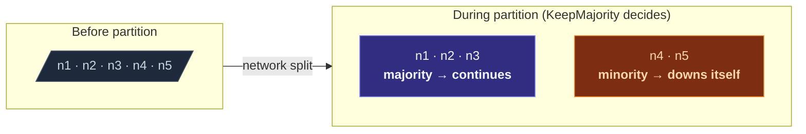

When the cluster partitions, both halves stay running — and both
think the other half has failed.  Without intervention:

- Two singletons would exist (one per side).
- Sharded entities for the same key could spawn on both sides.
- DistributedData replicas would diverge until reconciliation.

A **downing strategy** picks a winning side and forcibly downs the
losing side.  Each losing node leaves the cluster; the winning side
continues as the cluster.  Whether a losing node's actors stop as
well is `actor-ts.cluster.run-coordinated-shutdown-when-down`.  With
it on, the node runs its
[coordinated-shutdown pipeline](/fundamentals/coordinated-shutdown/#when-the-cluster-downs-this-node),
which ends its actor system unless
`coordinated-shutdown.terminate-actor-system` is off.  With the
shipped `off` it only leaves, and its actors keep running beside the
winners — a second writer for every entity and singleton it hosted.
Either way a node acts only on its own strategy's verdict: a downing
the winning side decides about it is not told to it
([issue #940](https://github.com/pathosDev/actor-ts/issues/940)).



Without a strategy: both halves keep running.  When the partition
heals, you have two separate clusters with the same name and no
automatic merge.  **Always configure a strategy for production.**

## The five built-in strategies

| Strategy | Wins on... | Trade-off |
| --- | --- | --- |
| **`KeepMajority`** | The side with `> N/2` members. | Simple; ties (exactly N/2-N/2 split) means both sides down. |
| **`KeepOldest`** | The side containing the lowest-addressed member (see the caveat below). | Works for even-sized clusters where majority is undefined. |
| **`KeepReferee`** | The side containing a designated *referee* node. | Predictable but creates a single point of failure (the referee). |
| **`StaticQuorum`** | The side that meets a configured quorum size. | Stricter than majority; the quorum-size config is the operator's choice. |
| **`LeaseMajority`** | Majority + must hold a coordination lease. | Paranoid safety; requires a Lease provider (K8s, etc.). |

Pick by your cluster's topology and operational constraints (see
the picking section below).

## Configuration

```ts
import { Cluster, ClusterOptions, KeepMajority } from 'actor-ts/cluster';

const clusterOptions = ClusterOptions.create()
  .withHost(host)
  .withPort(port)
  .withSeeds(seeds)
  .withDowning(new KeepMajority());
const cluster = await Cluster.join(
  system,
  clusterOptions,
);
```

Pass the provider as `downing`.  Every cluster event
(member unreachable, member reachable, etc.) re-runs the provider
with the current view; it returns the set of addresses to forcibly
down.  Returning an empty set means "no decision yet — wait."

### The stability window

A strategy is asked nothing until the member view has been **unchanged** for
`stable-after`, which defaults to **20 s**:

```ts
const clusterOptions = ClusterOptions.create()
  .withDowning(new KeepMajority())
  .withSplitBrainResolver({ stableAfterMs: 20_000 });
```

```hocon
actor-ts.cluster.split-brain-resolver.stable-after = 20s
```

This is not a flap filter, or not only one. **A partition is not one event the
cluster observes; it is a sequence of them.** The failure detector marks peers
unreachable one at a time, as each crosses `unreachable-after`, and downing used
to be evaluated at the end of that same tick — so a 2/2 partition whose two
remote peers were detected on different ticks was resolved as two successive
*majority* decisions rather than one equal-split decision:

```text
tick 1:  a=up b=up c=unreachable d=up          3 reachable of 4  ->  down c
tick 2:  a=up b=up c=removed  d=unreachable    2 reachable of 3  ->  down d
```

The tombstone closes the trap: a force-down marks the member `removed`, and
every strategy filters its candidates to `up | leaving | unreachable`, so the
denominator shrinks along with the numerator and what is left of the side reads
as a majority of it. Both halves run the identical computation over their mirror
image and **both survive** — and with `LeaseMajority` the lease is never
contended for at all, because the equal-split branch that reaches it is never
taken.

Measured, that was not a corner case: the framework's own four-node partition
test failed **8 of 15 runs** with the window disabled and **0 of 30** with a
1 s window, on the same machine within the same minute.

Two consequences worth knowing:

- **The window must outlast the spread between the first and last detection of
  one partition**, plus the gossip that follows — not merely the duration of a
  flap. A window shorter than the spread lets the sequence through again.
- **It costs failover latency.** Nothing is downed until the view has been still
  for the window, so a genuine node loss takes that much longer to resolve. The
  20 s default is the established value for this knob and is a deliberate trade
  of availability for integrity; a cluster that needs faster failover should
  lower it knowingly rather than by omission.

`stable-after = 0` restores the pre-window behaviour, and the defect above with
it. It exists so a deployment can ask for that explicitly.

### From the config file

All five strategies can be selected without touching the code,
which is what lets one image run unarbitrated in development and
`keep-majority` in production:

```hocon
actor-ts.cluster.split-brain-resolver {
  active-strategy = keep-majority   # off | keep-majority | keep-oldest | keep-referee | static-quorum | lease-majority

  # Per-strategy options, each read only by the strategy it belongs to.
  keep-majority.role                    = backend
  static-quorum.quorum-size             = 3
  keep-referee.referee-address          = "my-app@10.0.0.1:2552"
  keep-referee.down-all-if-below-quorum = 2
}
```

`active-strategy` builds the same object `withDowning(…)` takes, so the
ordinary precedence applies: **an explicit `withDowning(…)` wins**, and a
`Cluster.join` that names none falls through to the file.  `off` is the
shipped default and means no strategy at all — see the caution at the
bottom of this page for what that leaves you with.

`static-quorum.quorum-size` and the two `keep-referee` keys are absent from
`reference.conf` rather than shipped with a default: each is required or
bounded, and `quorum-size = 0` / `referee-address = ""` are refused by the
strategies' own validators, so any value that could ship would be one that
stops the node.  Naming `static-quorum` or `keep-referee` without its key
is refused at startup, with the missing key in the message.

:::caution[`static-quorum` from a config file is a cluster-wide switch]
Quorum is checked at *every* membership change, including the initial join,
and a node below it downs itself.  So `quorum-size = 3` in a config every
replica shares makes each node leave as it starts, until the third one is
up — a rolling restart then takes the cluster down rather than through.
Set it to a value at or below your minimum runtime size, and roll it out
before the deployment that relies on it.
:::

`lease-majority` needs a lease backend as well.  Its lease is built from
[`actor-ts.coordination.lease`](/reference/configuration/#leases-the-framework-builds),
named `<system>-split-brain-resolver` and owned by this node, so a deployment
selects it with both blocks:

```hocon
actor-ts.coordination.lease {
  backend = kubernetes
  ttl     = 15s
}
actor-ts.cluster.split-brain-resolver.active-strategy = lease-majority
```

With the shipped `backend = none` the strategy is refused at startup rather
than run with nothing to arbitrate through.  Its role and acquire timeout stay
in code; build it as shown below when either matters.

## The stability window

A strategy is not asked the moment a peer goes silent.  The membership
**and** reachability view has to hold still for `stable-after` first — 20 s
by default — and only then is the configured provider consulted:

```hocon
actor-ts.cluster.split-brain-resolver {
  active-strategy = keep-majority

  # The view must be unchanged this long before the strategy is asked.
  stable-after = 20s

  # Down everyone, self included, when it never once is.
  down-all-when-unstable = off
}
```

Or in code, where the same two settings are one nested block:

```ts
import { ClusterOptions, SplitBrainResolverOptions } from 'actor-ts/cluster';

const resolverPolicy = SplitBrainResolverOptions.create()
  .withStableAfterMs(30_000)
  .withDownAllWhenUnstable(true);
const clusterOptions = ClusterOptions.create()
  .withHost(host)
  .withPort(port)
  .withDowning(new KeepMajority())
  .withSplitBrainResolver(resolverPolicy);
```

**Why a mid-churn decision is the wrong decision.**  Every bundled strategy
is a pure function of one view — `KeepMajority` counts it, `KeepOldest`
orders it, `StaticQuorum` measures it.  A partition does not arrive as one
event: peers cross `unreachable-after` a few hundred milliseconds apart, and
a view sampled in the middle of that shows a cluster that existed at no
instant.  Counting a majority against it is how a node concludes it is in the
minority a second before the rest of its own side is marked unreachable too.
The window is what makes the input a settled fact rather than a snapshot of a
transition.

The clock is the failure-detection tick, so the window's resolution is
`actor-ts.cluster.failure-detector.heartbeat-interval` — 500 ms by default.
That is irrelevant at twenty seconds and worth knowing if you tune the window
down to a few hundred milliseconds.

**There is no upper bound against `failure-detector.down-after`.**  Once a
strategy is configured the detector stops evicting entirely: it parks an
unreachable peer and leaves the `down`/`removed` transition to the resolver,
so the window has no deadline to out-run and may be as long as the
deployment wants.  With **no** strategy configured, the two settings do
nothing at all — there is no decision for them to delay.  The detector
parks the peer at `down-after` too, and removes it there only under
`failure-detector.auto-down = on`.

### The window has a ceiling

`stable-after` is a preference, not a precondition, and the reason is the same
sentence read the other way round.  The view the window watches is *every*
member's address and status, so any join, leave or status transition anywhere
in the cluster restarts it.  A deployment whose membership moves more often
than `stable-after` would therefore never arbitrate a partition at all — and
at the shipped twenty seconds that is an ordinary autoscaling group, a rolling
deploy, or one flapping node.  It would not be a safe failure either: with a
strategy configured the failure detector stops evicting, so a partition nobody
arbitrates simply stays.

So a peer that has been **continuously** unreachable for `2 × stable-after` is
put to the strategy whatever else is moving.  That one peer's silence is a
settled fact on its own; the churn around it is about other members, and a
verdict is owed about the partition rather than about the churn.

The multiple sits deliberately between the two thresholds either side of it:
above one window, so a view that *does* settle is always arbitrated through
the ordinary path first and the ceiling never becomes the normal case; and
below the `3 × stable-after` escalation deadline below, so a strategy is asked
before `down-all-when-unstable` can stop the cluster.

A peer that recovers loses its place: the clock measures one uninterrupted run
of silence, so a peer that flaps never accumulates its way to the ceiling out
of intervals none of which meant anything on its own.

### When the view never settles

`down-all-when-unstable` is the escalation for a cluster that will not
converge: if the view has not once held still for a whole `stable-after`
across `3 × stable-after` of continuous change — **and** something is still
unreachable — every member is downed, this node included, and the reason is
logged at `warn`.  No strategy is consulted; a view that unsettled is not
evidence any of them could decide on.

The margin is derived from the window rather than configured beside it.  It
only ever means "several times however long this deployment thinks a view
needs to settle", so a second key would be one more number to keep consistent
— and a margin *below* the window could never observe one quiet window before
firing.

:::caution[It ships off, and turning it on is a posture]
This is the only setting on this page that stops the **whole** cluster, and
it is reached by a timer rather than by a strategy's verdict.  A rolling
restart whose replacements arrive less than `stable-after` apart looks
exactly like a cluster that will not settle.  Turning it on says you would
rather the cluster stop than keep running on a membership view nobody can
trust — a real position, but state it deliberately.

What it will *not* do is fire on ordinary churn: an empty unreachable set is
a hard precondition, so members joining and leaving cleanly never escalate,
however fast they do it.
:::

## KeepMajority

```ts
import { KeepMajority } from 'actor-ts/cluster';

new KeepMajority();
```

The classic strategy.  Counts members; the side with more wins.

**Picks:**

- Most general default.
- No external dependencies.
- Predictable when N is odd.

**Doesn't:**

- Handle exact N/2-N/2 splits — both sides down themselves.
- Distinguish between "5 members healthy" and "5 members all
  on the same machine, the rack burns" — majority by count is
  blind to physical topology.

Right for clusters with an **odd number of nodes** and no
special-purpose deployments.

## KeepOldest

```ts
import { KeepOldest, KeepOldestOptions } from 'actor-ts/cluster';

const keepOldestOptions = KeepOldestOptions.create().withDownIfAlone(true);
new KeepOldest(keepOldestOptions);
```

The side containing the **"oldest" member** wins.

:::caution["Oldest" here means lowest address, not longest-running]
Despite the name, this strategy does not track join order — no
monotonic join sequence travels in the gossip payload.  "Oldest" is
the member whose `host:port` sorts first — the same rule
`Cluster.leader()` uses.

The practical consequence: a node that joined a minute ago wins over
one that has been up for a week, if its address sorts lower.  So do
**not** pick this strategy expecting a long-running coordinator pod to
be the tiebreaker — pick it when you want a *deterministic, agreed*
tiebreaker, and then make sure the node you want to survive is the one
with the lowest address.
:::

Useful when:

- You have an even number of nodes, where `KeepMajority` is
  ambiguous on 50/50 splits.
- You can pin the address of the node that should survive — then the
  strategy is deterministic and needs no quorum arithmetic.

`downIfAlone: true` means "if I'm the oldest but everyone else is
unreachable, I down myself" — prevents a one-node "winner"
declaring itself the cluster after a total split.

## KeepReferee

```ts
import { KeepReferee, KeepRefereeOptions } from 'actor-ts/cluster';

const keepRefereeOptions = KeepRefereeOptions.create()
  .withRefereeAddress('my-app@10.0.0.1:2552')
  .withDownAllIfBelowQuorum(3);
new KeepReferee(
  keepRefereeOptions,
);
```

A designated **referee node** is the deciding member.  The side
containing the referee wins; the other side downs itself.

**Picks:**

- Most predictable strategy — there's no ambiguity about which
  side wins.
- Works for any cluster size, including even-sized.

**Doesn't:**

- Survive the referee itself going down.  If the referee
  disappears, neither side has it, and the strategy can't
  decide.  Hence `downAllIfBelowQuorum` — "if the cluster is
  below this size, down everyone and let operators rebuild."

Useful for **two-DC clusters** with a tie-breaker node in a
neutral location (a third DC, a control-plane K8s namespace).

## StaticQuorum

```ts
import { StaticQuorum, StaticQuorumOptions } from 'actor-ts/cluster';

const staticQuorumOptions = StaticQuorumOptions.create().withQuorumSize(3);
new StaticQuorum(staticQuorumOptions);
```

A side wins only if it has at least `quorumSize` reachable members.
Below the quorum, the side downs itself.

**Picks:**

- Stricter than majority — protects against minority-survivor
  scenarios where the minority would otherwise continue.
- Configurable based on your operator's confidence threshold.

**Doesn't:**

- Recover automatically.  If multiple sub-quorum partitions form,
  none wins; the operator has to manually rebuild.

Right when you'd rather **fail-stop** than risk wrong-side
survival.

## LeaseMajority

```ts
import { LeaseMajority, LeaseMajorityOptions } from 'actor-ts/cluster';

const leaseMajorityOptions = LeaseMajorityOptions.create().withLease(someLeaseImplementation);
new LeaseMajority(
  leaseMajorityOptions,
);
```

Majority **plus** a coordination lease.  Wrap any other strategy:
the winning side must additionally acquire a lease (e.g. a K8s
Lease resource) before considering itself authoritative.

**Picks:**

- Belt-and-braces safety.  Two-fold check.
- Useful when the network is unpredictable (e.g. cloud
  cross-zone).

**Doesn't:**

- Help if the lease provider itself is partitioned away.

Right for paranoid production scenarios where you'd rather
**double the cost** of split-brain protection.

From a config file the strategy gets its lease from the coordination
block instead of from `withLease(…)` — see
[from the config file](#from-the-config-file).  That lease is built at
the strategy's first decision, from the address the decision carries,
because the strategy is constructed before the node's address exists.

### When an acquire is abandoned

The interesting case is not "the lease said no" but "the lease
said nothing".  Two things leave an `acquire()` unwanted while it
is still on the wire: it has not resolved within
`acquireTimeoutMs` (5 s by default), or the partition view moved
on under it — the partition healed, or the unreachable set
changed.  The second is the likelier of the two, since a
membership change inside a 5 s window needs no stall at all.
Either way the strategy stops waiting for the attempt, and then
has to assume it may still succeed on the wire, leaving the lease
claimed by a node that no longer believes it won.  The same three
rules cover both:

- **The late result is dropped.**  Every attempt carries an
  epoch; a result arriving after its epoch was retired cannot
  write a decision.  So a slow `acquire() → true` can never make
  this side claim survival after the fact.
- **A late win is released, and nothing new starts until it is.**
  Ownership only begins when the acquire resolves, so the undo
  waits for it to report back — releasing earlier would be a
  no-op.  While that is outstanding, `decide()` keeps returning
  an empty decision rather than starting a second attempt: two
  attempts overlapping is precisely how the cleanup could delete
  a lease this side is actively claiming.
- **If the release fails, the strategy stops deciding.**  The
  lease is then in an unknown state, so it enters *fail-safe* and
  returns an empty decision for this partition view until the
  partition heals.  Deciding nothing is always safe; deciding
  wrongly is not.

The visible symptom of a lease provider having a bad day is
therefore a cluster that waits, not one that splits.

### When a win outlives its lease

A win is only as good as the lease behind it.  Once the view has
been stable for `stable-after`, the cluster asks the strategy again
on every failure-detector tick, so a cached win can be returned
long after the acquire that produced it.  A node that stalled past
the lease's TTL in between — a long GC pause, a starved container
— has lost the lease to the other side, which is by then downing
*this* one.  Replaying the old win is how both halves end up acting
as the survivor.

So before a won decision is returned again, the strategy asks
`lease.checkAlive()`.  If the lease has run out, the win is dropped
and the side arbitrates afresh: the new acquire loses if the other
side holds the lease now — and this side then downs itself — and
wins it back if nobody took it.  A lost arbitration is not re-asked;
it does not rest on the lease.  This relies on the backend answering
`checkAlive()` against its TTL rather than from a held flag, which
both built-in backends do (#937).

An acquire that takes longer than the lease's TTL can never produce
a usable win: the strategy keeps arbitrating and decides nothing,
the same posture as while an acquire is pending.

## Picking a strategy

Three questions in order:

1. **Odd or even cluster size?**
   - Odd → `KeepMajority`.
   - Even → `KeepOldest` or `KeepReferee` (avoid ties).

2. **Do you have a stable tie-breaker node?**
   - Yes → `KeepReferee` (most predictable).
   - No → `KeepMajority` or `KeepOldest`.

3. **Is fail-stop preferable to potential wrong-winner?**
   - Yes → `StaticQuorum` (errs on the side of stopping).
   - No → one of the above.

For a typical 3-node K8s deployment: **`KeepMajority`**.  For a
2-DC setup with a third-region tie-breaker: **`KeepReferee`**.
For a 5-node cluster that should never go below 3: **`StaticQuorum(3)`**.

## Custom strategies

The provider interface is tiny:

```ts
interface DowningProvider {
  decide(view: ClusterPartitionView): DowningDecision;
}

type ClusterPartitionView = {
  allMembers: ReadonlyArray<Member>;
  unreachable: ReadonlySet<string>;   // address strings
  self: NodeAddress;
};
```

Implement `decide(view) => Set<string>` and return the address
strings to down.  Empty set means "no decision."

Useful for app-specific rules — e.g. "always keep the node
hosting role=primary," or "if the partition includes the
DB-master node, that side wins."

import { Aside } from '@astrojs/starlight/components';

<Aside type="caution" title="No strategy = nobody decides">
  Without a `downing` provider, nothing removes an unreachable peer.
  The failure detector reaches `down` at `down-after` and parks the
  peer at `unreachable` — a member still, holding its slot, its
  shards not reallocated, its remote watchers told nothing — and logs
  one warning naming the ways out: `cluster.down(addr)`,
  `POST /cluster/down` (behind `actor-ts.management.enable-down-endpoint`),
  or a strategy.  So the default is manual: a crashed node stays until
  you remove it.  It does not keep a partition at one singleton,
  though — the leader is the first `up` member of each side's view,
  so a singleton that follows the leader moves on either side.

  `actor-ts.cluster.failure-detector.auto-down = on` restores the
  detector's own removal at `down-after` — no arbitration, no
  operator.  For a single crashed node that is the behaviour you
  want, and it is what makes shards reallocate and a singleton hand
  over.  Under a partition it is split-brain by construction: every
  side reaches `down-after` at the same time and removes the others,
  and each half continues as "the cluster".  It is refused beside a
  configured strategy.

  With a strategy configured, the detector stops at `unreachable` and
  the strategy owns removal; a member the strategy never decides about
  then stays `unreachable` indefinitely.  See
  [a parked member stays parked](/cluster/failure-detector/#a-parked-member-stays-parked).
</Aside>

<Aside type="caution" title="Stable stretched clusters need leases">
  ```ts
  // 2 nodes in DC-A, 2 nodes in DC-B, no tie-breaker
  new KeepMajority();   // ✗ both sides down on a 2-2 split
  ```
  Even-split clusters need a tie-breaker.  Without one, every
  partition kills the whole cluster.  Add a referee node or a
  lease.
</Aside>

<Aside type="caution" title="`StaticQuorum` blocks scale-up">
  ```ts
  const quorumOptions = StaticQuorumOptions.create().withQuorumSize(5);
  new StaticQuorum(quorumOptions);
  // Starting up with 3 nodes → cluster downs itself (no quorum)
  ```
  Quorum is checked at every membership change, including the
  initial join.  Either start with the quorum already met, or use
  a quorum equal to or below your minimum runtime size.
</Aside>

## What a downed address may do next

There is no separate quarantine. What keeps a removed member out is
its tombstone: the `removed` record the cluster keeps for the address,
which refuses any record for it at the same or an older version.
Whether a removal leaves one — and so whether the process that was
removed can carry on talking and be let back in — depends on the
route that removed it. *The same run* below means that process: the
same incarnation, still announcing the version it had when it was
removed.

| Removed by | Leaves behind | The same run speaks again |
| --- | --- | --- |
| `Cluster.down()` or `POST /cluster/down` | A tombstone. | Refused until the tombstone is pruned. |
| A strategy's decision, or `down-all-when-unstable` | A tombstone. | Refused until the tombstone is pruned. |
| The peer's own `leave` | A tombstone. | Refused until the tombstone is pruned. |
| The failure detector, under `failure-detector.auto-down = on` with no strategy | Nothing — the entry is deleted. | Readmitted on its next frame. |
| Nobody: no strategy and `auto-down` off, the default | Nothing is removed — the peer is parked at `unreachable`. | Back to `up` on its next heartbeat. |

A tombstone refuses for the larger of `tombstone.time-to-live` and
`tombstone.min-retention` — **24 h at the defaults** — and goes on the
first prune pass after that. `time-to-live` is the operator's knob;
there is no quarantine setting beside it. `min-retention` is a floor
under it, six times `failure-detector.down-after` when left at `0s`, so
that a short `time-to-live` cannot drop a tombstone before peers that
have not converged yet have seen it:

```hocon
actor-ts.cluster.tombstone {
  time-to-live   = 24h  # how long a removed address is refused
  prune-interval = 5m   # how often expired tombstones are dropped
  min-retention  = 0s   # floor under time-to-live; 0s = 6 x down-after
}
```

The refusal is a membership one. Nothing refuses the connection — no
handshake asks membership — so the downed node's frames still arrive
and the messages it sends are still delivered. What is refused is its
record: it is not a member, and nothing that places work by
membership — sharding, singletons, cluster-aware routing, downing
quorums — counts it or its roles. After the prune the same run is back
on its next frame, at its old version and with the roles it had: the
window is a delay, not a verdict. A node downed while still running
is not told about a downing decided elsewhere (see the top of this
page), so unless something stops it, it is a member again once the
window has passed.

**The opt-in detector route is the one with no refusal.** `auto-down`
deletes the entry instead of tombstoning it, so the same run is
readmitted on its next frame — after `MemberRemoved` was announced for
it and its remote watchers were sent a node-loss `Terminated`, with
nothing to tell them it is back. Nothing is left to refuse a
survivor's stale record of it either, which is why a crashed member
keeps coming back under `auto-down`
([what the detector decides](/cluster/failure-detector/#what-the-detector-decides--and-doesnt)
has the measurement). Nor does deleting help a healed partition:
neither side heartbeats or gossips a peer it holds unreachable, and
after the delete there is no entry to address at all
([issue #930](https://github.com/pathosDev/actor-ts/issues/930)).

**A restart is readmitted by version.** A process seeds its version
from its own wall clock when it joins, which out-versions the
tombstone its previous run left behind, so a node that restarts
rejoins at once whichever route removed it — nobody waits out the
window, and nothing has to be cleared.

Two limits follow from the tombstone being a version floor rather
than a ban on a process:

- **The same run restamping its version.** A version is a number the
  peer writes. A process that was downed while still running and
  announces itself at a fresh version cannot be told from a restart,
  and is readmitted at once. The refusal holds against a run that
  keeps speaking at its old version — one that did not notice, or a
  recording — not against one that sets out to come back.
- **A keep-out lever for a peer with standing.** A member this node
  holds active may gossip records about other addresses, and a
  `removed` record dated inside the version-skew budget
  (`maxVersionSkewMs`, five minutes by default) out-versions the fresh
  version a legitimate restart starts from. The restarted node stays
  out until it restarts again past that version, or the tombstone
  expires, counted from a `removedAt` the same peer chose.

Both close only once the incarnation — which process answers at an
address, minted once per `Cluster.join` — is required on the wire, so
that a refusal can compare processes rather than numbers
([issue #823](https://github.com/pathosDev/actor-ts/issues/823),
[issue #940](https://github.com/pathosDev/actor-ts/issues/940)). Today
it is carried, and no refusal compares it.

## Where to next

- **[Cluster overview](/cluster/overview/)** — the
  membership model the strategy works against.
- **[Failure detector](/cluster/failure-detector/)** —
  what flags members as unreachable in the first place.
- **[Singleton with lease](/cluster/singleton/with-lease/)** —
  per-singleton lease protection, complementary to a downing
  strategy.
- **[Coordination](/coordination/overview/)** — the
  lease abstraction.
- **[Cluster security](/operations/security/cluster-security/)** —
  TLS + auth around the cluster transport.

The [`DowningProvider`](/api/interfaces/downingprovider/)
API reference covers the strategy interface.
