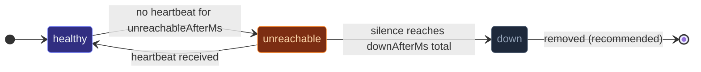
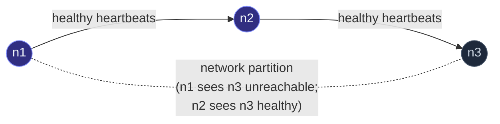

A clustered actor system needs to **agree on who's alive**.
The failure detector is the per-peer state machine that decides:



- **`healthy`** — heartbeats arriving normally.
- **`unreachable`** — past the threshold; the cluster avoids
  routing here.  Still officially a member; can recover.
- **`down`** — past the longer threshold; the cluster considers
  the peer permanently gone.  Triggers downing.

The detector is **per-peer** — different peers can be in
different states at once.  The cluster's overall behavior
(routing, sharding, singleton election) reads these states to
decide what to do.

## The defaults

```ts
{
  heartbeatIntervalMs: 500,    // send a heartbeat every 500ms
  unreachableAfterMs:  2_000,  // mark unreachable after 2s of silence
  downAfterMs:         5_000,  // mark down after 5s of silence
}
```

For typical LAN clusters (1-10 nodes, sub-millisecond latency), these
defaults work fine.  They give:

- **2-second detection window** for "this peer might be having
  trouble."
- **5-second decision window** for "this peer is definitively
  gone."

## Tuning

Override via the `failureDetector` field in the cluster settings:

```ts
const clusterOptions = ClusterOptions.create()
  .withHost(host)
  .withPort(port)
  .withSeeds(seeds)
  .withFailureDetector({
    heartbeatIntervalMs: 1_000,
    unreachableAfterMs:  5_000,
    downAfterMs:         15_000,
  });
Cluster.join(
  system,
  clusterOptions,
);
```

When to tune:

| Workload | Direction |
| --- | --- |
| Cross-region cluster (high RTT) | Increase all three.  100ms RTT means a single missed heartbeat is normal noise. |
| Local Docker compose (sub-ms RTT) | Decrease for faster failover tests.  Production-tune up before deploying. |
| Network with periodic blips | Increase `unreachableAfterMs` to avoid false positives, but keep `downAfterMs` larger so a real failure still gets detected. |
| Cost-sensitive (chatty heartbeats) | Increase `heartbeatIntervalMs` — at 5s intervals, gossip + heartbeat is < 1KB/sec per peer. |

The ratio `downAfterMs / unreachableAfterMs` (default ~2.5x) is the
**flap-tolerance window**: a peer that's marked unreachable can
recover to healthy without being downed, as long as a heartbeat
arrives within the difference.

## Heartbeats are explicit; liveness is any frame

Every node sends a heartbeat to each reachable member once per
`heartbeat-interval`, and the member answers each one with an
acknowledgment.  That loop is what the detectors rely on, so an idle
cluster is watched exactly as closely as a busy one.

What a frame from a peer *counts for* depends on the question:

- **Any frame is liveness, for both detectors** — a heartbeat, an
  acknowledgment, gossip, an application message.  It moves the
  instant the peer's silence is measured from.  For the simple
  detector that is the whole model.
- **Only heartbeat frames feed φ's history.**  The φ-accrual detector
  models one thing: the inter-arrival times of a peer's heartbeats.
  When every frame fed it, the history described the traffic instead —
  after a burst of 300 messages the window held 200 samples of 0 ms,
  and at the 0 s pause it then shipped with a peer read unreachable
  562 ms and down 704 ms after it went quiet.  Acknowledgments stay out
  for a second reason: they answer *this* node's heartbeats, so they
  arrive on this node's cadence, and sampled beside the peer's own
  heartbeats they interleave two schedules — the crossings then wander
  between 0.8 s and 1.4 s with the phase between the two nodes.

The contract a detector implements says the same thing in two methods:
`heardFrom` is a frame of any kind, `heartbeat` a heartbeat frame.

## What the detector decides — and doesn't

The detector returns `'healthy'` / `'unreachable'` / `'down'`.
What the cluster *does* with that:

| Decision | Cluster behavior |
| --- | --- |
| `healthy` | Normal routing.  No effect. |
| `unreachable` | Mark the member `unreachable` in the membership table.  Routers skip them; sharding doesn't allocate new shards to them.  Singleton manager won't elect a leader from an unreachable side. |
| `down`, [downing strategy](/cluster/downing-strategies/) configured | Mark the member `unreachable` and stop.  The strategy decides which addresses to evict; the cluster announces those nodes as `removed`.  The detector removes nothing itself. |
| `down`, no strategy configured | The detector evicts the peer itself: `down`, then straight out of the membership table as `removed`. |

**The two rows are the whole story, and which one you get is
decided by whether you configured a strategy.**  With one, the
detector is the *signal*, not the action — it parks the peer at
`unreachable` and the strategy owns the eviction.  Without one,
nothing arbitrates, and the detector evicting the peer at
`down-after` is the only failover you have: it is what lets shards
reallocate and a singleton hand over after a crash.  That is
convenient for a single crashed node and wrong for a partition,
where both halves evict the other and keep running.  Configuring a
strategy is how you replace one with the other.

### A parked member stays parked

With a strategy configured, a member the strategy never reaches a
verdict about stays `unreachable` **indefinitely**.  There is no
detector backstop behind it, deliberately: a backstop is the bypass
the strategy exists to prevent, and one that fires at some multiple
of `down-after` only makes the bypass later.

That has consequences worth planning for.  The member keeps its
slot against `max-members`.  `ClusterSingletonManager` does not
hand over, because it reconciles on `MemberDown` / `MemberLeft` /
`MemberRemoved` and deliberately not on `MemberUnreachable` — one
node's detector is not a membership fact the cluster agrees on.
`ShardCoordinator` does not reallocate, because it listens for
`MemberRemoved` only.  And a healed partition does not currently
bring the member back to `up`: gossip and heartbeats are sent to
reachable members only, so neither side addresses the other again.

This is integrity over availability, chosen on purpose.  Pick a
strategy that always reaches a verdict on your cluster shape — an
odd member count for `KeepMajority`, a referee or a lease for an
even one — rather than one that can answer "pending" forever.

## The view from the local node

Every node runs its own detector, watching its own peers.  This
means **two nodes can disagree** about whether a third is
reachable:



The cluster gossip propagates these per-node observations.  A
member is considered globally unreachable when *enough* peers
report it that way — the threshold is configurable in some
downing strategies (see KeepMajority, KeepReferee).

## Choosing the φ-accrual detector

The detector described above is intentionally simple — plain
elapsed-time thresholds, no statistical variance tracking.  For LAN
scale this is sufficient, so it is the default.

The framework ships a second one.  `PhiAccrualFailureDetector` tracks
the distribution of a peer's recent heartbeat inter-arrival times and
produces a continuous suspicion value, φ, which the cluster converts to
`unreachable` / `down` by threshold.  Where the simple detector asks
*"has it been quiet for longer than 2s?"*, φ-accrual asks *"how
surprising is this silence, given how this peer has actually been
behaving?"* — so a peer whose heartbeats arrive like clockwork can be
flagged sooner and one behind a jittery link gets more slack, without
either number being guessed in advance.

Pick it per node, in code:

```ts
const clusterOptions = ClusterOptions.create()
  .withHost(host)
  .withPort(port)
  .withFailureDetectorImplementation('phi')
  .withPhiAccrual({ unreachableThreshold: 10, downThreshold: 14 });
Cluster.join(
  system,
  clusterOptions,
);
```

or in `application.conf`:

```hocon
actor-ts.cluster.failure-detector {
  implementation = phi

  # Shared by both implementations: the cadence of the cluster's own
  # heartbeat loop, which is why `phi` below has no copy of it.
  heartbeat-interval = 500ms

  phi {
    unreachable-threshold      = 8       # φ above which the peer is unreachable
    down-threshold             = 12      # φ above which it is down; must exceed the above
    max-sample-size            = 200     # inter-arrival times kept per peer
    min-std-deviation          = 100ms   # floor, so a very steady peer is not flagged on noise
    acceptable-heartbeat-pause = 3s      # grace added to the last heartbeat before φ rises
    expected-response-after    = "auto"  # φ's estimate before a peer's first heartbeat
  }
}
```

Explicit options win over the file **per field**, so setting one
threshold in code keeps the other five from `application.conf`.

Worth knowing before you switch:

- **`heartbeat-interval` is shared and stays where it is.**  It is the
  cadence of the cluster's heartbeat loop rather than a property of
  either algorithm, so there is deliberately no
  `failure-detector.phi.heartbeat-interval`: swapping the
  implementation cannot change how often this node talks to its peers.
- **`unreachable-after` / `down-after` are the simple detector's** and
  are ignored under `phi`; the `phi.*-threshold` pair replaces them.
  They are φ values, not durations — a continuous score where 8 means
  roughly "a 1-in-10⁸ delay", and fractions are an ordinary tuning
  move.
- **φ tops out at about 14.9.**  The normal-tail approximation behind
  it ends at z = 8: φ climbs to about 14.9 there and then jumps straight
  to infinity.  A `down-threshold` above ~14.9 therefore behaves exactly
  like 14.9 — keep it inside that range, as the example above does
  with 14.
- **`acceptable-heartbeat-pause` ships at `3s`, chosen by
  measurement.**  It is a pure offset on the silence before φ starts to
  rise, so every crossing below moves by exactly the pause.  It is there
  for stalls a healthy node cannot help: a throttled container, a
  suspended VM, a long synchronous handler holding the event loop.
  Garbage collection is not one of them — measured at a ~300 MB heap, it
  delayed the loop by tens of milliseconds, a full collection by about
  0.1 s.  Raise it if your deployment has longer known pauses; `0s` is
  the strictest reading φ can give.
- **`min-std-deviation` stays at `100ms`.**  Raising the floor would
  widen the tolerance too, but it scales with the thresholds and blunts
  detection of a genuinely steady peer.  The pause is an offset that
  leaves the shape of the tail alone, so the tolerance lives there.
- **`expected-response-after` is φ's estimate before it has a
  history.**  Under `auto` it is `heartbeat-interval` — whatever cadence
  the detector is given, from the file or from code — and a duration
  decouples the two.  From a peer's first frame φ assumes that mean with
  a deviation of a quarter of it (never below `min-std-deviation`); the
  first heartbeat seeds the history with the same estimate, and real
  intervals wash it out as the window turns over.  It also judges a
  member this node learned of through gossip and never heard from, from
  the moment it was registered — as the simple detector always has.

### What the shipped settings tolerate

Silence after the last frame from a peer until φ says `unreachable` and
`down`, at the shipped thresholds (8 and 12), the 3 s pause and
`expected-response-after = auto`:

| `heartbeat-interval` | Steady heartbeats | First contact |
| --- | --- | --- |
| `500ms` (default) | 4.06 s / 4.20 s | 4.20 s / 4.38 s |
| `1s` | 4.56 s / 4.70 s | 5.40 s / 5.76 s |
| `2s` | 5.56 s / 5.70 s | 7.81 s / 8.52 s |

*Steady heartbeats* is a peer whose window holds real intervals only;
*first contact* is a peer heard from once, or registered and never heard
from.  The simple detector says 2 s / 5 s at every cadence.  These are
the detector's crossings: the cluster asks for a verdict once per
`heartbeat-interval`, so an announced verdict lands on the first
detection tick after the crossing — at most one cadence later.  Each
second of pause moves both columns by a second.

Measured over `TcpTransport` on loopback, with the two nodes in separate
processes (Windows 11, Bun 1.4.2 and Node 26.10, 2026-10-14): a node
blocked synchronously for 0.5, 1, 2 or 3 s drew no verdict on either
runtime — the observer saw at most 3.18 s of silence and a peak φ of
0.09 — while every 4 s block, 4.14–4.18 s of silence, crossed φ = 8, and
one of four was announced before the node came back.  The blocked node
never flagged its peer.  A 20 ms timer under allocation churn at a
~300 MB heap ran at most 87 ms late on Bun and 14 ms on Node, and a
forced full collection took 71–113 ms.  At a 0 s pause a 1 s block
already crossed φ = 8.  Every cell of the table is pinned by a
deterministic test on the real class, so a changed default shows up as
a red test rather than as drift.

There is still no hook for a detector class of your own: the choice is
between the two shipped implementations, named.  `Cluster` talks to
whichever is installed through one small contract, `FailureDetectorLike`
(`register` / `heartbeat` / `heardFrom` / `decide` / `forget` /
`lastSeen` / `interval`), which is exported if you want to read what a
detector owes the cluster.

## Diagnosing failure-detector decisions

```ts
import { MemberUnreachable, MemberReachable } from 'actor-ts/cluster';

cluster.subscribe((evt) => {
  if (evt instanceof MemberUnreachable) {
    console.log(`${evt.member.address} marked unreachable`);
  } else if (evt instanceof MemberReachable) {
    console.log(`${evt.member.address} marked reachable again`);
  }
});
```

Subscribe to the cluster events for visibility.  In production,
wire these into metrics — a histogram of "unreachable durations"
shows whether the threshold matches your network's actual blip
profile.

### `ReachabilityChanged` — what *this* node can see

`MemberUnreachable` is a membership transition, and that makes it the
wrong signal for two questions it looks like it answers:

- **It may not be this node's observation.**  Member status travels in
  gossip, so `MemberUnreachable` also fires for a peer that *someone
  else* has stopped hearing from while this node's heartbeats to it
  arrive normally.
- **It only fires for a member that was `up`.**  A peer that falls
  silent while `joining`, `weakly-up` or `leaving` produces no
  reachability event at all — the next thing you hear about it is the
  eviction.

`ReachabilityChanged` is the local detector's own verdict, without
either caveat:

```ts
import { ReachabilityChanged } from 'actor-ts/cluster';

cluster.subscribe((evt) => {
  if (evt instanceof ReachabilityChanged) {
    peerHealth.gauge({ peer: evt.address.toString() }).set(evt.reachable ? 1 : 0);
  }
});
```

It fires **on transition only** — once when the detector stops seeing
a peer, once when it sees it again — and never for a peer that has been
healthy since this node first met it.  The verdict is recomputed once
per `heartbeatIntervalMs` and turns negative at `unreachableAfterMs`
under the simple detector, or where φ crosses `unreachable-threshold`
under φ-accrual — about 4.06 s of silence at the shipped settings — so
it is the earliest warning the detector produces, well ahead of any
downing decision.

Comparing this against the member's gossiped `status` is how you tell a
partition from a dead peer: a node that everyone else can still reach
is a link problem, not a host problem.  The event carries no observer
set — *"which other nodes also cannot reach X"* would need an
observer-to-subject table on the wire, and gossip carries a flat member
list.

import { Aside } from '@astrojs/starlight/components';

<Aside type="caution" title="Defaults are LAN defaults">
  ```ts
  // ✗ unreachable in 2s — too aggressive over 100ms-RTT WAN
  const clusterOptions = ClusterOptions.create()
    .withHost(host)
    .withPort(port)
    .withSeeds(seeds);
  Cluster.join(system, clusterOptions);   // uses defaults
  ```
  Cross-region clusters need at least 5-10 seconds for
  `unreachableAfterMs`; a 100ms-RTT link with normal jitter
  produces "missed" heartbeats that cross the 2s threshold.
  Tune up for any non-LAN deployment.
</Aside>

<Aside type="caution" title="`down` is not the same as definitely-gone">
  The detector's `down` decision is statistical — based on
  elapsed silence.  A peer that's slow but recovering can be
  marked `down` and then come back.  Without a downing strategy
  the detector acts on that guess by itself and evicts the peer,
  so a GC pause long enough to cross `down-after` costs you a node.
  With one, the guess is only an input: the strategy weighs it
  against the rest of the cluster's view before anything is
  evicted.  Configure a downing strategy.
</Aside>

<Aside type="caution" title="Tight thresholds in noisy networks">
  ```ts
  failureDetector: { unreachableAfterMs: 200, downAfterMs: 500 }
  ```
  Aggressive thresholds detect failures quickly but produce false
  positives on transient delays — a peer that's briefly busy GCing
  gets marked unreachable, the cluster reacts, by the time the GC
  finishes routing has shifted.  For most production clusters, the
  defaults (2s/5s) are already aggressive enough.
</Aside>

## Where to next

- **[Cluster overview](/cluster/overview/)** — the
  membership state machine the detector feeds.
- **[Downing strategies](/cluster/downing-strategies/)** —
  what happens *after* the detector decides `down`.
- **[Joining and seeds](/cluster/joining-and-seeds/)** —
  how peers first appear in the membership table.
- **[Configuration](/reference/configuration/)** — the
  HOCON keys (`actor-ts.cluster.failure-detector.*`).
- **[Failure-detector tuning](/operations/tuning/failure-detector/)** —
  the operations-focused tuning page.

The [`FailureDetector`](/api/classes/failuredetector/) API
reference covers the full surface.
