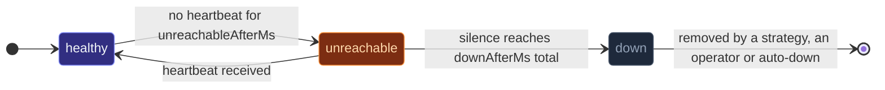
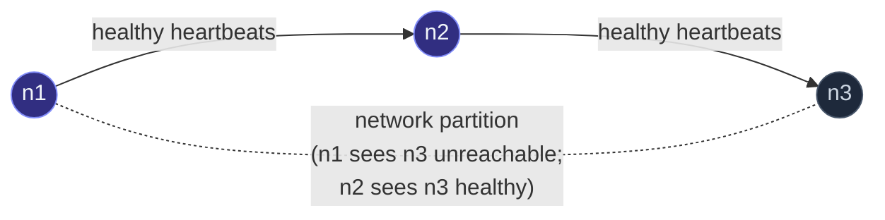

A clustered actor system needs to **agree on who's alive**.
The failure detector is the per-peer state machine that decides:



- **`healthy`** — heartbeats arriving normally.
- **`unreachable`** — past the threshold; the cluster avoids
  routing here.  Still officially a member; can recover.
- **`down`** — past the longer threshold; the detector's verdict
  that the peer is gone.  With no
  [downing strategy](/cluster/downing-strategies/) the detector then
  removes the peer itself — `auto-down` is on by default — and with
  one, the strategy decides.  See
  [what the detector decides](#what-the-detector-decides--and-doesnt).

The detector is **per-peer** — different peers can be in
different states at once.  The cluster's overall behavior
(routing, sharding, singleton election) reads these states to
decide what to do.

## The defaults

```ts
{
  heartbeatIntervalMs: 500,    // send a heartbeat every 500ms
  unreachableAfterMs:  2_000,  // mark unreachable after 2s of silence
  downAfterMs:         5_000,  // mark down after 5s of silence
}
```

For typical LAN clusters (1-10 nodes, sub-millisecond latency), these
defaults work fine.  They give:

- **2-second detection window** for "this peer might be having
  trouble."
- **5-second verdict** that "this peer is gone" — at which, with no
  strategy configured, the detector removes it, and the surviving
  nodes take over its shards and singletons.

## Tuning

Override via the `failureDetector` field in the cluster settings:

```ts
const clusterOptions = ClusterOptions.create()
  .withHost(host)
  .withPort(port)
  .withSeeds(seeds)
  .withFailureDetector({
    heartbeatIntervalMs: 1_000,
    unreachableAfterMs:  5_000,
    downAfterMs:         15_000,
  });
Cluster.join(
  system,
  clusterOptions,
);
```

When to tune:

| Workload | Direction |
| --- | --- |
| Cross-region cluster (high RTT) | Increase all three.  100ms RTT means a single missed heartbeat is normal noise. |
| Local Docker compose (sub-ms RTT) | Decrease for faster failover tests.  Production-tune up before deploying. |
| Network with periodic blips | Increase `unreachableAfterMs` to avoid false positives, but keep `downAfterMs` larger so a real failure still gets detected. |
| Cost-sensitive (chatty heartbeats) | Increase `heartbeatIntervalMs` — at 5s intervals, gossip + heartbeat is < 1KB/sec per peer. |

The ratio `downAfterMs / unreachableAfterMs` (default ~2.5x) is the
**flap-tolerance window**: a peer that's marked unreachable can
recover to healthy without being downed, as long as a heartbeat
arrives within the difference.

## Heartbeats are explicit; liveness is any frame

Every node sends a heartbeat to each reachable member once per
`heartbeat-interval`, and the member answers each one with an
acknowledgment.  That loop is what the detectors rely on, so an idle
cluster is watched exactly as closely as a busy one.

What a frame from a peer *counts for* depends on the question:

- **Any frame is liveness, for both detectors** — a heartbeat, an
  acknowledgment, gossip, an application message.  It moves the
  instant the peer's silence is measured from.  For the simple
  detector that is the whole model.
- **Only heartbeat frames feed φ's history.**  The φ-accrual detector
  models one thing: the inter-arrival times of a peer's heartbeats.
  When every frame fed it, the history described the traffic instead —
  after a burst of 300 messages the window held 200 samples of 0 ms,
  and at the 0 s pause it then shipped with a peer read unreachable
  562 ms and down 704 ms after it went quiet.  Acknowledgments stay out
  for a second reason: they answer *this* node's heartbeats, so they
  arrive on this node's cadence, and sampled beside the peer's own
  heartbeats they interleave two schedules — the crossings then wander
  between 0.8 s and 1.4 s with the phase between the two nodes.

The contract a detector implements says the same thing in two methods:
`heardFrom` is a frame of any kind, `heartbeat` a heartbeat frame.

## What the detector decides — and doesn't

The detector returns `'healthy'` / `'unreachable'` / `'down'`.
What the cluster *does* with that:

| Decision | Cluster behavior |
| --- | --- |
| `healthy` | Normal routing.  No effect. |
| `unreachable` | Mark the member `unreachable` in the membership table.  Sharding allocates no new shards to them.  Routers do not skip them yet: a cluster router rebuilds its routees only on `MemberUp` and `MemberRemoved`, so an unreachable member stays a routee until the next of those ([issue #942](https://github.com/pathosDev/actor-ts/issues/942)).  The leader is the first `up` member, so an unreachable leader is replaced in this node's view — and a singleton or shard coordinator that follows the leader moves with it. |
| `down`, a [downing strategy](/cluster/downing-strategies/) configured | Park the member at `unreachable` and stop.  The strategy decides which addresses to remove; the cluster announces those as `down` and `removed`.  The detector removes nothing itself, whatever `auto-down` says. |
| `down`, no strategy, `auto-down = on` (the default) | The detector removes the peer itself: `down`, then straight out of the membership table as `removed`.  The surviving nodes take over its shards and singletons. |
| `down`, no strategy, `auto-down = off` (the opt-out) | Park the member at `unreachable` and stop, with one warning in the log.  Nothing removes it until an operator does — `Cluster.down` or `POST /cluster/down` — or a strategy is configured. |

**Which row you get is a strategy's call first, and `auto-down`'s
only when there is none.**  With a strategy, the detector is the
*signal*, not the action — it parks the peer and the strategy owns
the removal, whatever `failure-detector.auto-down` says.  Without
one, the detector removes the peer itself at `down-after`, so an
n-node cluster keeps running down to its last available node, which
takes over everything the dead peers hosted.  The price is the
partition.  The detector cannot tell a crashed node from a
partitioned one, and removing on its verdict is right for the first
and wrong for the second, where every side removes the other at the
same moment and both halves keep running as two clusters — each with
its own singletons and its own copy of every shard — that do not
merge again when the network heals
([issue #930](https://github.com/pathosDev/actor-ts/issues/930)).
Configuring a strategy is how you get failover without the fork:
for production, configure `lease-majority` or another
[downing strategy](/cluster/downing-strategies/).
`auto-down = off` is the opt-out — the detector parks the peer
instead, and a crashed node stays a member until an operator or a
strategy removes it.

`auto-down` deletes the member rather than tombstoning it, so
nothing is left to refuse the address afterwards: a peer whose view
still carries the member re-introduces it on its next gossip, as
`unreachable`, and the detector removes it again at `down-after`.
With two or more survivors that do not delete at the same instant, a
crashed member keeps coming back — measured on three in-process
nodes, each survivor announced `MemberRemoved` for the dead one 50
times in 20 seconds.  The first announcement is the one that moves
shards and fires death watch; code that counts or logs removals sees
all of them.  A strategy's removal tombstones the member and does
not do this.

### A parked member stays parked

A member parked at `unreachable` — by a strategy that has not
reached a verdict, or by the detector under the opt-out
`auto-down = off` — stays there **indefinitely**.  There is no
detector backstop behind it, deliberately: with a strategy, a
backstop is the bypass the strategy exists to prevent, and one that
fires at some multiple of `down-after` only makes the bypass later;
under the opt-out, a backstop would be the default's removal under
another name, fork included.  Two things bring a parked member back
without anyone removing it.  The peer itself: the next heartbeat it
sends this node flips it to `up` again — which ends a pause or a
one-sided silence, but never a symmetric partition (see below).
And a restart on the same address, which ends the parked run before
the new one joins — see
[a restart ends the previous run](#a-restart-ends-the-previous-run).

That has consequences worth planning for.  Parking prevents
*removal* and everything that hangs off it: there is no tombstone
and no delete, so the member keeps its slot against `max-members` —
a phantom that gossip introduced included, which is why that cap is
the bound on them; no shard is reallocated, because
`ShardCoordinator` reallocates on `MemberRemoved` only; the member's
remote watchers get no node-loss `Terminated` while it stays parked,
because that fires on `MemberDown` or `MemberRemoved`; and the
receptionist, pub-sub and distributed data do not prune it, since
they prune on `MemberRemoved`.  Under the opt-out with no strategy,
the node logs one warning per parked peer that names both keys and
the three ways out: `Cluster.down`, `POST /cluster/down` (behind
`actor-ts.management.enable-down-endpoint`), or a strategy.

Three things keep working under the opt-out all the same.  The
survivor's readiness: the framework's `cluster-transport` check does
not expect a peer this node has parked, so a survivor whose only
peer crashed is out of rotation only while that peer is merely
`unreachable`, and ready again from the moment it parks the peer at
`down-after` — the moment the default would have removed it.  A
parked peer that heartbeats again is expected again, and a peer a
strategy is still deciding about stays expected until it decides.
A restart on the same address, which ends the parked run and sends
its remote watchers their `Terminated` (below).  And the join
give-up: a node still waiting to be promoted counts a peer parked
past `down-after` as gone, so
`actor-ts.cluster.shutdown-after-unsuccessful-join` gives up at its
deadline instead of waiting for a member nothing will remove — a
peer that is only `unreachable`, short of `down-after`, still counts
as live.

What parking does **not** do is keep a partitioned cluster at one
singleton.  The leader is the first `up` member of each node's view,
so parking the leader makes another member leader on that side, and
a singleton or shard coordinator that follows the leader moves with
it — each side of a partition can end up hosting its own.  Only a
strategy that removes one side settles that.  And a healed symmetric
partition does not currently bring a parked member back to `up`:
heartbeats and gossip are sent to reachable members only, so neither
side addresses the other again, and the cluster stays split until an
operator acts ([issue #930](https://github.com/pathosDev/actor-ts/issues/930)).

Parking is integrity over availability: it is what a deployment
chooses when a forked cluster costs more than a crashed node held as
a member.  Pick a strategy that always reaches a verdict on your
cluster shape — an odd member count for `KeepMajority`, a referee or
a lease for an even one — rather than one that can answer "pending"
forever.  Under the opt-out with no strategy, an operator is the one
who removes a crashed node.

### A restart ends the previous run

A node restarted on the same `host:port` is a new process with a new
incarnation, and its record reaches the survivors — through its own
join, or relayed by gossip — while they may still hold the old run
as a member: parked under `auto-down = off`, held for a strategy, or
not removed yet because the restart came inside `down-after`.  A
node that holds a live record for the address and receives one of
another incarnation at a higher version ends the old run first.  It
announces `MemberDown` (unless the old record was already `down`)
and `MemberRemoved` for the old incarnation, drops the entry with its
reachability verdict, its parking warning and its gossip replay
mark, forgets the detector's history for the address, and only then
lets the new run join with `MemberJoined`.  One info line names both
incarnations.  So remote death watch delivers the node-loss
`Terminated` to every watcher of an actor on the old run, and shards
and singletons follow the `MemberRemoved` — under the default and
under the opt-out alike.  A heartbeat of the new run that reaches a
node before its record can flip the old record back to `up` for a
moment; the old run's removal follows as soon as the record arrives.

Nothing is announced for a reconnect of the same run: a heartbeat or
a newer record of the same incarnation brings it back to `up`.  Nor
for a record without an incarnation — from a peer that predates the
field, or relayed through one that stripped it — which replaces the
old record silently, as every record did before: the frame does not
say which process wrote it, and ending a run on a guess would
terminate watches that are still alive.

## The view from the local node

Every node runs its own detector, watching its own peers.  This
means **two nodes can disagree** about whether a third is
reachable:



The cluster gossip propagates these per-node observations.  A
member is considered globally unreachable when *enough* peers
report it that way — the threshold is configurable in some
downing strategies (see KeepMajority, KeepReferee).

## Choosing the φ-accrual detector

The detector described above is intentionally simple — plain
elapsed-time thresholds, no statistical variance tracking.  For LAN
scale this is sufficient, so it is the default.

The framework ships a second one.  `PhiAccrualFailureDetector` tracks
the distribution of a peer's recent heartbeat inter-arrival times and
produces a continuous suspicion value, φ, which the cluster converts to
`unreachable` / `down` by threshold.  Where the simple detector asks
*"has it been quiet for longer than 2s?"*, φ-accrual asks *"how
surprising is this silence, given how this peer has actually been
behaving?"* — so a peer whose heartbeats arrive like clockwork can be
flagged sooner and one behind a jittery link gets more slack, without
either number being guessed in advance.

Pick it per node, in code:

```ts
const clusterOptions = ClusterOptions.create()
  .withHost(host)
  .withPort(port)
  .withFailureDetectorImplementation('phi')
  .withPhiAccrual({ unreachableThreshold: 10, downThreshold: 14 });
Cluster.join(
  system,
  clusterOptions,
);
```

or in `application.conf`:

```hocon
actor-ts.cluster.failure-detector {
  implementation = phi

  # Shared by both implementations: the cadence of the cluster's own
  # heartbeat loop, which is why `phi` below has no copy of it.
  heartbeat-interval = 500ms

  phi {
    unreachable-threshold      = 8       # φ above which the peer is unreachable
    down-threshold             = 12      # φ above which it is down; must exceed the above
    max-sample-size            = 200     # inter-arrival times kept per peer
    min-std-deviation          = 100ms   # floor, so a very steady peer is not flagged on noise
    acceptable-heartbeat-pause = 3s      # grace added to the last heartbeat before φ rises
    expected-response-after    = "auto"  # φ's estimate before a peer's first heartbeat
  }
}
```

Explicit options win over the file **per field**, so setting one
threshold in code keeps the other five from `application.conf`.

Worth knowing before you switch:

- **`heartbeat-interval` is shared and stays where it is.**  It is the
  cadence of the cluster's heartbeat loop rather than a property of
  either algorithm, so there is deliberately no
  `failure-detector.phi.heartbeat-interval`: swapping the
  implementation cannot change how often this node talks to its peers.
- **`unreachable-after` / `down-after` are the simple detector's** and
  are ignored under `phi`; the `phi.*-threshold` pair replaces them.
  They are φ values, not durations — a continuous score where 8 means
  roughly "a 1-in-10⁸ delay", and fractions are an ordinary tuning
  move.
- **φ tops out at about 14.9.**  The normal-tail approximation behind
  it ends at z = 8: φ climbs to about 14.9 there and then jumps straight
  to infinity.  A `down-threshold` above ~14.9 therefore behaves exactly
  like 14.9 — keep it inside that range, as the example above does
  with 14.
- **`acceptable-heartbeat-pause` ships at `3s`, chosen by
  measurement.**  It is a pure offset on the silence before φ starts to
  rise, so every crossing below moves by exactly the pause.  It is there
  for stalls a healthy node cannot help: a throttled container, a
  suspended VM, a long synchronous handler holding the event loop.
  Garbage collection is not one of them — measured at a ~300 MB heap, it
  delayed the loop by tens of milliseconds, a full collection by about
  0.1 s.  Raise it if your deployment has longer known pauses; `0s` is
  the strictest reading φ can give.
- **`min-std-deviation` stays at `100ms`.**  Raising the floor would
  widen the tolerance too, but it scales with the thresholds and blunts
  detection of a genuinely steady peer.  The pause is an offset that
  leaves the shape of the tail alone, so the tolerance lives there.
- **`expected-response-after` is φ's estimate before it has a
  history.**  Under `auto` it is `heartbeat-interval` — whatever cadence
  the detector is given, from the file or from code — and a duration
  decouples the two.  From a peer's first frame φ assumes that mean with
  a deviation of a quarter of it (never below `min-std-deviation`); the
  first heartbeat seeds the history with the same estimate, and real
  intervals wash it out as the window turns over.  It also judges a
  member this node learned of through gossip and never heard from, from
  the moment it was registered — as the simple detector always has.

### What the shipped settings tolerate

Silence after the last frame from a peer until φ says `unreachable` and
`down`, at the shipped thresholds (8 and 12), the 3 s pause and
`expected-response-after = auto`:

| `heartbeat-interval` | Steady heartbeats | First contact |
| --- | --- | --- |
| `500ms` (default) | 4.06 s / 4.20 s | 4.20 s / 4.38 s |
| `1s` | 4.56 s / 4.70 s | 5.40 s / 5.76 s |
| `2s` | 5.56 s / 5.70 s | 7.81 s / 8.52 s |

*Steady heartbeats* is a peer whose window holds real intervals only;
*first contact* is a peer heard from once, or registered and never heard
from.  The simple detector says 2 s / 5 s at every cadence.  These are
the detector's crossings: the cluster asks for a verdict once per
`heartbeat-interval`, so an announced verdict lands on the first
detection tick after the crossing — at most one cadence later.  Each
second of pause moves both columns by a second.

Measured over `TcpTransport` on loopback, with the two nodes in separate
processes (Windows 11, Bun 1.4.2 and Node 26.10, 2026-10-14): a node
blocked synchronously for 0.5, 1, 2 or 3 s drew no verdict on either
runtime — the observer saw at most 3.18 s of silence and a peak φ of
0.09 — while every 4 s block, 4.14–4.18 s of silence, crossed φ = 8, and
one of four was announced before the node came back.  The blocked node
never flagged its peer.  A 20 ms timer under allocation churn at a
~300 MB heap ran at most 87 ms late on Bun and 14 ms on Node, and a
forced full collection took 71–113 ms.  At a 0 s pause a 1 s block
already crossed φ = 8.  Every cell of the table is pinned by a
deterministic test on the real class, so a changed default shows up as
a red test rather than as drift.

There is still no hook for a detector class of your own: the choice is
between the two shipped implementations, named.  `Cluster` talks to
whichever is installed through one small contract, `FailureDetectorLike`
(`register` / `heartbeat` / `heardFrom` / `decide` / `forget` /
`lastSeen` / `interval`), which is exported if you want to read what a
detector owes the cluster.

## Diagnosing failure-detector decisions

```ts
import { MemberUnreachable, MemberReachable } from 'actor-ts/cluster';

cluster.subscribe((evt) => {
  if (evt instanceof MemberUnreachable) {
    console.log(`${evt.member.address} marked unreachable`);
  } else if (evt instanceof MemberReachable) {
    console.log(`${evt.member.address} marked reachable again`);
  }
});
```

Subscribe to the cluster events for visibility.  In production,
wire these into metrics — a histogram of "unreachable durations"
shows whether the threshold matches your network's actual blip
profile.

### `ReachabilityChanged` — what *this* node can see

`MemberUnreachable` is a membership transition, and that makes it the
wrong signal for two questions it looks like it answers:

- **It may not be this node's observation.**  Member status travels in
  gossip, so `MemberUnreachable` also fires for a peer that *someone
  else* has stopped hearing from while this node's heartbeats to it
  arrive normally.
- **It only fires for a member that was `up`.**  A peer that falls
  silent while `joining`, `weakly-up` or `leaving` produces no
  `MemberUnreachable` at `unreachable-after` — the next thing you hear
  about it comes at `down-after`: its removal under the default, or
  the `MemberUnreachable` of its parking with a strategy or under
  `auto-down = off`.

`ReachabilityChanged` is the local detector's own verdict, without
either caveat:

```ts
import { ReachabilityChanged } from 'actor-ts/cluster';

cluster.subscribe((evt) => {
  if (evt instanceof ReachabilityChanged) {
    peerHealth.gauge({ peer: evt.address.toString() }).set(evt.reachable ? 1 : 0);
  }
});
```

It fires **on transition only** — once when the detector stops seeing
a peer, once when it sees it again — and never for a peer that has been
healthy since this node first met it.  The verdict is recomputed once
per `heartbeatIntervalMs` and turns negative at `unreachableAfterMs`
under the simple detector, or where φ crosses `unreachable-threshold`
under φ-accrual — about 4.06 s of silence at the shipped settings — so
it is the earliest warning the detector produces, well ahead of any
downing decision.

Comparing this against the member's gossiped `status` is how you tell a
partition from a dead peer: a node that everyone else can still reach
is a link problem, not a host problem.  The event carries no observer
set — *"which other nodes also cannot reach X"* would need an
observer-to-subject table on the wire, and gossip carries a flat member
list.

import { Aside } from '@astrojs/starlight/components';

<Aside type="caution" title="Defaults are LAN defaults">
  ```ts
  // ✗ unreachable in 2s — too aggressive over 100ms-RTT WAN
  const clusterOptions = ClusterOptions.create()
    .withHost(host)
    .withPort(port)
    .withSeeds(seeds);
  Cluster.join(system, clusterOptions);   // uses defaults
  ```
  Cross-region clusters need at least 5-10 seconds for
  `unreachableAfterMs`; a 100ms-RTT link with normal jitter
  produces "missed" heartbeats that cross the 2s threshold.
  Tune up for any non-LAN deployment.
</Aside>

<Aside type="caution" title="`down` is not the same as definitely-gone">
  The detector's `down` decision is statistical — based on
  elapsed silence.  A peer that's slow but recovering can be
  marked `down` and then come back.  With no strategy the detector
  acts on that guess by itself and evicts the peer — `auto-down` is
  on by default — so a GC pause long enough to cross `down-after`
  costs you a node.  Under the opt-out `auto-down = off` it only
  parks the peer, which the peer's next heartbeat undoes; and with a
  strategy the guess is only an input, weighed against the rest of
  the cluster's view before anything is evicted.  Configure a
  downing strategy.
</Aside>

<Aside type="caution" title="Tight thresholds in noisy networks">
  ```ts
  failureDetector: { unreachableAfterMs: 200, downAfterMs: 500 }
  ```
  Aggressive thresholds detect failures quickly but produce false
  positives on transient delays — a peer that's briefly busy GCing
  gets marked unreachable, the cluster reacts, by the time the GC
  finishes routing has shifted.  For most production clusters, the
  defaults (2s/5s) are already aggressive enough.
</Aside>

## Where to next

- **[Cluster overview](/cluster/overview/)** — the
  membership state machine the detector feeds.
- **[Downing strategies](/cluster/downing-strategies/)** —
  what happens *after* the detector decides `down`.
- **[Joining and seeds](/cluster/joining-and-seeds/)** —
  how peers first appear in the membership table.
- **[Configuration](/reference/configuration/)** — the
  HOCON keys (`actor-ts.cluster.failure-detector.*`).
- **[Failure-detector tuning](/operations/tuning/failure-detector/)** —
  the operations-focused tuning page.

The [`FailureDetector`](/api/classes/failuredetector/) API
reference covers the full surface.
