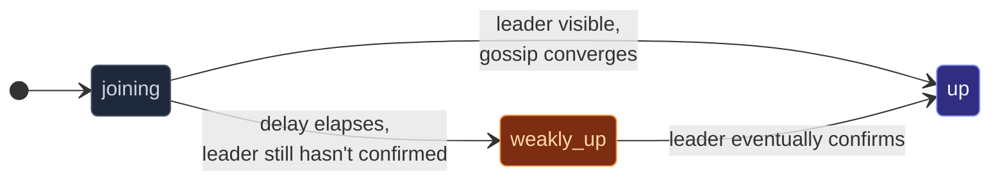
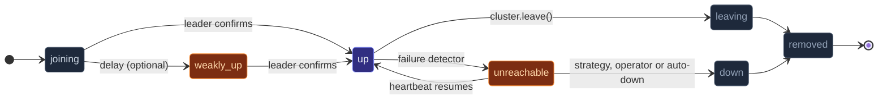

In a healthy cluster, a joining node transitions from `joining` to
`up` over a few gossip rounds — once the leader sees it.  But when
the cluster is **partitioned**, the leader's view doesn't include
the partitioned side; a node joining the minority side waits
indefinitely.

**Weakly-up** is a transient state that breaks this deadlock:
after a configured delay, a joiner that hasn't reached `up` is
auto-promoted to `weakly-up`.  It's gossip-visible to its
partition; the cluster can route to it without the leader's
involvement — but with some restrictions.



## When this matters

In normal operation, the transition `joining → up` happens within
a second or two — you never see `weakly-up`.  It comes up only
during:

- **Cold-start with a partition** — multiple nodes booting
  simultaneously across a partial network.
- **A leader-side outage during join** — the leader is
  unreachable but the joiner can reach other members.
- **Stretched clusters with high RTT** — the gossip-to-leader
  round trip is slow enough to exceed a configured threshold.

Without weakly-up, none of these scenarios make progress; the
joiner is stuck in `joining` forever (or until the leader
appears).

## Enabling weakly-up

```ts
const clusterOptions = ClusterOptions.create()
  .withHost(host)
  .withPort(port)
  .withSeeds(seeds)
  .withWeaklyUpAfterMs(3_000);
await Cluster.join(
  system,
  clusterOptions,   // auto-promote after 3s in joining
);
```

The default is `0` (disabled).  Pick a value high enough that
normal `joining → up` is the common path, but low enough that a
stalled join progresses within reasonable time.

3-10 seconds is typical.  Less and you'd promote during routine
slow gossip rounds; more and the stalled-join recovery is
sluggish.

The delay is also settable from config, for a deployment that
would rather tune it per environment than per build:

```hocon
actor-ts.cluster.weakly-up-after = 3s   # 0 disables
```

`withWeaklyUpAfterMs(…)` still wins where both are set — the
usual **explicit options > HOCON > built-in defaults** order.

## What weakly-up members can and can't do

| Capability | `weakly-up` |
| --- | --- |
| Receive `tell` from other peers in the same partition | ✓ |
| Subscribe to cluster events | ✓ |
| Be a routee in cluster-router pools | ✗ |
| Host sharding entities | ✗ |
| Win a singleton election | ✗ |

The split: **passive participation works**, **active
responsibilities don't**.  A `weakly-up` member can still serve
HTTP requests landing on it, but cluster-managed responsibilities
wait for full `up` confirmation.

This is conservative on purpose — a weakly-up member might
actually be on the *minority* side of a partition (it's just not
confirmed either way yet).  Letting it host a singleton would
risk dual-leadership.

## The full state path



`weakly-up` is **transient** — once the leader becomes reachable
and gossip converges, the member transitions to `up`.  A member
stopped gracefully before it reaches `up` goes straight from
`weakly-up` to `leaving`.  One that crashes is removed by the failure
detector at `down-after` when no downing strategy is configured —
`failure-detector.auto-down` is on by default — or, under the opt-out
`auto-down = off`, parked at `unreachable` until an operator or a
strategy downs it.

## Observing the transition

```ts
import { MemberWeaklyUp, MemberUp } from 'actor-ts/cluster';

cluster.subscribe((evt) => {
  if (evt instanceof MemberWeaklyUp) {
    console.log(`${evt.member.address} promoted to weakly-up`);
  } else if (evt instanceof MemberUp) {
    console.log(`${evt.member.address} reached full up`);
  }
});
```

In dashboards or monitoring, count `MemberWeaklyUp` events — a
non-zero rate in steady state means partitions are happening (or
the threshold is set too low for your network).

## When to enable, when not

**Enable when:**

- Cold-start partition tolerance matters (multi-AZ deployments,
  CI multi-node tests with imperfect networking).
- Your application has work that doesn't *require* full cluster
  membership (e.g., an HTTP API that can serve cached reads
  even before the cluster fully forms).

**Don't enable when:**

- Your app's correctness depends on "every node in the cluster
  agrees on membership before doing anything."  Stay strict;
  let joins wait for full convergence.
- The cluster is small + stable, and you'd rather see "join
  stuck" alerts than silent half-membership.

## Pitfalls

import { Aside } from '@astrojs/starlight/components';

<Aside type="caution" title="Weakly-up isn't a substitute for downing">
  ```ts
  weaklyUpAfterMs: 3_000;
  // ✗ no downingProvider
  ```
  Weakly-up helps **join** during partition; it doesn't help the
  partition *resolve*.  Without a downing strategy, each side of a
  real partition removes the other at `down-after`, and both halves
  run on as two clusters that do not merge again when the network
  heals.  Configure `lease-majority` or another
  [downing strategy](/cluster/downing-strategies/) to evict the
  losing side instead.  Use both.
</Aside>

<Aside type="caution" title="Weakly-up members may surprise you">
  ```ts
  const members = cluster.upMembers();
  // ↑ doesn't include weakly-up members
  ```
  `upMembers()` is strict — only fully-up.  If your code branches
  on "are at least 3 members up?" without considering weakly-up,
  a partitioned cluster might pass the check on one side and
  fail on the other.  Decide explicitly which state(s) your
  logic considers "live."
</Aside>

<Aside type="caution" title="`minimumMembersBeforeUp` is the other half of the same knob">
  ```ts
  const clusterOptions = ClusterOptions.create()
    .withWeaklyUpAfterMs(3_000)
    .withMinimumMembersBeforeUp(3);
  ```
  The two are read together and act on opposite sides of the same
  transition.  `weaklyUpAfterMs` decides how long a `joining`
  member waits before it is given a *partial* membership;
  `minimumMembersBeforeUp` decides whether the leader may hand out
  a full one at all.  With both set, `weakly-up` is precisely the
  state a node sits in while the membership threshold is unmet —
  and a `weakly-up` member still counts toward that threshold, so
  the promotion does not push the goal further away.  The wait is
  reported all the same: after a few seed-contact rounds a
  `weakly-up` node logs the key and the current count once, just
  as a `joining` one does.  See
  [Joining and seeds](/cluster/joining-and-seeds/).
</Aside>

<Aside type="caution" title="Very-short `weaklyUpAfterMs` makes routine joins look like partitions">
  ```ts
  weaklyUpAfterMs: 200;
  ```
  Below the failure-detector's `unreachableAfterMs`, you'd
  promote members to `weakly-up` during routine gossip-round-trip
  delays, before the leader's response arrives.  Nothing demotes
  them again — no transition leads from `weakly-up` back to
  `joining`, and the leader's response simply moves them on to
  `up` — so the cost is not churn but the signal: ordinary joins
  now emit `MemberWeaklyUp`, and counting those events, as
  suggested above, no longer tells a partition from a slow
  gossip round.  Keep `weaklyUpAfterMs > unreachableAfterMs`.
</Aside>

## Where to next

- **[Cluster overview](/cluster/overview/)** — the
  full membership state machine.
- **[Joining and seeds](/cluster/joining-and-seeds/)** —
  what happens before weakly-up.
- **[Failure detector](/cluster/failure-detector/)** —
  the threshold to keep `weaklyUpAfterMs` above.
- **[Downing strategies](/cluster/downing-strategies/)** —
  the complementary mechanism for partition recovery.
