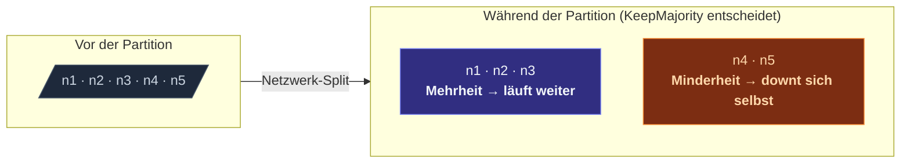

Wenn der Cluster partitioniert wird, laufen beide Hälften weiter —
und beide denken, die andere Hälfte sei ausgefallen. Ohne Eingriff:

- Es würden zwei Singletons existieren (einer pro Seite).
- Sharded Entities für denselben Key könnten auf beiden Seiten
  gespawnt werden.
- DistributedData-Replicas würden bis zur Versöhnung divergieren.

Eine **Downing-Strategie** wählt eine Gewinnerseite und downt die
Verliererseite zwangsweise. Jeder verlierende Node verlässt den
Cluster; die Gewinnerseite läuft als Cluster weiter. Ob auch die
Actors eines verlierenden Nodes stoppen, entscheidet
`actor-ts.cluster.run-coordinated-shutdown-when-down`. Ist er an,
führt der Node seine
[Coordinated-Shutdown-Pipeline](/de/fundamentals/coordinated-shutdown/#wenn-der-cluster-diesen-knoten-downt)
aus, die sein Actor-System beendet, sofern
`coordinated-shutdown.terminate-actor-system` nicht aus ist. Mit
dem ausgelieferten `off` verlässt er den Cluster nur, und seine
Actors laufen neben den Gewinnern weiter — ein zweiter Schreiber für
jede Entity und jeden Singleton, die er hielt. So oder so handelt ein
Node nur auf das Urteil seiner eigenen Strategie: ein Downing, das
die Gewinnerseite über ihn entscheidet, wird ihm nicht mitgeteilt
([Issue #940](https://github.com/pathosDev/actor-ts/issues/940)).



Ohne Strategie entfernt der Failure Detector einen unerreichbaren
Peer bei `down-after` selbst — richtig für einen abgestürzten Node,
dessen Shards und Singletons die Überlebenden übernehmen, bis hinunter
zum letzten verfügbaren Node. Bei einer Partition dagegen entfernen
sich beide Hälften gegenseitig und laufen weiter. Wenn die Partition
heilt, hast du zwei getrennte Cluster mit demselben Namen und
keinen automatischen Merge
([Issue #930](https://github.com/pathosDev/actor-ts/issues/930)).
**Konfiguriere immer eine Strategie für Produktion** —
`lease-majority` oder eine andere der fünf unten.

## Die fünf eingebauten Strategien

| Strategie | Gewinnt bei... | Trade-off |
| --- | --- | --- |
| **`KeepMajority`** | Der Seite mit `> N/2` Mitgliedern. | Einfach; Unentschieden (genau N/2-N/2-Split) bedeutet, beide Seiten gehen down. |
| **`KeepOldest`** | Der Seite mit dem niedrigst-adressierten Mitglied (siehe Einschränkung unten). | Funktioniert für gerade Cluster-Größen, in denen Mehrheit undefiniert ist. |
| **`KeepReferee`** | Der Seite mit einem bestimmten *Schiedsrichter*-Node. | Vorhersagbar, schafft aber einen Single Point of Failure (den Schiedsrichter). |
| **`StaticQuorum`** | Der Seite, die eine konfigurierte Quorum-Größe erreicht. | Strenger als Mehrheit; die Quorum-Größe ist die Wahl des Operators. |
| **`LeaseMajority`** | Mehrheit + muss eine Koordinations-Lease halten. | Paranoide Sicherheit; erfordert einen Lease-Provider (K8s etc.). |

Wähle nach der Topologie deines Clusters und den operativen
Randbedingungen (siehe Auswahlabschnitt unten).

## Konfiguration

```ts
import { Cluster, ClusterOptions, KeepMajority } from 'actor-ts/cluster';

const clusterOptions = ClusterOptions.create()
  .withHost(host)
  .withPort(port)
  .withSeeds(seeds)
  .withDowning(new KeepMajority());
const cluster = await Cluster.join(
  system,
  clusterOptions,
);
```

Übergib den Provider als `downing`. Jedes Cluster-Event
(Mitglied unreachable, Mitglied reachable etc.) führt den Provider
mit der aktuellen Sicht erneut aus; er gibt die Menge der Adressen
zurück, die zwangsweise herabgestuft werden sollen. Eine leere
Menge bedeutet "noch keine Entscheidung — abwarten."

### Das Stabilitätsfenster

Eine Strategie wird erst gefragt, wenn die Mitgliedersicht `stable-after` lang
**unverändert** war — voreingestellt sind **20 s**:

```ts
const clusterOptions = ClusterOptions.create()
  .withDowning(new KeepMajority())
  .withSplitBrainResolver({ stableAfterMs: 20_000 });
```

```hocon
actor-ts.cluster.split-brain-resolver.stable-after = 20s
```

Das ist kein Flap-Filter, jedenfalls nicht nur. **Eine Partition ist kein
einzelnes Ereignis, das das Cluster beobachtet, sondern eine Folge davon.** Der
Failure Detector markiert Peers einen nach dem anderen als unreachable, sobald
jeder `unreachable-after` überschreitet, und Downing wurde am Ende genau dieses
Ticks ausgewertet — eine 2/2-Partition, deren beide entfernte Peers auf
verschiedenen Ticks erkannt wurden, wurde deshalb als zwei aufeinanderfolgende
*Mehrheits*-Entscheidungen aufgelöst statt als eine Gleichstands-Entscheidung:

```text
Tick 1:  a=up b=up c=unreachable d=up          3 von 4 erreichbar  ->  c herabstufen
Tick 2:  a=up b=up c=removed  d=unreachable    2 von 3 erreichbar  ->  d herabstufen
```

Der Tombstone schließt die Falle: ein Force-Down setzt das Mitglied auf
`removed`, und jede Strategie filtert ihre Kandidaten auf
`up | leaving | unreachable` — der Nenner schrumpft also mit dem Zähler, und was
von der Seite übrig ist, liest sich als Mehrheit davon. Beide Hälften rechnen
dasselbe über ihr Spiegelbild, und **beide überleben** — bei `LeaseMajority`
wird die Lease dabei überhaupt nie angefragt, weil der Gleichstands-Zweig, der
zu ihr führt, nie genommen wird.

Gemessen war das kein Randfall: der eigene Vier-Knoten-Partitionstest des
Frameworks fiel ohne Fenster in **8 von 15 Läufen** um und mit einem 1-s-Fenster
in **0 von 30** — auf derselben Maschine, in derselben Minute.

Zwei Konsequenzen, die man kennen sollte:

- **Das Fenster muss länger sein als der Abstand zwischen der ersten und der
  letzten Erkennung einer Partition**, zuzüglich der anschließenden Gossip-Runde
  — nicht bloß länger als ein Flap. Ein Fenster, das kürzer ist als dieser
  Abstand, lässt die Folge wieder durch.
- **Es kostet Failover-Latenz.** Es wird nichts herabgestuft, bevor die Sicht so
  lange still war, ein echter Knotenausfall braucht also entsprechend länger.
  Die 20 s sind der etablierte Wert für diese Stellschraube und ein bewusster
  Tausch von Verfügbarkeit gegen Integrität; wer schnelleres Failover braucht,
  sollte den Wert wissentlich senken statt durch Unterlassen.

`stable-after = 0` stellt das Verhalten vor dem Fenster wieder her, und damit den
oben beschriebenen Defekt. Der Wert existiert, damit eine Installation das
ausdrücklich verlangen kann.

### Aus der Config-Datei

Alle fünf Strategien lassen sich ohne Code-Änderung wählen — genau
das erlaubt es, ein Image in der Entwicklung ohne Schiedsrichter und in
Produktion mit `keep-majority` zu fahren:

```hocon
actor-ts.cluster.split-brain-resolver {
  active-strategy = keep-majority   # off | keep-majority | keep-oldest | keep-referee | static-quorum | lease-majority

  # Per-strategy options, each read only by the strategy it belongs to.
  keep-majority.role                    = backend
  static-quorum.quorum-size             = 3
  keep-referee.referee-address          = "my-app@10.0.0.1:2552"
  keep-referee.down-all-if-below-quorum = 2
}
```

`active-strategy` baut dasselbe Objekt, das `withDowning(…)` entgegennimmt
— es gilt also die gewohnte Präzedenz: **ein explizites `withDowning(…)`
gewinnt**, und ein `Cluster.join`, das keines nennt, fällt auf die Datei
durch.  `off` ist der ausgelieferte Default und bedeutet gar keine
Strategie — was das übrig lässt, steht in der Warnung am Ende dieser Seite.

`static-quorum.quorum-size` und die beiden `keep-referee`-Keys fehlen in
`reference.conf`, statt mit einem Default zu erscheinen: jeder ist
erforderlich oder begrenzt, und `quorum-size = 0` bzw.
`referee-address = ""` werden von den Validatoren der Strategien
abgelehnt — jeder auslieferbare Wert wäre also einer, der den Node
anhält.  `static-quorum` oder `keep-referee` ohne den zugehörigen Key wird
beim Start abgelehnt, mit dem fehlenden Key in der Meldung.

:::caution[`static-quorum` aus der Config ist ein clusterweiter Schalter]
Das Quorum wird bei *jeder* Mitgliedsänderung geprüft, auch beim ersten
Join, und ein Node darunter downt sich selbst.  `quorum-size = 3` in einer
Config, die alle Replicas teilen, lässt also jeden Node beim Start wieder
gehen, bis der dritte oben ist — ein Rolling Restart nimmt das Cluster dann
herunter statt hindurch.  Setze den Wert auf höchstens die kleinste
Laufzeitgröße und rolle ihn vor dem Deployment aus, das sich darauf
verlässt.
:::

`lease-majority` braucht zusätzlich ein Lease-Backend.  Sein Lease wird aus
[`actor-ts.coordination.lease`](/de/reference/configuration/#leases-die-das-framework-baut)
gebaut, heißt `<system>-split-brain-resolver` und gehört diesem Node, also
wählt ein Deployment es mit beiden Blöcken:

```hocon
actor-ts.coordination.lease {
  backend = kubernetes
  ttl     = 15s
}
actor-ts.cluster.split-brain-resolver.active-strategy = lease-majority
```

Mit dem ausgelieferten `backend = none` wird die Strategie beim Start
abgelehnt, statt ohne etwas zu laufen, worüber sie entscheiden könnte.  Rolle
und Acquire-Timeout bleiben im Code; baue die Strategie wie unten gezeigt,
wenn eines davon zählt.

## Das Stabilitätsfenster

Eine Strategie wird nicht in dem Moment gefragt, in dem ein Peer verstummt.
Das Mitglieder- **und** Erreichbarkeitsbild muss zuerst `stable-after` lang
stillstehen — standardmäßig 20 s —, und erst dann wird der konfigurierte
Provider konsultiert:

```hocon
actor-ts.cluster.split-brain-resolver {
  active-strategy = keep-majority

  # The view must be unchanged this long before the strategy is asked.
  stable-after = 20s

  # Down everyone, self included, when it never once is.
  down-all-when-unstable = off
}
```

Oder im Code, wo dieselben zwei Einstellungen ein verschachtelter Block sind:

```ts
import { ClusterOptions, SplitBrainResolverOptions } from 'actor-ts/cluster';

const resolverPolicy = SplitBrainResolverOptions.create()
  .withStableAfterMs(30_000)
  .withDownAllWhenUnstable(true);
const clusterOptions = ClusterOptions.create()
  .withHost(host)
  .withPort(port)
  .withDowning(new KeepMajority())
  .withSplitBrainResolver(resolverPolicy);
```

**Warum eine Entscheidung mitten in der Unruhe die falsche ist.**  Jede
eingebaute Strategie ist eine reine Funktion *eines* Bildes — `KeepMajority`
zählt es, `KeepOldest` ordnet es, `StaticQuorum` misst es.  Eine Partition
tritt nicht als ein Ereignis auf: Peers überschreiten `unreachable-after`
einige hundert Millisekunden auseinander, und ein mittendrin gelesenes Bild
zeigt einen Cluster, den es zu keinem Zeitpunkt gab.  Eine Mehrheit dagegen
zu zählen ist genau der Weg, auf dem ein Node sich in der Minderheit wähnt —
eine Sekunde bevor der Rest seiner eigenen Seite ebenfalls als unerreichbar
markiert wird.  Das Fenster macht die Eingabe zu einem ruhenden Stand statt
zu einer Momentaufnahme eines Übergangs.

Die Uhr ist der Failure-Detection-Tick, die Auflösung des Fensters damit
`actor-ts.cluster.failure-detector.heartbeat-interval` — standardmäßig
500 ms.  Bei zwanzig Sekunden ist das belanglos; wenn du das Fenster auf
einige hundert Millisekunden herunterdrehst, ist es wissenswert.

**Es gibt keine Obergrenze gegen `failure-detector.down-after`.**  Sobald
eine Strategie konfiguriert ist, entfernt der Detector überhaupt nichts
mehr: er parkt einen unerreichbaren Peer und überlässt den Übergang nach
`down`/`removed` dem Resolver.  Das Fenster hat also keine Frist zu schlagen
und darf so lang sein, wie das Deployment möchte.  **Ohne** konfigurierte
Strategie tun beide Einstellungen gar nichts — es gibt dann keine
Entscheidung, die sie verzögern könnten.  Der Detector entfernt den Peer
bei `down-after` selbst unter dem Default
`failure-detector.auto-down = on` oder parkt ihn dort unter
`auto-down = off`.

### Das Fenster hat eine Obergrenze

`stable-after` ist eine Präferenz, keine Vorbedingung — und der Grund ist
derselbe Satz, andersherum gelesen.  Das Bild, das das Fenster beobachtet,
umfasst Adresse **und** Status *jedes* Mitglieds; jeder Beitritt, jedes
Verlassen und jeder Statuswechsel irgendwo im Cluster startet es also neu.
Ein Deployment, dessen Mitgliederbild sich häufiger bewegt als `stable-after`,
würde eine Partition damit überhaupt nie entscheiden — und bei den
ausgelieferten zwanzig Sekunden ist das eine gewöhnliche Autoscaling-Gruppe,
ein rollierendes Deployment oder ein einziger flatternder Node.  Es wäre auch
kein sicheres Scheitern: mit konfigurierter Strategie entfernt der Failure
Detector nichts mehr, eine von niemandem entschiedene Partition bleibt also
einfach bestehen.

Deshalb wird ein Peer, der **durchgehend** `2 × stable-after` lang
unerreichbar war, der Strategie vorgelegt, gleich was sich sonst bewegt.  Das
Verstummen dieses einen Peers ist für sich genommen ein ruhender Stand; die
Unruhe ringsum betrifft andere Mitglieder, und geschuldet ist ein Urteil über
die Partition, nicht über die Unruhe.

Das Vielfache liegt bewusst zwischen den beiden Schwellen zu seinen Seiten:
oberhalb eines Fensters, damit ein Bild, das doch stillsteht, immer zuerst auf
dem gewöhnlichen Weg entschieden wird und die Obergrenze nie zum Normalfall
wird; und unterhalb der Eskalationsfrist `3 × stable-after` weiter unten,
damit eine Strategie gefragt wird, bevor `down-all-when-unstable` den Cluster
stoppen kann.

Ein Peer, der sich erholt, verliert seinen Platz: die Uhr misst einen
*ununterbrochenen* Lauf des Verstummens, ein flatternder Peer sammelt sich
also nie aus Intervallen zur Obergrenze, von denen keines für sich etwas
bedeutet hätte.

### Wenn das Bild nie zur Ruhe kommt

`down-all-when-unstable` ist die Eskalation für einen Cluster, der nicht
konvergiert: hat das Bild über `3 × stable-after` durchgehender Änderung kein
einziges Mal ein volles `stable-after` stillgestanden — **und** ist weiterhin
etwas unerreichbar —, werden alle Mitglieder gedownt, dieser Node
eingeschlossen, und der Grund wird auf `warn` protokolliert.  Keine Strategie
wird gefragt; ein derart unruhiges Bild ist kein Stand, über den eine von
ihnen entscheiden könnte.

Der Abstand ist aus dem Fenster abgeleitet statt daneben konfiguriert.  Er
bedeutet ohnehin nur „ein Vielfaches dessen, was dieses Deployment für die
Beruhigungszeit hält“ — ein zweiter Key wäre also nur eine weitere Zahl, die
konsistent bleiben muss, und ein Abstand *unterhalb* des Fensters könnte nie
ein einziges ruhiges Fenster abwarten, bevor er auslöst.

:::caution[Ausgeliefert wird „aus“, und das Einschalten ist eine Haltung]
Dies ist die einzige Einstellung auf dieser Seite, die den **ganzen** Cluster
stoppt, und sie wird von einer Uhr ausgelöst, nicht vom Urteil einer
Strategie.  Ein rollierender Neustart, dessen Ersatz-Nodes weniger als
`stable-after` auseinander eintreffen, sieht genau wie ein Cluster aus, der
sich nicht beruhigt.  Einschalten heißt: lieber steht der Cluster still, als
dass er auf einem Mitgliederbild weiterläuft, dem niemand trauen kann — eine
legitime Position, aber eine, die man bewusst einnimmt.

Was nicht passiert: ein Auslösen bei gewöhnlicher Unruhe.  Eine leere
Unerreichbar-Menge ist harte Vorbedingung, saubere Beitritte und Abgänge
eskalieren also nie, so schnell sie auch aufeinander folgen.
:::

## KeepMajority

```ts
import { KeepMajority } from 'actor-ts/cluster';

new KeepMajority();
```

Die klassische Strategie. Zählt Mitglieder; die Seite mit mehr
gewinnt.

**Macht gut:**

- Allgemeinster Default.
- Keine externen Abhängigkeiten.
- Vorhersagbar bei ungeradem N.

**Macht nicht:**

- Exakte N/2-N/2-Splits handhaben — beide Seiten downen sich
  selbst.
- Zwischen "5 Mitglieder gesund" und "5 Mitglieder alle auf
  derselben Maschine, das Rack brennt" unterscheiden — Mehrheit
  per Zählung ist blind für physische Topologie.

Richtig für Cluster mit einer **ungeraden Zahl an Nodes** und ohne
besondere Deployments.

## KeepOldest

```ts
import { KeepOldest, KeepOldestOptions } from 'actor-ts/cluster';

const keepOldestOptions = KeepOldestOptions.create().withDownIfAlone(true);
new KeepOldest(keepOldestOptions);
```

Die Seite mit dem **„ältesten“ Mitglied** gewinnt.

:::caution[„Ältestes“ heißt hier niedrigste Adresse, nicht längste Laufzeit]
Dem Namen zum Trotz verfolgt diese Strategie keine Join-Reihenfolge —
im Gossip-Payload reist keine monoton wachsende Join-Sequenz mit.
„Ältestes“ ist das Mitglied, dessen `host:port` zuerst sortiert — nach
derselben Regel wie `Cluster.leader()`.

Die praktische Folge: eine Node, die vor einer Minute gejoint ist,
gewinnt gegen eine, die seit einer Woche läuft, wenn ihre Adresse
niedriger sortiert.  Wähle diese Strategie also **nicht** in der
Erwartung, ein langlebiger Koordinator-Pod sei der Tiebreaker — wähle
sie, wenn du einen *deterministischen, übereinstimmenden* Tiebreaker
willst, und sorge dann dafür, dass die Node, die überleben soll, die
mit der niedrigsten Adresse ist.
:::

Nützlich, wenn:

- Du eine gerade Zahl an Nodes hast, bei denen `KeepMajority` bei
  50/50-Splits mehrdeutig wird.
- Du die Adresse der Node festlegen kannst, die überleben soll — dann
  ist die Strategie deterministisch und braucht keine Quorum-Arithmetik.

`downIfAlone: true` bedeutet "wenn ich der älteste bin, aber alle
anderen unreachable sind, downe ich mich selbst" —
verhindert, dass ein Ein-Node-"Gewinner" sich nach einem
Komplett-Split selbst zum Cluster erklärt.

## KeepReferee

```ts
import { KeepReferee, KeepRefereeOptions } from 'actor-ts/cluster';

const keepRefereeOptions = KeepRefereeOptions.create()
  .withRefereeAddress('my-app@10.0.0.1:2552')
  .withDownAllIfBelowQuorum(3);
new KeepReferee(
  keepRefereeOptions,
);
```

Ein bestimmter **Schiedsrichter-Node** ist das entscheidende
Mitglied. Die Seite mit dem Schiedsrichter gewinnt; die andere
Seite downt sich selbst.

**Macht gut:**

- Die vorhersagbarste Strategie — keine Mehrdeutigkeit darüber,
  welche Seite gewinnt.
- Funktioniert für jede Cluster-Größe, auch gerade.

**Macht nicht:**

- Den Schiedsrichter selbst überleben, wenn er ausfällt.
  Verschwindet der Schiedsrichter, hat ihn keine Seite, und die
  Strategie kann nicht entscheiden. Daher
  `downAllIfBelowQuorum` — "wenn der Cluster unter dieser Größe
  ist, downe alle und lass Operatoren neu aufbauen."

Nützlich für **Zwei-DC-Cluster** mit einem Tie-Breaker-Node an
einem neutralen Ort (drittes DC, eine Control-Plane-K8s-Namespace).

## StaticQuorum

```ts
import { StaticQuorum, StaticQuorumOptions } from 'actor-ts/cluster';

const staticQuorumOptions = StaticQuorumOptions.create().withQuorumSize(3);
new StaticQuorum(staticQuorumOptions);
```

Eine Seite gewinnt nur, wenn sie mindestens `quorumSize`
erreichbare Mitglieder hat. Unterhalb des Quorums downt die Seite
sich selbst.

**Macht gut:**

- Strenger als Mehrheit — schützt vor Szenarien, in denen die
  Minderheit sonst weiterlaufen würde.
- Konfigurierbar nach der Konfidenzschwelle deines Operators.

**Macht nicht:**

- Sich automatisch erholen. Bilden sich mehrere Sub-Quorum-Partitionen,
  gewinnt keine; der Operator muss manuell neu aufbauen.

Richtig, wenn du eher **Fail-Stop** willst, als ein
Falsche-Seite-Überleben zu riskieren.

## LeaseMajority

```ts
import { LeaseMajority, LeaseMajorityOptions } from 'actor-ts/cluster';

const leaseMajorityOptions = LeaseMajorityOptions.create().withLease(someLeaseImplementation);
new LeaseMajority(
  leaseMajorityOptions,
);
```

Mehrheit **plus** eine Koordinations-Lease. Wrappe jede andere
Strategie: die Gewinnerseite muss zusätzlich eine Lease (z. B. eine
K8s-Lease-Ressource) erwerben, bevor sie sich als autoritativ
betrachtet.

**Macht gut:**

- Doppelt gemoppelte Sicherheit. Zweifachprüfung.
- Nützlich, wenn das Netzwerk unberechenbar ist (z. B.
  Cloud-Cross-Zone).

**Macht nicht:**

- Helfen, wenn der Lease-Provider selbst weg-partitioniert ist.

Richtig für paranoide Produktionsszenarien, in denen du eher
**doppelten Aufwand** für Split-Brain-Schutz akzeptierst.

Aus einer Config-Datei bekommt die Strategie ihren Lease aus dem
Coordination-Block statt aus `withLease(…)` — siehe
[Aus der Config-Datei](#aus-der-config-datei).  Dieser Lease wird bei der
ersten Entscheidung der Strategie gebaut, aus der Adresse, die diese
Entscheidung mitbringt, denn die Strategie entsteht, bevor es die Adresse
des Nodes gibt.

### Wenn ein Acquire aufgegeben wird

Der interessante Fall ist nicht „die Lease sagt nein“, sondern
„die Lease sagt gar nichts“.  Zwei Dinge machen ein `acquire()`
unerwünscht, während es noch auf der Leitung ist: Es resolved
nicht innerhalb von `acquireTimeoutMs` (Default 5 s), oder die
Partitionssicht zieht darunter weiter — die Partition heilt, oder
das Unreachable-Set ändert sich.  Der zweite Fall ist der
wahrscheinlichere, denn eine Mitgliedschaftsänderung innerhalb
eines 5-Sekunden-Fensters braucht gar keine Verzögerung.  In
beiden Fällen hört die Strategie auf, auf den Versuch zu warten,
und muss dann damit rechnen, dass er auf der Leitung trotzdem noch
erfolgreich ist und die Lease bei einem Node beansprucht
zurücklässt, der nicht mehr glaubt, gewonnen zu haben.  Für beide
gelten dieselben drei Regeln:

- **Das späte Ergebnis wird verworfen.**  Jeder Versuch trägt eine
  Epoch; ein Ergebnis, das nach dem Ausmustern seiner Epoch
  eintrifft, kann keine Entscheidung mehr schreiben.  Ein langsames
  `acquire() → true` kann diese Seite also nicht nachträglich zur
  Überlebenden erklären.
- **Ein später Gewinn wird released — und bis dahin startet
  nichts Neues.**  Eigentum beginnt erst, wenn das Acquire
  resolved, also wartet das Rückgängigmachen darauf, dass es sich
  zurückmeldet; früher zu releasen wäre ein No-op.  Solange das
  offen ist, liefert `decide()` weiter eine leere Entscheidung,
  statt einen zweiten Versuch zu starten: zwei überlappende
  Versuche sind genau der Weg, auf dem das Aufräumen eine Lease
  löschen könnte, die diese Seite gerade beansprucht.
- **Schlägt das Release fehl, entscheidet die Strategie nicht
  mehr.**  Der Zustand der Lease ist dann unbekannt, also geht sie
  in den *Fail-safe* und liefert für diese Partitionssicht eine
  leere Entscheidung, bis die Partition heilt.  Nichts zu
  entscheiden ist immer sicher; falsch zu entscheiden nicht.

Das sichtbare Symptom eines Lease-Providers mit einem schlechten
Tag ist deshalb ein Cluster, der wartet — keiner, der auseinander
fällt.

### Wenn ein Gewinn seine Lease überdauert

Ein Gewinn ist nur so gut wie die Lease dahinter.  Sobald die
Sicht `stable-after` lang stabil war, fragt der Cluster die
Strategie bei jedem Failure-Detector-Tick erneut, sodass ein
gecachter Gewinn noch lange nach dem Acquire zurückkommen kann, das
ihn erzeugt hat.  Ein Node, der dazwischen länger als die TTL der
Lease stand — eine lange GC-Pause, ein ausgehungerter Container —,
hat die Lease an die andere Seite verloren, die inzwischen *diese*
downt.  Den alten Gewinn erneut abzuspielen ist genau der
Weg, auf dem beide Hälften als Überlebende handeln.

Bevor eine gewonnene Entscheidung erneut zurückgegeben wird, fragt
die Strategie deshalb `lease.checkAlive()`.  Ist die Lease
abgelaufen, wird der Gewinn verworfen und die Seite arbitriert neu:
Das neue Acquire verliert, wenn die andere Seite die Lease jetzt
hält — dann downt sich diese Seite selbst —, und gewinnt
sie zurück, wenn niemand sie genommen hat.  Ein verlorener
Schiedsspruch wird nicht erneut gestellt; er stützt sich nicht auf
die Lease.  Das setzt voraus, dass das Backend `checkAlive()`
gegen seine TTL beantwortet statt aus einem gehaltenen Flag — was
beide eingebauten Backends tun (#937).

Ein Acquire, das länger als die TTL der Lease dauert, kann nie
einen verwertbaren Gewinn liefern: Die Strategie arbitriert weiter
und entscheidet nichts — dieselbe Haltung wie bei einem noch
laufenden Acquire.

## Eine Strategie auswählen

Drei Fragen, in dieser Reihenfolge:

1. **Gerade oder ungerade Cluster-Größe?**
   - Ungerade → `KeepMajority`.
   - Gerade → `KeepOldest` oder `KeepReferee` (Unentschieden
     vermeiden).

2. **Hast du einen stabilen Tie-Breaker-Node?**
   - Ja → `KeepReferee` (am vorhersagbarsten).
   - Nein → `KeepMajority` oder `KeepOldest`.

3. **Ist Fail-Stop besser als ein potenzieller Falsche-Seite-Gewinn?**
   - Ja → `StaticQuorum` (irrt auf der Stop-Seite).
   - Nein → eine der oben genannten.

Für ein typisches 3-Node-K8s-Deployment: **`KeepMajority`**. Für
ein 2-DC-Setup mit einem Tie-Breaker in der dritten Region:
**`KeepReferee`**. Für einen 5-Node-Cluster, der niemals unter 3
fallen soll: **`StaticQuorum(3)`**.

## Eigene Strategien

Das Provider-Interface ist winzig:

```ts
interface DowningProvider {
  decide(view: ClusterPartitionView): DowningDecision;
}

type ClusterPartitionView = {
  allMembers: ReadonlyArray<Member>;
  unreachable: ReadonlySet<string>;   // Adress-Strings
  self: NodeAddress;
};
```

Implementiere `decide(view) => Set<string>` und gib die
Adress-Strings zurück, die herabgestuft werden sollen. Leere Menge
heißt "keine Entscheidung."

Nützlich für app-spezifische Regeln — z. B. "behalte immer den
Node mit role=primary" oder "wenn die Partition den
DB-Master-Node enthält, gewinnt diese Seite."

import { Aside } from '@astrojs/starlight/components';

<Aside type="caution" title="Keine Strategie = der Failure Detector entscheidet">
  Ohne `downing`-Provider entfernt der Failure Detector einen
  unerreichbaren Peer selbst: Er erreicht bei `down-after` das Urteil
  `down`, und der Peer wird als `down`, dann als `removed` verkündet —
  ohne Schlichtung, ohne Operator. Für einen einzelnen abgestürzten
  Node ist das genau das gewünschte Verhalten: Der letzte verfügbare
  Node übernimmt die Shards und Singletons des toten Peers, also läuft
  ein Cluster aus n Nodes bis hinunter zu einem Node weiter. Bei einer
  Partition ist es Split-Brain per Konstruktion: Jede Seite erreicht
  `down-after` zur selben Zeit und entfernt die anderen, und jede
  Hälfte läuft als "der Cluster" weiter — und bleibt es, nachdem das
  Netz geheilt ist
  ([Issue #930](https://github.com/pathosDev/actor-ts/issues/930)).
  Für Produktion konfiguriere `lease-majority` oder eine andere
  Strategie auf dieser Seite.

  `actor-ts.cluster.failure-detector.auto-down = off` ist das Opt-out.
  Der Detector parkt den Peer dann auf `unreachable` — weiterhin
  Mitglied, mit seinem Platz, seine Shards nicht neu verteilt, seine
  entfernten Watcher ohne Nachricht, bis er entfernt wird oder neu
  startet — und loggt eine Warnung, die die Auswege nennt:
  `cluster.down(addr)`, `POST /cluster/down` (hinter
  `actor-ts.management.enable-down-endpoint`) oder eine Strategie.
  Ein abgestürzter Node bleibt dann, bis du ihn entfernst. Einen
  partitionierten Cluster hält Parken trotzdem nicht bei einem
  Singleton — Leader ist das erste `up`-Mitglied in der Sicht jeder
  Seite, ein Singleton, der dem Leader folgt, zieht also auf beiden
  Seiten um.

  Mit einer konfigurierten Strategie hält der Detector bei
  `unreachable` an, und die Strategie besitzt das Entfernen, was immer
  `auto-down` sagt; ein Mitglied, über das die Strategie nie
  entscheidet, bleibt dann unbegrenzt `unreachable`. Siehe
  [Ein geparktes Mitglied bleibt geparkt](/de/cluster/failure-detector/#ein-geparktes-mitglied-bleibt-geparkt).
</Aside>

<Aside type="caution" title="Stabile gestreckte Cluster brauchen Leases">
  ```ts
  // 2 Nodes in DC-A, 2 Nodes in DC-B, kein Tie-Breaker
  new KeepMajority();   // ✗ beide Seiten gehen bei 2-2-Split down
  ```
  Gerade Cluster brauchen einen Tie-Breaker. Ohne diesen tötet jede
  Partition den ganzen Cluster. Füge einen Schiedsrichter-Node oder
  eine Lease hinzu.
</Aside>

<Aside type="caution" title="`StaticQuorum` blockiert Scale-Up">
  ```ts
  const quorumOptions = StaticQuorumOptions.create().withQuorumSize(5);
  new StaticQuorum(quorumOptions);
  // Starting up with 3 nodes → cluster downs itself (no quorum)
  ```
  Quorum wird bei jeder Mitgliedschaftsänderung geprüft, auch beim
  initialen Join. Starte entweder mit bereits erreichtem Quorum
  oder verwende eine Quorum-Größe gleich oder kleiner deiner
  minimalen Laufzeit-Größe.
</Aside>

## Was eine gedownte Adresse danach darf

Eine eigene Quarantäne gibt es nicht. Was ein entferntes Mitglied
draußen hält, ist sein Tombstone: der `removed`-Eintrag, den der
Cluster für die Adresse behält und der jeden Eintrag für sie mit
gleicher oder älterer Version abweist. Ob eine Entfernung einen
hinterlässt — und ob der entfernte Prozess also weiterreden und wieder
hereingelassen werden kann —, hängt vom Weg ab, auf dem er entfernt
wurde. *Derselbe Lauf* heißt unten dieser Prozess: dieselbe
Inkarnation, die weiterhin die Version ankündigt, die sie bei ihrer
Entfernung hatte.

| Entfernt durch | Hinterlässt | Derselbe Lauf meldet sich wieder |
| --- | --- | --- |
| `Cluster.down()` oder `POST /cluster/down` | Einen Tombstone. | Abgewiesen, bis der Tombstone aufgeräumt ist. |
| Die Entscheidung einer Strategie oder `down-all-when-unstable` | Einen Tombstone. | Abgewiesen, bis der Tombstone aufgeräumt ist. |
| Das eigene `leave` des Peers | Einen Tombstone. | Abgewiesen, bis der Tombstone aufgeräumt ist. |
| Den Failure Detector ohne Strategie — `failure-detector.auto-down = on`, der Default | Nichts — der Eintrag wird gelöscht. | Mit seinem nächsten Gossip-Frame wieder aufgenommen; ein Heartbeat allein findet keinen Eintrag, den er zurückholen könnte. |
| Niemanden: keine Strategie und `auto-down = off`, das Opt-out | Entfernt wird nichts — der Peer wird auf `unreachable` geparkt. | Mit seinem nächsten Heartbeat an diesen Node wieder `up`. |

Der Rückweg der letzten Zeile braucht einen Heartbeat des Peers an
diesen Node, und der beendet eine Pause, keine Partition: Nachdem
eine symmetrische Partition geheilt ist, schickt keine Seite einem
Peer, den sie für unerreichbar hält, Heartbeats oder Gossip, also
bleiben die geparkten Mitglieder geparkt und der Cluster gespalten,
bis ein Operator handelt
([Issue #930](https://github.com/pathosDev/actor-ts/issues/930)).

Ein Tombstone weist so lange ab, wie der größere der beiden Werte
`tombstone.time-to-live` und `tombstone.min-retention` vorgibt —
**24 h im Default** — und verschwindet beim ersten Prune-Durchlauf
danach. `time-to-live` ist der Stellknopf des Operators; eine
Quarantäne-Einstellung daneben gibt es nicht. `min-retention` ist eine
Untergrenze darunter, bei `0s` das Sechsfache von
`failure-detector.down-after`, damit ein kurzes `time-to-live` einen
Tombstone nicht verwirft, bevor ihn Peers gesehen haben, die noch nicht
konvergiert sind:

```hocon
actor-ts.cluster.tombstone {
  time-to-live   = 24h  # how long a removed address is refused
  prune-interval = 5m   # how often expired tombstones are dropped
  min-retention  = 0s   # floor under time-to-live; 0s = 6 x down-after
}
```

Die Abweisung betrifft die Mitgliedschaft. Die Verbindung weist nichts
ab — kein Handshake fragt nach der Mitgliedschaft —, die Frames des
gedownten Nodes kommen also weiter an, und die Nachrichten, die er
schickt, werden weiter zugestellt. Abgewiesen wird sein Eintrag: Er ist
kein Mitglied, und nichts, was Arbeit nach der Mitgliedschaft
verteilt — Sharding, Singletons, clusterbewusstes Routing,
Downing-Quoren —, zählt ihn oder seine Rollen. Nach dem Prune ist
derselbe Lauf mit seinem nächsten Gossip-Frame wieder da, mit seiner
alten Version und den Rollen, die er hatte: Das Fenster ist ein Aufschub,
kein Urteil. Ein Node, der gedownt wurde, während er weiterlief,
erfährt nichts von einem Downing, das anderswo entschieden wurde (siehe
oben auf dieser Seite); hält ihn nichts an, ist er also wieder
Mitglied, sobald das Fenster abgelaufen ist.

**Der eigene Weg des Detectors — der Default — ist der einzige ohne
Abweisung.** Er löscht den Eintrag, statt einen Tombstone zu
schreiben; derselbe Lauf wird also mit seinem nächsten Gossip-Frame
wieder aufgenommen —
nachdem für ihn `MemberRemoved` angekündigt wurde und seine entfernten
Watcher ein `Terminated` wegen Knotenverlust bekommen haben, ohne dass
ihnen irgendetwas sagt, dass er zurück ist. Es bleibt auch nichts, das
den veralteten Eintrag eines anderen Überlebenden abweisen könnte —
deshalb kommt ein abgestürztes Mitglied unter `auto-down` immer wieder
zurück
([was der Detector entscheidet](/de/cluster/failure-detector/#was-der-detector-entscheidet--und-was-nicht)
hat die Messung). Einer geheilten Partition hilft das Löschen auch
nicht: Keine Seite schickt einem Peer, den sie für unerreichbar hält,
Heartbeats oder Gossip, und nach dem Löschen gibt es gar keinen Eintrag
mehr, den sie adressieren könnte
([Issue #930](https://github.com/pathosDev/actor-ts/issues/930)).

**Ein Neustart wird über die Version wieder aufgenommen.** Ein Prozess
setzt seine Version beim Join aus seiner eigenen Wanduhr, und die
überbietet den Tombstone, den sein vorheriger Lauf hinterlassen hat;
ein neu gestarteter Node ist also sofort wieder dabei, egal auf welchem
Weg er entfernt wurde — niemand wartet das Fenster ab, und nichts muss
weggeräumt werden. Wurde sein vorheriger Lauf nie entfernt — geparkt
unter `auto-down = off`, für eine Strategie gehalten oder innerhalb
von `down-after` neu gestartet —, ersetzt der Eintrag des neuen Laufs
einen lebenden, und der Node beendet zuerst den alten Lauf:
`MemberDown` und `MemberRemoved` für die alte Inkarnation, damit
deren entfernte Watcher ihr `Terminated` wegen Knotenverlust bekommen
und ihre Shards und Singletons umziehen, dann `MemberJoined` für die
neue. Dafür müssen beide Einträge eine Inkarnation tragen; ein
Eintrag ohne ersetzt den alten Lauf still, wie es jeder Eintrag
vorher tat
([ein Neustart beendet den vorherigen Lauf](/de/cluster/failure-detector/#ein-neustart-beendet-den-vorherigen-lauf)).

Zwei Grenzen folgen daraus, dass der Tombstone eine Versionsuntergrenze
ist und kein Bann gegen einen Prozess:

- **Derselbe Lauf stempelt seine Version neu.** Eine Version ist eine
  Zahl, die der Peer selbst schreibt. Ein Prozess, der gedownt wurde,
  während er weiterlief, und sich mit einer frischen Version ankündigt,
  ist von einem Neustart nicht zu unterscheiden und wird sofort wieder
  aufgenommen. Die Abweisung hält gegen einen Lauf, der weiter mit
  seiner alten Version spricht — einen, der nichts bemerkt hat, oder
  einen Mitschnitt —, nicht gegen einen, der zurückkommen will.
- **Ein Hebel zum Aussperren für einen Peer mit Standing.** Ein
  Mitglied, das dieser Knoten für aktiv hält, darf Einträge über andere
  Adressen gossipen, und ein `removed`-Eintrag, der innerhalb des
  Versions-Skew-Budgets (`maxVersionSkewMs`, im Default fünf Minuten)
  datiert ist, überbietet die frische Version, mit der ein legitimer
  Neustart beginnt. Der neu gestartete Node bleibt draußen, bis er
  erneut jenseits dieser Version startet oder der Tombstone abläuft —
  gezählt ab einem `removedAt`, das derselbe Peer gewählt hat.

Beide schließen sich erst, wenn die Inkarnation — welcher Prozess unter
einer Adresse antwortet, einmal pro `Cluster.join` geprägt — auf dem
Draht verpflichtend ist, sodass eine Abweisung Prozesse vergleichen kann
statt Zahlen
([Issue #823](https://github.com/pathosDev/actor-ts/issues/823),
[Issue #940](https://github.com/pathosDev/actor-ts/issues/940)). Heute
wird sie mitgeführt und entscheidet nur, was ein Neustart verkündet;
keine Abweisung vergleicht sie.

## Wohin als Nächstes

- **[Cluster-Überblick](/de/cluster/overview/)** — das
  Mitgliedschaftsmodell, gegen das die Strategie arbeitet.
- **[Failure Detector](/de/cluster/failure-detector/)** —
  was Mitglieder erst als unreachable kennzeichnet.
- **[Singleton mit Lease](/de/cluster/singleton/with-lease/)** —
  Lease-Schutz pro Singleton, ergänzend zu einer Downing-Strategie.
- **[Coordination](/de/coordination/overview/)** — die
  Lease-Abstraktion.
- **[Cluster-Sicherheit](/de/operations/security/cluster-security/)** —
  TLS + Auth rund um den Cluster-Transport.

Die [`DowningProvider`](/api/interfaces/downingprovider/)
API-Referenz deckt das Strategie-Interface ab.
