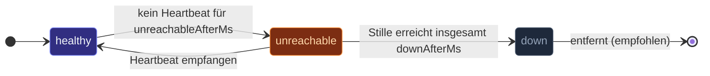
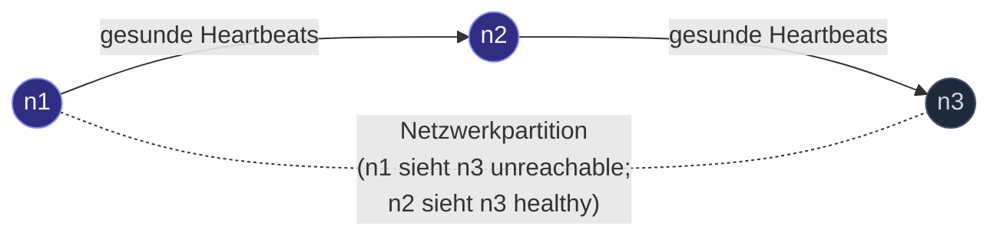

Ein geclusterter Actor-System muss sich **darauf einigen, wer
lebt**. Der Failure Detector ist die Peer-spezifische
Zustandsmaschine, die entscheidet:



- **`healthy`** — Heartbeats kommen normal an.
- **`unreachable`** — über dem Schwellwert; der Cluster vermeidet
  es, dorthin zu routen. Offiziell noch Mitglied; kann sich
  erholen.
- **`down`** — über dem längeren Schwellwert; der Cluster
  betrachtet den Peer als endgültig weg. Löst Downing aus.

Der Detector ist **pro Peer** — verschiedene Peers können
gleichzeitig in verschiedenen Zuständen sein. Das Gesamtverhalten
des Clusters (Routing, Sharding, Singleton-Wahl) liest diese
Zustände, um zu entscheiden, was zu tun ist.

## Die Defaults

```ts
{
  heartbeatIntervalMs: 500,    // alle 500ms einen Heartbeat senden
  unreachableAfterMs:  2_000,  // nach 2s Stille als unreachable markieren
  downAfterMs:         5_000,  // nach 5s Stille als down markieren
}
```

Für typische LAN-Cluster (1-10 Nodes, Sub-Millisekunden-Latenz)
funktionieren diese Defaults gut. Sie ergeben:

- **2-Sekunden-Erkennungsfenster** für "dieser Peer hat
  möglicherweise Probleme."
- **5-Sekunden-Entscheidungsfenster** für "dieser Peer ist endgültig
  weg."

## Tuning

Überschreibe über das `failureDetector`-Feld in den
Cluster-Settings:

```ts
const clusterOptions = ClusterOptions.create()
  .withHost(host)
  .withPort(port)
  .withSeeds(seeds)
  .withFailureDetector({
    heartbeatIntervalMs: 1_000,
    unreachableAfterMs:  5_000,
    downAfterMs:         15_000,
  });
Cluster.join(
  system,
  clusterOptions,
);
```

Wann tunen:

| Workload | Richtung |
| --- | --- |
| Cluster über Regionen hinweg (hohe RTT) | Alle drei erhöhen. 100 ms RTT bedeuten, dass ein einzelner verpasster Heartbeat normales Rauschen ist. |
| Lokales Docker-Compose (Sub-ms RTT) | Verringern für schnellere Failover-Tests. Vor dem Deploy für Produktion wieder hochstellen. |
| Netzwerk mit periodischen Aussetzern | `unreachableAfterMs` erhöhen, um Fehlalarme zu vermeiden, aber `downAfterMs` größer halten, damit ein echter Ausfall trotzdem erkannt wird. |
| Kostensensitiv (chatty Heartbeats) | `heartbeatIntervalMs` erhöhen — bei 5s-Intervallen sind Gossip + Heartbeat < 1KB/s pro Peer. |

Das Verhältnis `downAfterMs / unreachableAfterMs` (Standard ~2.5x)
ist das **Flap-Toleranzfenster**: ein als unreachable markierter
Peer kann sich zurück auf healthy erholen, ohne downed zu werden,
solange ein Heartbeat innerhalb der Differenz eintrifft.

## Heartbeats sind explizit; Lebenszeichen ist jeder Frame

Jeder Node schickt einmal pro `heartbeat-interval` einen Heartbeat an
jedes erreichbare Mitglied, und das Mitglied beantwortet jeden mit einer
Bestätigung.  Auf diese Schleife verlassen sich die Detectoren, also
wird ein leerlaufender Cluster genauso genau beobachtet wie ein
beschäftigter.

Wofür ein Frame von einem Peer *zählt*, hängt von der Frage ab:

- **Jeder Frame ist ein Lebenszeichen, für beide Detectoren** — ein
  Heartbeat, eine Bestätigung, Gossip, eine Anwendungsnachricht.  Er
  verschiebt den Zeitpunkt, ab dem die Stille des Peers gemessen wird.
  Für den einfachen Detector ist das schon das ganze Modell.
- **Nur Heartbeat-Frames speisen φs Historie.**  Der φ-Accrual-Detector
  modelliert genau eine Sache: die Zwischenankunftszeiten der Heartbeats
  eines Peers.  Als ihn jeder Frame speiste, beschrieb die Historie
  stattdessen den Verkehr — nach einem Schwall von 300 Nachrichten
  enthielt das Fenster 200 Proben von 0 ms, und bei der damals
  ausgelieferten Pause von 0 s galt ein Peer 562 ms nach seinem
  Verstummen als unreachable und nach 704 ms als down.  Bestätigungen
  bleiben aus einem zweiten Grund draußen: Sie beantworten die
  Heartbeats *dieses* Nodes, kommen also in dessen Takt an, und neben
  den eigenen Heartbeats des Peers verschränken sie zwei Zeitpläne — die
  Schwellen wandern dann je nach Phase zwischen den beiden Nodes
  zwischen 0,8 s und 1,4 s.

Der Vertrag, den ein Detector implementiert, sagt dasselbe in zwei
Methoden: `heardFrom` ist ein Frame beliebiger Art, `heartbeat` ein
Heartbeat-Frame.

## Was der Detector entscheidet — und was nicht

Der Detector gibt `'healthy'` / `'unreachable'` / `'down'` zurück.
Was der Cluster *damit* macht:

| Entscheidung | Cluster-Verhalten |
| --- | --- |
| `healthy` | Normales Routing. Kein Effekt. |
| `unreachable` | Markiere das Mitglied in der Mitgliedertabelle als `unreachable`. Router überspringen es; Sharding allokiert keine neuen Shards mehr darauf. Singleton-Manager wählt keinen Leader von einer unerreichbaren Seite. |
| `down`, [Downing-Strategie](/de/cluster/downing-strategies/) konfiguriert | Markiere das Mitglied als `unreachable` und halte an. Die Strategie entscheidet, welche Adressen entfernt werden; der Cluster verkündet diese Nodes als `removed`. Der Detector entfernt selbst nichts. |
| `down`, keine Strategie konfiguriert | Der Detector entfernt den Peer selbst: erst `down`, dann direkt als `removed` aus der Mitgliedertabelle. |

**Diese beiden Zeilen sind die ganze Geschichte, und welche du
bekommst, entscheidet allein, ob du eine Strategie konfiguriert
hast.** Mit einer ist der Detector das *Signal*, nicht die Aktion —
er parkt den Peer auf `unreachable`, und die Strategie besitzt die
Entfernung. Ohne eine schlichtet nichts, und dass der Detector den
Peer bei `down-after` entfernt, ist das einzige Failover, das du
hast: nur so werden Shards neu verteilt und ein Singleton
übergeben. Das ist bequem für einen einzelnen abgestürzten Node und
falsch für eine Partition, wo beide Hälften die jeweils andere
entfernen und weiterlaufen. Eine Strategie zu konfigurieren, ist
der Weg, das eine durch das andere zu ersetzen.

### Ein geparktes Mitglied bleibt geparkt

Mit konfigurierter Strategie bleibt ein Mitglied, über das die
Strategie nie zu einem Urteil kommt, **unbegrenzt** `unreachable`.
Dahinter steht bewusst kein Auffangnetz des Detectors: ein
Auffangnetz ist genau die Umgehung, die die Strategie verhindern
soll, und eines, das nach einem Vielfachen von `down-after`
auslöst, verschiebt die Umgehung nur nach hinten.

Das hat Konsequenzen, die man einplanen sollte. Das Mitglied
belegt weiterhin seinen Platz gegen `max-members`. Der
`ClusterSingletonManager` übergibt nicht, denn er reagiert auf
`MemberDown` / `MemberLeft` / `MemberRemoved` und bewusst nicht auf
`MemberUnreachable` — der Detector eines einzelnen Nodes ist keine
Mitgliedschaftstatsache, auf die sich der Cluster geeinigt hat. Der
`ShardCoordinator` verteilt nicht neu, denn er hört nur auf
`MemberRemoved`. Und eine geheilte Partition holt das Mitglied
derzeit nicht nach `up` zurück: Gossip und Heartbeats gehen nur an
erreichbare Mitglieder, also spricht keine Seite die andere je
wieder an.

Das ist Integrität vor Verfügbarkeit, und zwar mit Absicht. Wähle
eine Strategie, die auf deiner Cluster-Form immer zu einem Urteil
kommt — eine ungerade Mitgliederzahl für `KeepMajority`, einen
Schiedsrichter oder ein Lease für eine gerade — statt einer, die
für immer "pending" antworten kann.

## Die Sicht des lokalen Nodes

Jeder Node fährt seinen eigenen Detector und beobachtet seine
eigenen Peers. Das bedeutet, dass **zwei Nodes uneins sein
können**, ob ein dritter erreichbar ist:



Der Cluster-Gossip propagiert diese pro-Node-Beobachtungen. Ein
Mitglied gilt global als unreachable, wenn *genug* Peers es so
melden — der Schwellwert ist in manchen Downing-Strategien
konfigurierbar (siehe KeepMajority, KeepReferee).

## Den φ-Accrual-Detector wählen

Der oben beschriebene Detector ist bewusst einfach — einfache
Zeitschwellen, kein Tracking statistischer Varianz. Für LAN-Skala
reicht das aus, deshalb ist er der Default.

Das Framework bringt einen zweiten mit. `PhiAccrualFailureDetector`
verfolgt die Verteilung der jüngsten Heartbeat-Zwischenankunftszeiten
eines Peers und erzeugt einen kontinuierlichen Verdachtswert φ, den der
Cluster über Schwellwerte in `unreachable` / `down` übersetzt. Wo der
einfache Detector fragt *"war es länger als 2s still?"*, fragt
φ-Accrual *"wie überraschend ist diese Stille, gemessen daran, wie sich
dieser Peer tatsächlich verhält?"* — ein Peer, dessen Heartbeats wie ein
Uhrwerk ankommen, kann also früher auffallen, und einer hinter einer
zappeligen Verbindung bekommt mehr Spielraum, ohne dass eine der beiden
Zahlen vorab geraten werden muss.

Wähle ihn pro Node, im Code:

```ts
const clusterOptions = ClusterOptions.create()
  .withHost(host)
  .withPort(port)
  .withFailureDetectorImplementation('phi')
  .withPhiAccrual({ unreachableThreshold: 10, downThreshold: 14 });
Cluster.join(
  system,
  clusterOptions,
);
```

oder in der `application.conf`:

```hocon
actor-ts.cluster.failure-detector {
  implementation = phi

  # Shared by both implementations: the cadence of the cluster's own
  # heartbeat loop, which is why `phi` below has no copy of it.
  heartbeat-interval = 500ms

  phi {
    unreachable-threshold      = 8       # φ above which the peer is unreachable
    down-threshold             = 12      # φ above which it is down; must exceed the above
    max-sample-size            = 200     # inter-arrival times kept per peer
    min-std-deviation          = 100ms   # floor, so a very steady peer is not flagged on noise
    acceptable-heartbeat-pause = 3s      # grace added to the last heartbeat before φ rises
    expected-response-after    = "auto"  # φ's estimate before a peer's first heartbeat
  }
}
```

Explizite Optionen gewinnen **pro Feld** über die Datei: setzt du eine
Schwelle im Code, bleiben die anderen fünf aus der `application.conf`
erhalten.

Was du vor dem Umschalten wissen solltest:

- **`heartbeat-interval` gilt für beide und bleibt, wo es ist.** Es ist
  die Kadenz der Heartbeat-Schleife des Clusters und keine Eigenschaft
  eines der Algorithmen; deshalb gibt es bewusst kein
  `failure-detector.phi.heartbeat-interval`: ein Wechsel der
  Implementierung kann nicht ändern, wie oft dieser Node mit seinen
  Peers spricht.
- **`unreachable-after` / `down-after` gehören dem einfachen Detector**
  und werden unter `phi` ignoriert; das Paar `phi.*-threshold` ersetzt
  sie. Das sind φ-Werte, keine Zeitdauern — ein kontinuierlicher Score,
  bei dem 8 grob "eine Verzögerung von 1 zu 10⁸" bedeutet, und
  Nachkommastellen sind ein ganz normaler Tuning-Schritt.
- **φ endet bei etwa 14,9.**  Die Normalverteilungs-Näherung dahinter
  hört bei z = 8 auf: φ steigt dort auf etwa 14,9 und springt dann
  direkt auf unendlich.  Ein `down-threshold` über ~14,9 verhält sich
  deshalb genau wie 14,9 — bleib innerhalb dieses Bereichs, wie es das
  Beispiel oben mit 14 tut.
- **`acceptable-heartbeat-pause` startet bei `3s`, per Messung
  gewählt.**  Die Pause ist ein reiner Versatz auf die Stille, bevor φ
  zu steigen beginnt, also verschiebt sie jede Schwelle unten um genau
  ihren Wert.  Sie ist für Stillstände da, für die ein gesunder Node
  nichts kann: einen gedrosselten Container, eine suspendierte VM, einen
  langen synchronen Handler, der die Event-Loop festhält.  Garbage
  Collection gehört nicht dazu — gemessen bei einem Heap von ~300 MB hat
  sie die Loop um einige zehn Millisekunden verzögert, eine vollständige
  Collection um etwa 0,1 s.  Erhöhe sie, wenn dein Deployment längere
  bekannte Pausen hat; `0s` ist die strengste Lesart, die φ geben kann.
- **`min-std-deviation` bleibt bei `100ms`.**  Eine höhere Untergrenze
  würde die Toleranz ebenfalls weiten, aber sie skaliert mit den
  Schwellwerten und stumpft die Erkennung eines wirklich gleichmäßigen
  Peers ab.  Die Pause ist ein Versatz, der die Form der Verteilung
  unangetastet lässt, also lebt die Toleranz dort.
- **`expected-response-after` ist φs Schätzung, bevor es eine Historie
  hat.**  Unter `auto` ist sie `heartbeat-interval` — welcher Takt dem
  Detector auch gegeben wird, aus der Datei oder aus dem Code — und eine
  Dauer entkoppelt die beiden.  Ab dem ersten Frame eines Peers nimmt φ
  diesen Mittelwert mit einer Standardabweichung von einem Viertel davon
  an (nie unter `min-std-deviation`); der erste Heartbeat setzt die
  Historie mit derselben Schätzung an, und echte Intervalle waschen sie
  aus, während sich das Fenster füllt.  Sie beurteilt auch ein Mitglied,
  das dieser Node über Gossip kennengelernt und nie gehört hat, ab dem
  Moment seiner Registrierung — wie es der einfache Detector immer schon
  tut.

### Was die ausgelieferten Einstellungen tolerieren

Stille nach dem letzten Frame eines Peers, bis φ `unreachable` und
`down` sagt, bei den ausgelieferten Schwellwerten (8 und 12), der Pause
von 3 s und `expected-response-after = auto`:

| `heartbeat-interval` | Gleichmäßige Heartbeats | Erster Kontakt |
| --- | --- | --- |
| `500ms` (Standard) | 4,06 s / 4,20 s | 4,20 s / 4,38 s |
| `1s` | 4,56 s / 4,70 s | 5,40 s / 5,76 s |
| `2s` | 5,56 s / 5,70 s | 7,81 s / 8,52 s |

*Gleichmäßige Heartbeats* ist ein Peer, dessen Fenster nur echte
Intervalle enthält; *erster Kontakt* ist ein Peer, von dem einmal etwas
kam oder der registriert und nie gehört wurde.  Der einfache Detector
sagt bei jedem Takt 2 s / 5 s.  Das sind die Schwellen des Detectors:
Der Cluster fragt einmal pro `heartbeat-interval` nach einem Urteil,
also landet ein angekündigtes Urteil auf dem ersten Detection-Tick nach
der Schwelle — höchstens einen Takt später.  Jede Sekunde Pause
verschiebt beide Spalten um eine Sekunde.

Gemessen über `TcpTransport` auf Loopback, mit den beiden Nodes in
getrennten Prozessen (Windows 11, Bun 1.4.2 und Node 26.10,
2026-10-14): Ein Node, der 0,5, 1, 2 oder 3 s synchron blockiert war,
zog auf keiner Runtime ein Urteil auf sich — der Beobachter sah
höchstens 3,18 s Stille und ein φ von höchstens 0,09 —, während jede
Blockade von 4 s, 4,14–4,18 s Stille, φ = 8 überschritt, und eine von
vieren wurde angekündigt, bevor der Node zurückkam.  Der blockierte Node
hat seinen Peer nie markiert.  Ein 20-ms-Timer unter
Allokationslast bei einem Heap von ~300 MB lief auf Bun höchstens 87 ms
und auf Node 14 ms zu spät, und eine erzwungene vollständige Collection
dauerte 71–113 ms.  Bei einer Pause von 0 s überschritt schon eine
Blockade von 1 s φ = 8.  Jede Zelle der Tabelle ist durch einen
deterministischen Test an der echten Klasse festgehalten, also zeigt
sich ein geänderter Default als roter Test statt als Drift.

Einen Hook für eine eigene Detector-Klasse gibt es weiterhin nicht: die
Wahl besteht zwischen den beiden mitgelieferten Implementierungen, beim
Namen genannt. `Cluster` spricht mit der jeweils installierten über
einen kleinen Vertrag, `FailureDetectorLike` (`register` / `heartbeat` /
`heardFrom` / `decide` / `forget` / `lastSeen` / `interval`), der
exportiert ist, falls du nachlesen willst, was ein Detector dem Cluster
schuldet.

## Failure-Detector-Entscheidungen diagnostizieren

```ts
import { MemberUnreachable, MemberReachable } from 'actor-ts/cluster';

cluster.subscribe((evt) => {
  if (evt instanceof MemberUnreachable) {
    console.log(`${evt.member.address} als unreachable markiert`);
  } else if (evt instanceof MemberReachable) {
    console.log(`${evt.member.address} wieder als reachable markiert`);
  }
});
```

Abonniere die Cluster-Events für Sichtbarkeit. In Produktion
verdrahte das in Metriken — ein Histogramm der
"unreachable-Dauern" zeigt, ob der Schwellwert dem tatsächlichen
Aussetzerprofil deines Netzwerks entspricht.

### `ReachabilityChanged` — was *diese* Node sieht

`MemberUnreachable` ist ein Mitgliedschaftsübergang, und das macht es
zum falschen Signal für zwei Fragen, die es zu beantworten scheint:

- **Es muss nicht die Beobachtung dieser Node sein.** Der
  Member-Status wandert per Gossip, also feuert `MemberUnreachable`
  auch für einen Peer, von dem *jemand anderes* nichts mehr hört,
  während die eigenen Heartbeats dorthin normal ankommen.
- **Es feuert nur für ein Member, das `up` war.** Ein Peer, der
  während `joining`, `weakly-up` oder `leaving` verstummt, erzeugt gar
  kein Reachability-Event — das Nächste, was du von ihm hörst, ist die
  Entfernung.

`ReachabilityChanged` ist das eigene Urteil des lokalen Detectors, ohne
beide Einschränkungen:

```ts
import { ReachabilityChanged } from 'actor-ts/cluster';

cluster.subscribe((evt) => {
  if (evt instanceof ReachabilityChanged) {
    peerHealth.gauge({ peer: evt.address.toString() }).set(evt.reachable ? 1 : 0);
  }
});
```

Es feuert **nur bei Übergängen** — einmal, wenn der Detector einen Peer
aus den Augen verliert, einmal, wenn er ihn wiedersieht — und nie für
einen Peer, der seit dem ersten Kontakt gesund war. Das Urteil wird
einmal pro `heartbeatIntervalMs` neu berechnet und kippt beim einfachen
Detector bei `unreachableAfterMs`, bei φ-Accrual dort, wo φ den
`unreachable-threshold` überschreitet — bei den ausgelieferten
Einstellungen nach etwa 4,06 s Stille —, ist also die früheste Warnung
des Detectors, lange vor jeder Downing-Entscheidung.

Dieses Urteil gegen den gegossipten `status` des Members zu halten, ist
der Weg, eine Partition von einem toten Peer zu unterscheiden: eine
Node, die alle anderen noch erreichen, ist ein Leitungs- und kein
Host-Problem. Das Event trägt keine Observer-Menge — *"welche anderen
Nodes erreichen X ebenfalls nicht"* bräuchte eine Observer-zu-Subjekt-
Tabelle auf dem Draht, und Gossip trägt eine flache Member-Liste.

import { Aside } from '@astrojs/starlight/components';

<Aside type="caution" title="Defaults sind LAN-Defaults">
  ```ts
  // ✗ unreachable in 2s — zu aggressiv für ein WAN mit 100ms RTT
  const clusterOptions = ClusterOptions.create()
    .withHost(host)
    .withPort(port)
    .withSeeds(seeds);
  Cluster.join(system, clusterOptions);   // nutzt Defaults
  ```
  Cluster über Regionen hinweg brauchen mindestens 5-10 Sekunden für
  `unreachableAfterMs`; eine 100ms-RTT-Strecke mit normalem Jitter
  erzeugt "verpasste" Heartbeats, die den 2s-Schwellwert
  überschreiten. Für jedes Nicht-LAN-Deployment hochtunen.
</Aside>

<Aside type="caution" title="`down` ist nicht dasselbe wie endgültig-weg">
  Die `down`-Entscheidung des Detectors ist statistisch — basiert
  auf vergangener Stille. Ein Peer, der nur langsam, aber sich
  erholend ist, kann als `down` markiert werden und dann wiederkommen.
  Ohne Downing-Strategie handelt der Detector selbst nach dieser
  Vermutung und entfernt den Peer — eine GC-Pause, die lang genug
  ist, um `down-after` zu überschreiten, kostet dich also einen
  Node. Mit einer Strategie ist die Vermutung nur eine Eingabe: die
  Strategie wägt sie gegen die übrige Sicht des Clusters ab, bevor
  irgendetwas entfernt wird. Konfiguriere eine Downing-Strategie.
</Aside>

<Aside type="caution" title="Enge Schwellwerte in unruhigen Netzwerken">
  ```ts
  failureDetector: { unreachableAfterMs: 200, downAfterMs: 500 }
  ```
  Aggressive Schwellwerte erkennen Ausfälle schnell, erzeugen aber
  Fehlalarme bei kurzen Verzögerungen — ein Peer, der kurz GC macht,
  wird als unreachable markiert, der Cluster reagiert, und bis die
  GC fertig ist, hat sich das Routing schon verschoben. Für die
  meisten Produktions-Cluster sind die Defaults (2s/5s) schon
  aggressiv genug.
</Aside>

## Wohin als Nächstes

- **[Cluster-Überblick](/de/cluster/overview/)** — die
  Mitgliedschafts-Zustandsmaschine, die der Detector speist.
- **[Downing-Strategien](/de/cluster/downing-strategies/)** —
  was *nach* der `down`-Entscheidung des Detectors passiert.
- **[Joining und Seeds](/de/cluster/joining-and-seeds/)** —
  wie Peers erstmals in der Mitgliedertabelle auftauchen.
- **[Konfiguration](/de/reference/configuration/)** — die
  HOCON-Keys (`actor-ts.cluster.failure-detector.*`).
- **[Failure-Detector-Tuning](/de/operations/tuning/failure-detector/)** —
  die operativ ausgerichtete Tuning-Seite.

Die [`FailureDetector`](/api/classes/failuredetector/)
API-Referenz deckt die vollständige Oberfläche ab.
