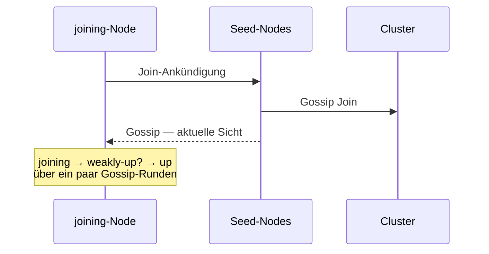
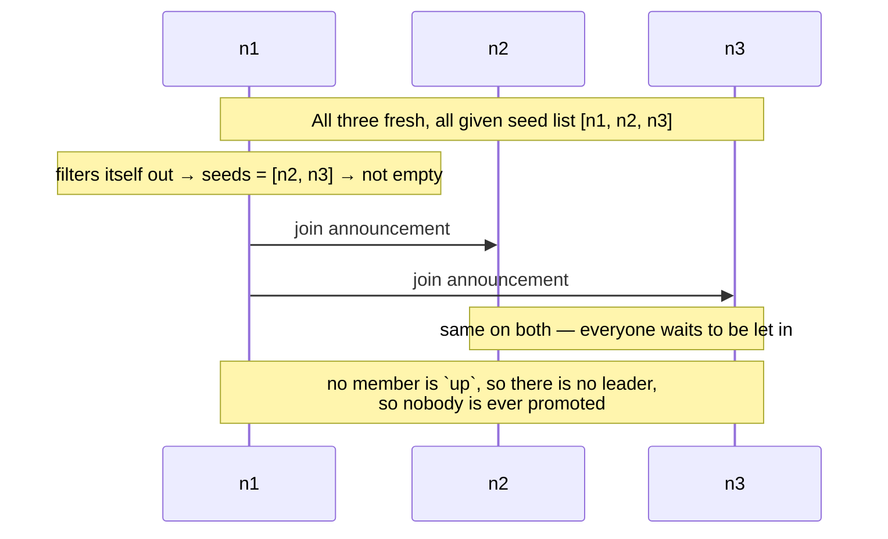

Ein Node tritt einem Cluster bei, indem er **einen Seed-Node
kontaktiert**. Der Seed sendet per Gossip seine aktuelle
Mitgliedschaftssicht zurück; der Joiner wird als `joining`
hinzugefügt, propagiert per Gossip, und sobald der Leader ihn sieht
(plus Konvergenz), wechselt er zu `up`.



Diese Seite behandelt die **Mechanik** dieses Handshakes plus die
Seed-Discovery-Ebene darüber.

## Der einfachste Fall — explizite Seeds

```ts
import { ActorSystem } from 'actor-ts';
import { Cluster, ClusterOptions } from 'actor-ts/cluster';

const system = ActorSystem.create('my-app');

const clusterOptions = ClusterOptions.create()
  .withHost('10.0.0.5')
  .withPort(2552)
  .withSeeds(['10.0.0.5:2552', '10.0.0.6:2552', '10.0.0.7:2552']);
const cluster = await Cluster.join(
  system,
  clusterOptions,
);
```

Drei Seeds. Der Joiner schickt seinen Join an alle drei, und
erneut alle `seedRetryIntervalMs`, bis er `up` ist. Sobald
irgendein Seed akzeptiert, propagiert der Gossip des Clusters das
neue Mitglied; Konvergenz zu `up` geschieht innerhalb weniger
Sekunden in einem gesunden Netzwerk.

Die Seed-Liste ist nur ein **Bootstrap-Hinweis** — sobald der Node
beigetreten ist, lernt er alle anderen Peers per Gossip kennen.
Seeds müssen nach dem Join nicht mehr besonders sein.

## Konfiguration

```ts
type ClusterOptionsType = {
  host:                       string;       // Interface zum Binden (Wildcard ok)
  advertisedHost?:            string;       // Adresse, die Peers wählen (nie Wildcard)
  port:                       number;       // Port zum Binden
  advertisedPort?:            number;       // Port, den Peers wählen (default: port)
  seeds?:                     string[];     // Peer-Adressen fürs Bootstrap
  roles?:                     string[];     // Rollen-Tags
  failureDetector?:           Partial<...>;
  transport?:                 Transport;
  gossipIntervalMs?:          number;
  seedRetryIntervalMs?:       number;       // Seeds erneut kontaktieren, bis up
  shutdownAfterUnsuccessfulJoinMs?: number; // Join aufgeben (0 = keine Frist)
  // ...
};
```

Die seed-bezogenen Knöpfe:

| Einstellung | Standard | Was |
| --- | --- | --- |
| `seeds` | `[]` | Liste von `"host:port"`-Strings. Leer = "ich bin der erste". |
| `seedRetryIntervalMs` | 3000 | Wiederhole die Seed-Liste so oft, bis dieser Node `up` ist — egal, ob ein Seed geantwortet hat, und auch über `weakly-up` hinweg. |
| `selfElection` | `'immediate'` | Wann dieser Node allein einen Cluster bilden darf: `'immediate'` (nur bei leerer Seed-Liste), `'never'`, oder eine Frist in Millisekunden. Wird vom [Cluster-Bootstrap](/de/cluster/cluster-bootstrap/) gesetzt. |
| `shutdownAfterUnsuccessfulJoinMs` | 0 | Den Join nach dieser Zeit aufgeben, falls bis dahin nichts diesen Node befördern kann: eine Warnung, Verlassen, dann die Coordinated-Shutdown-Pipeline. `0` setzt keine Frist; ein Wert kürzer als `seedRetryIntervalMs` wird abgelehnt — siehe [Wenn kein Seed je antwortet](#wenn-kein-seed-je-antwortet). |

### Dieselben zwei Einstellungen in HOCON

`seeds` und `roles` haben auch eine Config-Form, ein Deployment kann sie also
aus dem Code herausziehen:

```hocon
actor-ts.cluster {
  seed-nodes = ["billing@10.0.0.5:2552"]
  roles      = ["backend"]
}
```

Die Präzedenz ist die übliche des Frameworks, pro Feld: ein explizites
`.withSeeds(…)` gewinnt, ein nicht gesetztes fällt auf die Datei durch. Dass
eine Datei für das ganze Deployment reicht, liegt daran, dass ein Node seine
**eigene** Adresse vor dem Wählen entfernt — das Rezept unten (ein
festgelegter erster Node, der Rest zeigt auf ihn) ist damit eine einzige
Liste, die auf jedem Node richtig ist: der genannte Node liest seine eigene
Adresse, filtert sie heraus und wählt sich selbst.

Beide Schlüssel werden als Liste gelesen und nur als Liste; das naheliegende
`seed-nodes = ${?SEED_NODES}` wird beim Start abgelehnt statt an Kommata
zerlegt. Eine optionale Substitution pro Eintrag ist die Form, die
funktioniert — nicht gesetzte fallen aus dem Array heraus:

```hocon
actor-ts.cluster.seed-nodes = [ ${?SEED_1}, ${?SEED_2}, ${?SEED_3} ]
actor-ts.cluster.roles      = [ ${?NODE_ROLE} ]
```

Für eine einzelne kommaseparierte Variable nehmen Sie stattdessen
[`seedsFromEnv(…)`](/de/discovery/seed-providers/config/) im Code. Ein
fehlerhafter Eintrag — etwa ein Host ohne Port — wird von `Cluster.join`
abgelehnt, bevor der Transport bindet, und die Meldung nennt die betroffene
Zeichenkette.

## Der erste Node

```ts
const clusterOptions = ClusterOptions.create()
  .withHost('0.0.0.0')
  .withPort(2552)
  .withSeeds([]);
const cluster = await Cluster.join(
  system,
  clusterOptions,
);
```

`0.0.0.0` ist dort die *Bind*-Adresse. Was dieser Node per Gossip
verteilt, wird getrennt aufgelöst und ist nie eine Wildcard — ohne
weitere Konfiguration verteilt er `127.0.0.1`, was für einen
Single-Node-Entwicklungslauf genau richtig ist und der Grund, warum
das Paar keine Beachtung braucht, solange es keine zweite Maschine
gibt. Siehe [Cluster — Überblick](/de/cluster/overview/).

Eine leere `seeds`-Liste (oder eine, die komplett unerreichbar ist)
bedeutet, dass **dieser Node den Cluster selbst bootstrapt**. Er
befördert sich automatisch zum Leader; künftige Joiner kontaktieren
*ihn*.

Das macht die Single-Node-Entwicklung trivial — keine zu pflegende
Seed-Liste. Füge später einen zweiten Node hinzu, indem du ihm die
Adresse des ersten als Seed gibst.

**Für Produktion** bestimme einen Node mit leerer Seed-Liste und gib
den übrigen dessen Adresse — oder, besser, nutze den
[Cluster-Bootstrap](/de/cluster/cluster-bootstrap/), der einen
festgelegten ersten Node überflüssig macht.

### Den ersten Node zurückhalten

Einen Cluster aus einem Node zu bilden ist in der Entwicklung genau
richtig und in Produktion oft nicht: der Gründungsknoten ist allein
`up`, also starten Singletons auf ihm und Shards werden auf ihm
platziert, bevor es überhaupt Repliken gibt. `minimumMembersBeforeUp`
hält jeden Übergang nach `up` zurück — die Beförderungen des Leaders
*und* die Selbstwahl dieses Nodes —, bis so viele Mitglieder vorhanden
sind:

```ts
const clusterOptions = ClusterOptions.create()
  .withHost('0.0.0.0')
  .withPort(2552)
  .withSeeds([])
  .withMinimumMembersBeforeUp(3);
```

Der Gründungsknoten bleibt jetzt `joining`, bis drei Mitglieder in
seiner Mitgliederkarte stehen, wählt sich dann selbst und befördert die
beiden anderen im selben Durchlauf. Jeder Node sollte denselben Wert
tragen — er ist eine Eigenschaft des Clusters, nicht des Nodes.

Gezählt werden Mitglieder in `joining`, `weakly-up` und `up`. Ein
`leaving`-Mitglied hält die Schwelle für seinen Nachfolger nicht offen,
ein Rolling Restart schließt das Tor also für genau die Zeit, die der
Nachfolger zum Erscheinen braucht. Rückwärts wird nie ausgewertet:
einen Übergang `up` → `joining` gibt es nicht, ein später schrumpfender
Cluster behält die bereits beförderten Mitglieder und hält nur neue
zurück.

Schwellen pro Rolle sind damit UND-verknüpft — so sagst du „erst wenn
es ein Backend gibt, auf dem Arbeit platziert werden kann“:

```ts
const clusterOptions = ClusterOptions.create()
  .withHost('0.0.0.0')
  .withPort(2552)
  .withSeeds([])
  .withMinimumMembersBeforeUp(3)
  .withMinimumMembersBeforeUpPerRole({ backend: 2 });
```

Das ist **kein** Quorum und keine Sicherheitsmaßnahme: jeder Node darf
sich selbst als `up` ankündigen, die Schwelle begrenzt also Versehen —
eine abgetrennte Hälfte, die ihren eigenen Ein-Node-Cluster bildet —
und keine Angreifer. Für Split-Brain zuständig ist
[Downing](/de/cluster/downing-strategies/); eine Schwelle über `1`
vergrößert außerdem das Zeitfenster, in dem der Cluster kleiner ist,
als eine `static-quorum`-Strategie erwartet — prüfe beides zusammen.

Es ist auch nicht `bootstrap.minimum-members`, das wartet, ohne etwas
zu ändern: siehe [`awaitReady`](/de/cluster/cluster-bootstrap/). Diese
Einstellung nimmt jener weitgehend den Anlass.

## Die symmetrische Seed-Liste startet nicht kalt

Es liegt nahe, jedem Node dieselbe Liste mit allen Nodes zu geben.
Diese Konfiguration **bildet nie einen Cluster**:



`Cluster` entfernt die eigene Adresse aus der Seed-Liste, also bleibt
bei einer symmetrischen Liste **keinem** Node die leere Liste, die
`selfElection: 'immediate'` verlangt. Jeder Node bleibt für immer
`joining`; es gibt keinen Leader, und der Leader ist es, der
`joining → up` befördert.

Zwei Auswege:

- **Ein festgelegter erster Node** mit `seeds: []`, der Rest zeigt auf
  ihn. Einfach, aber dieser Node ist beim Start etwas Besonderes — was
  Container und Autoscaler unhandlich machen.
- **[Cluster-Bootstrap](/de/cluster/cluster-bootstrap/)** — jeder Node
  bekommt dieselbe Konfiguration, und das Framework wählt genau einen
  aus, der den Gleichstand bricht. Das ist die Wahl, sobald Nodes
  gleichzeitig starten.

Dieselbe Falle gilt, wenn die Liste aus einer gemeinsamen
`application.conf` kommt. Das Selbst-Ausschließen macht eine gemeinsame Datei
überhaupt erst sicher, und es hilft nur, wenn die Datei *einen* Node nennt:
`seed-nodes = ["app@n1:2552"]` überall ausgeliefert ist der erste Ausweg,
einmal geschrieben — `seed-nodes` mit allen Nodes ist dieser Deadlock, einmal
geschrieben. Der Cluster-Bootstrap ist die Antwort, sobald die Mitglieder
vorab nicht bekannt sind.

Die Retry-Schleife über `seedRetryIntervalMs` bleibt wichtig, löst aber
ein anderes Problem: einen Seed, der *irgendwann* erreichbar ist. Ein
erstes Mitglied kann sie nicht herbeizaubern.

Sie trägt aber die Diagnose. Ein Node, der nach ein paar Kontaktrunden
immer noch `joining` oder `weakly-up` ist, kein `up`-Mitglied kennt und
auf keine Selbstwahl mehr wartet, loggt eine WARN-Zeile, die seinen
Status benennt, was er sieht und was zu ändern ist — die unbeantworteten
Seed-Adressen, wenn niemand geantwortet hat, oder die Kombination aus
Seed-Liste und `selfElection` von oben, wenn alle Peers da sind und alle
warten. Sie erscheint einmal, nicht pro Runde. Eine
[Join-Frist](#wenn-kein-seed-je-antwortet) handelt, wenn gesetzt, nach
demselben Urteil.

`weakly-up` steht in diesem Satz, weil es nicht näher an `up` ist: Es
ist der eigene [`weaklyUpAfterMs`](/de/cluster/weakly-up/)-Timer des
Nodes, der ihn weiterschiebt, und kein Leader, der ihn aufnimmt. Die
Schleife hört dort also nicht auf — sie kontaktiert die Seeds weiter,
bis der Node `up` ist, und genau das lässt einen Seed, der erst nach der
Beförderung startet, den Node trotzdem finden.

Diese Zeile ist deshalb wichtig, weil das *Symptom* weit von der Ursache
entfernt auftritt: einem so blockierten Cluster fehlt jedes `up`-Mitglied,
ein [Cluster-Singleton](/de/cluster/singleton/overview/) wählt seinen Host
aus den `up`-Mitgliedern, und das Erste, was die meisten Anwendungen
bemerken, ist deshalb ein `AskTimeoutError` von einem Singleton-Proxy.

## Wenn kein Seed je antwortet

Die Retry-Schleife hat kein eigenes Ende. Ein Node, dessen Seeds nie
antworten — falsche Adressen, eine Firewall, Seeds, die nie gestartet
sind —, loggt nach drei Runden die Stall-Warnung von oben und kontaktiert
sie dann weiter, solange der Prozess lebt. Auf einem Orchestrator ist das ein Pod,
der nie beitritt und nie endet, also startet ihn auch nichts je neu.

`shutdownAfterUnsuccessfulJoinMs` gibt dem Join eine Frist:

```ts
const clusterOptions = ClusterOptions.create()
  .withHost('10.0.0.8')
  .withPort(2552)
  .withSeeds(['10.0.0.5:2552', '10.0.0.6:2552'])
  .withShutdownAfterUnsuccessfulJoinMs(60_000);
const cluster = await Cluster.join(system, clusterOptions);
```

oder für jeden Node eines Deployments auf einmal:

```hocon
actor-ts.cluster.shutdown-after-unsuccessful-join = 60s
```

Die Frist ist der Zeitpunkt der Entscheidung, nicht ihr Grund. Läuft sie
ab, stellt der Node die Frage, die die Stall-Warnung beantwortet — kann ihn
noch irgendetwas befördern? Nur wenn nichts das kann, gibt er auf: eine
WARN-Zeile mit Schlüssel, Frist und derselben Abhilfe, dann `leave()`, dann
die [Coordinated-Shutdown-Pipeline](/de/fundamentals/coordinated-shutdown/)
mit `ClusterJoinUnsuccessfulReason`. Kann ihn noch etwas befördern, fragt er
alle `seedRetryIntervalMs` erneut, bis der Node `up` ist oder sich die
Antwort ändert.

| Zur Frist | Gibt auf? |
| --- | --- |
| Kein Seed hat geantwortet, `selfElection: 'immediate'` | ja |
| `selfElection: 'never'`, kein Mitglied `up` | ja |
| Peers bekannt, keiner `up`, überall `'immediate'` — die symmetrische Liste von oben | ja |
| `weakly-up` durch den eigenen Timer, sonst unverändert | ja — `weakly-up` ist nicht beigetreten |
| `minimum-members-before-up` nicht erreicht, und niemand antwortet | ja |
| Ein Mitglied ist `up` | nein — dieser Leader befördert den Node |
| Eine aufgeschobene `selfElection` steht noch aus | nein — und feuert sie, bildet der Node einen Cluster aus einem Mitglied |
| `minimum-members-before-up` nicht erreicht, lebende Peers vorhanden | nein — der Cluster wartet auf Mitglieder, er steckt nicht fest |
| `minimum-members-before-up` nicht erreicht, die Peers, die geantwortet haben, sind seitdem gestorben | ja, sobald sie weg sind — vom Default bei `down-after` entfernt oder dort unter `failure-detector.auto-down = off` geparkt, was als weg zählt; ein Peer, der nur `unreachable` ist, vor `down-after`, zählt weiterhin als lebendig |

Ein paar Details regeln die Ränder:

- **`0`, der Default, setzt keine Frist** — was jedes Release vor dem
  Schlüssel getan hat. Ein Wert kürzer als `seedRetryIntervalMs` wird von
  `Cluster.join` abgelehnt: Der Node gäbe auf, bevor er seine Seeds ein
  zweites Mal kontaktiert hat.
- **Die Uhr startet beim Join**, nicht bei der Discovery. Unter dem
  [Cluster-Bootstrap](/de/cluster/cluster-bootstrap/) laufen die Seed-Suche
  und eine etwaige Stable Observation vorher, und der Schlüssel verbindet
  sich dort mit `awaitReady` — siehe
  [Auf Readiness warten](/de/cluster/cluster-bootstrap/#auf-readiness-warten).
- **`leave()` kommt zuerst**, also stoppt die Seed-Schleife auch mit
  `coordinated-shutdown.auto-register-tasks = off`. Worin der Lauf endet,
  entscheidet die Pipeline: Das Actor-System endet standardmäßig, und der
  Prozess beendet sich nur mit `coordinated-shutdown.exit-process = on`.
- **Auch ein Readiness-Warten richtet sich danach**: Ein `awaitReady()`, das
  noch aussteht, wenn der Join aufgibt, lehnt sofort mit einem
  `ClusterReadyTimeoutError` ab, der den Schlüssel nennt, statt seine eigene
  Frist abzuwarten.
- **Die anstehende Selbstwahl eines Gründungsknotens sehen die anderen
  nicht.** Ein Node, dessen Seeds antworten, selbst aber noch `joining`
  sind — ein Gründungsknoten, der eine eigene aufgeschobene `selfElection`
  abwartet —, sieht nichts, was ihn befördern könnte: Dieser Timer läuft
  auf dem Gründungsknoten, und nichts verbreitet ihn per Gossip. Also gibt
  er zu seiner Frist auf einem Cluster auf, der gerade entsteht, und die
  Frist muss die Wahl-Grace des Gründungsknotens überschreiten. Hinter
  Stable Observation
  [lehnt der Cluster-Bootstrap eine kürzere ab](/de/cluster/cluster-bootstrap/#verbunden-mit-der-eigenen-frist-des-joins);
  ein einfaches `Cluster.join` nicht.

## Seed-Discovery — jenseits einer statischen Liste

Eine hartcodierte Seed-Liste reicht für Tests und kleine Cluster.
Für Produktion, in der Nodes dynamische IPs haben (Container, K8s
Pods), nutze einen **Seed-Provider**:

| Provider | Wann |
| --- | --- |
| **[Config](/de/discovery/seed-providers/config/)** | Statische Liste (der Fall oben). |
| **[DNS](/de/discovery/seed-providers/dns/)** | Löst `_actor-ts._tcp.example.com` SRV-Records auf. |
| **[Kubernetes API](/de/discovery/seed-providers/kubernetes-api/)** | Listet Pods, die einem Label-Selector entsprechen. |
| **[Aggregate](/de/discovery/seed-providers/aggregate/)** | Fällt durch mehrere Provider durch (z. B. K8s, dann DNS). |

```ts
import { KubernetesApiSeedProvider, KubernetesApiSeedProviderOptions } from 'actor-ts/discovery';

const kubernetesApiSeedProviderOptions = KubernetesApiSeedProviderOptions.create()
  .withNamespace('default')
  .withServiceName('actor-ts')
  .withPort(2552);
const seedProvider = new KubernetesApiSeedProvider(
  kubernetesApiSeedProviderOptions,
);

const seeds = await seedProvider.discover();

const clusterOptions = ClusterOptions.create()
  .withHost(process.env.POD_IP!)
  .withPort(2552)
  .withSeeds(seeds);
const cluster = await Cluster.join(
  system,
  clusterOptions,
);
```

Der Provider liefert eine Momentaufnahme von Seed-Adressen; das
Framework nutzt sie, um den Join zu bootstrappen. Siehe
[Discovery-Überblick](/de/discovery/overview/) für das Seed-Provider-Modell.

## Den Join-Fortschritt beobachten

Zuerst das Ein-Aufruf-Gate — `awaitReady` löst auf, sobald dieser Node
`up` ist und, mit `minimumMembers`, sobald das Cluster seine erwartete
Größe erreicht hat; `isReady` ist die synchrone Probe:

```ts
await cluster.awaitReady({ minimumMembers: 3, timeoutMs: 30_000 });
cluster.isReady();     // probe the same predicate without waiting
cluster.selfMember();  // this node's own record — status included
```

Mit gesetztem `timeoutMs` lehnt es mit `ClusterReadyTimeoutError` ab,
statt raten zu lassen; ohne wartet es unbegrenzt. Siehe
[Cluster-Bootstrap → Auf Readiness warten](/de/cluster/cluster-bootstrap/#auf-readiness-warten)
dafür, wie `Cluster.bootstrap` dasselbe Warten standardmäßig anwendet.

Für Logik, die auf *einzelne* Übergänge reagiert, die Events
abonnieren:

```ts
import { SelfUp, MemberUp } from 'actor-ts/cluster';

cluster.subscribe((evt) => {
  if (evt instanceof SelfUp) {
    console.log(`dieser Node ist jetzt Up`);
  } else if (evt instanceof MemberUp) {
    console.log(`Peer ${evt.member.address} hat Up erreicht`);
  }
});
```

Zwei zentrale Events:

- **`SelfUp`** feuert einmal, wenn *dieser* Node auf `up` übergeht.
- **`MemberUp`** feuert jedes Mal, wenn *irgendein* Mitglied `up`
  erreicht.

`MemberUp`s von Hand zu zählen, um "sind mindestens 3 Nodes up?" zu
beantworten, ist genau das, was `awaitReady({ minimumMembers: 3 })`
ersetzt — die Subscription ist zum Reagieren auf Änderungen da, nicht
als Startup-Gate.

## Einstellungen, die übereinstimmen müssen

Ein Node, der mit einem abweichenden Wert für etwas beitritt, das der
Cluster als einheitlich voraussetzt, scheitert nicht.  Er tritt bei, er
läuft, und die Uneinigkeit zeigt sich später als Verhalten, das niemand
erklären kann.  `actor-ts.cluster.configuration-compatibility-check` sorgt
dafür, dass sie stattdessen in dem Moment ausgesprochen wird, in dem sich
die beiden Nodes begegnen.

Jeder Node veröffentlicht den **effektiven** Wert jeder Einstellung aus
`checked-paths` auf der gewöhnlichen Gossip-Bahn und vergleicht ihn mit dem,
was seine Peers zurückveröffentlichen.  *Effektiv*, nicht konfiguriert: die
Präzedenz ist **explizite Optionen > HOCON > eingebaute Defaults**, deshalb
sind zwei Nodes mit identischen Config-Dateien und unterschiedlichen Buildern
trotzdem ungleich — und genau das ist der Fall, auf den es ankommt, denn der
Builder ist der dokumentierte Weg, die meisten dieser Werte zu setzen.

```ts
const clusterOptions = ClusterOptions.create()
  .withHost('n1')
  .withPort(2552)
  .withConfigurationCompatibilityCheckedPaths([
    'actor-ts.remote.max-frame-bytes',
    'actor-ts.cluster.failure-detector.heartbeat-interval',
  ]);
```

Verglichen werden kann nur, was auch jemand veröffentlicht; das Framework
veröffentlicht drei Einstellungen:

| Einstellung | Warum eine Abweichung zählt | Standardmäßig in `checked-paths` |
| --- | --- | --- |
| `actor-ts.remote.max-frame-bytes` | Ein Frame über der niedrigeren Grenze des Peers reißt die ganze Assoziation ab, und der Sender erfährt nie, warum.  Es gibt keine Protokollverhandlung, die das abfängt. | ja |
| `actor-ts.cluster.failure-detector.heartbeat-interval` | Ein Peer, der langsamer schlägt, als das `down-after` dieses Nodes toleriert, wird als `down` beurteilt, weil er anders konfiguriert ist — nicht, weil er tot ist — und von dem entfernt, was nach diesem Urteil handelt: einer Downing-Strategie oder dem Detektor selbst unter `failure-detector.auto-down = on`.  Ohne beides wird er auf `unreachable` geparkt. | nein |
| `actor-ts.cluster.tombstone.time-to-live` | Eine Seite räumt einen Tombstone weg, den die andere noch durchsetzt, also wird eine entfernte Adresse nur auf einer Seite wieder zugelassen. | nein |

Die letzten beiden sind standardmäßig aus, weil das schrittweise Ausrollen
eines neuen Werts ein gewöhnlicher Vorgang ist und beide Abweichungen von
selbst heilen.  Für die erste gibt es nirgendwo sonst eine Erkennung — das
ist die Messlatte dafür, voreingestellt zu sein.

Veröffentliche eine eigene von überall dort, wo der aufgelöste Wert vorliegt:

```ts
cluster.publishConfigurationFact('acme.orders.partition-count', String(partitions));
```

Sie reist nur, wenn `checked-paths` den Namen führt — diese Liste ist eine
Erlaubnisliste dessen, was den Node *verlässt*, und genau deshalb gibt es
keine zweite Liste von Pfaden zum Schwärzen.  Ein Name außerhalb des
Zeichensatzes eines HOCON-Pfads (Kleinbuchstaben, Punkte und Bindestriche)
wird bei der Validierung der Optionen abgelehnt, statt veröffentlicht und
von jedem Peer stillschweigend verworfen zu werden.

**Jeder Zeitpunkt im Leben eines Nodes ist ein gültiger Moment für diesen
Aufruf**, und darum gibt es ihn überhaupt: die drei Einstellungen oben sind
aufgelöst, bevor der erste Gossip-Frame läuft — eine Partitionsanzahl, die
aus einer Migration oder von einem Broker zurückkommt, ist es nicht.  Eine
Tatsache, die veröffentlicht wird, nachdem sich der Record jedes Peers
gesetzt hat, erreicht trotzdem den Vergleich jedes Peers: das eigene Gossip
jedes Nodes trägt seine aktuellen Tatsachen, und ein Peer ersetzt das, was er
für ein Mitglied hält, wenn **dieses Mitglied selbst** es neu ausspricht.
Eine von einem dritten Node weitergereichte Kopie füllt eine Lücke, aber
überschreibt nie — eine veraltete Kopie, die die Runde macht, kann den
Vergleich also nicht flattern lassen.  Denselben Wert erneut zu
veröffentlichen ändert nichts und kostet nichts.

Sind sich zwei Nodes uneinig, loggt jeder eine Zeile, die die Einstellung und
**beide** Werte nennt, und veröffentlicht ein `MemberConfigurationMismatch`
mit demselben Inhalt.  Einmal pro Einstellung pro Peer, nicht einmal pro
Gossip-Runde.  Abwesenheit auf einer der beiden Seiten ist Schweigen: ein
Peer mit älterer Version, oder einer, dessen `checked-paths` diese
Einstellung nicht führt, meldet nichts — statt während eines Rolling
Upgrades alles zu melden.

`enforce = on` fügt genau eine Sache hinzu: der abweichende Peer ist kein
Platzierungskandidat dieses Nodes mehr, ein
[Cluster-Router](/de/cluster/cluster-router/#kandidaten-nicht-einfach-up-mitglieder)
routet also nicht mehr zu ihm.  Es downed oder quarantäniert niemanden, und
nichts, das eine
Rolle *wählt*, liest diese Menge: eine falsch konfigurierte Mehrheit würde
sonst die korrekt konfigurierte Minderheit verdrängen, und eine asymmetrische
Kandidatensicht würde zwei Singleton-Hosts wählen statt einem.  Standardmäßig
aus, denn ein durchsetzender Default macht aus jedem Rolling Deploy, der
einen geprüften Wert ändert, einen selbstverschuldeten Ausfall.

`actor-ts.sharding.number-of-shards` ist bewusst **keine** der
veröffentlichten Einstellungen.  Eine Region, deren Shard-Anzahl von der des
Koordinators abweicht, wird bereits rundheraus abgelehnt — mit einem Error,
der den Key nennt, und einem `ShardRegionRegistrationRefused`-Event, siehe
[Sharding-Introspektion](/de/cluster/sharding/introspection/).

## Was schiefgehen kann

import { Aside } from '@astrojs/starlight/components';

<Aside type="caution" title="Seeds unerreichbar, sich selbst nicht in der Liste">
  ```ts
  // ✗ dieser Node ist kein Seed, kein anderer Seed antwortet
  const clusterOptions = ClusterOptions.create()
    .withHost('n4')
    .withPort(2552)
    .withSeeds(['n1:2552', 'n2:2552', 'n3:2552']);
  Cluster.join(system, clusterOptions);
  ```
  Der Node tritt nie bei, und er sagt es: Nach drei
  Seed-Kontaktrunden loggt er eine WARN-Zeile —
  `no seed has answered at all`, mit den kontaktierten Adressen — und
  kontaktiert sie dann weiter. Von selbst hört er nicht auf. Gib dem Join mit
  `actor-ts.cluster.shutdown-after-unsuccessful-join` eine Frist,
  und sobald ihn nichts mehr befördern kann, warnt er, verlässt den
  Cluster und führt die Coordinated-Shutdown-Pipeline aus; `'never'`
  gibt genauso auf, während eine aufgeschobene `selfElection` zu
  ihrer Frist stattdessen einen Cluster aus einem Mitglied bildet —
  siehe [Wenn kein Seed je antwortet](#wenn-kein-seed-je-antwortet).
  `n4` in die eigene Seed-Liste aufzunehmen ändert nichts, weil ein
  Node seine eigene Adresse entfernt, und jeden Node aufzulisten ist
  der [symmetrische Deadlock](#die-symmetrische-seed-liste-startet-nicht-kalt).
  Der [Cluster-Bootstrap](/de/cluster/cluster-bootstrap/) gibt von
  selbst auf, sobald sein `awaitReady`-Budget abgelaufen ist.
</Aside>

<Aside type="caution" title="Zwei Cluster bilden sich mit demselben Namen">
  ```ts
  // Netzwerkpartition direkt beim Start:
  // - n1, n2 erreichen sich → bilden Cluster
  // - n3 kann sie nicht erreichen → bootstrapt eigenen Cluster
  // - Partition heilt → zwei Cluster mit demselben Namen existieren
  ```
  Sobald die Partition geheilt ist, *merged* das Gossip-Protokoll
  die beiden Cluster nicht automatisch — sie sind unabhängig.
  Mildere das mit einer Downing-Strategie
  ([Downing-Strategien](/de/cluster/downing-strategies/)) und mit dem
  [Cluster-Bootstrap](/de/cluster/cluster-bootstrap/), der genau einen
  Node berechtigt, einen Cluster zu bilden, und gar nicht erst
  entscheidet, solange Discovery ihre Meinung ändert.
</Aside>

<Aside type="caution" title="Schwelle größer als das Deployment">
  ```ts
  // Drei Repliken konfiguriert, vier gefordert:
  const clusterOptions = ClusterOptions.create()
    .withHost('n1')
    .withPort(2552)
    .withSeeds([])
    .withMinimumMembersBeforeUp(4);
  ```
  Nichts erreicht je `up`, und das Symptom ist ein Cluster, der
  einfach nie hochkommt — dieselbe Form wie eine unerreichbare
  Seed-Liste. Der Node unterscheidet beides für dich: Ist er nach ein
  paar Seed-Kontaktrunden mit vorhandenen Peers noch `joining` oder
  `weakly-up`, loggt er einmalig Schlüssel und aktuelle Zahl
  (`2 of 4 member(s) present`) statt der Cold-Start-Stall-Diagnose,
  die hier ein falsches Urteil wäre — und eine Join-Frist gibt ihn
  ebenso wenig auf, weil die fehlenden Mitglieder noch kommen können.
  Antwortet überhaupt niemand, ist nicht die Schwelle das Problem:
  Dieser Node bekommt die Stall-Diagnose mit seinen unbeantworteten
  Seeds. Ein Gründungsknoten ohne Seed-Liste loggt das Warten als
  `holding self-election`.
</Aside>

<Aside type="caution" title="Hostname-vs-IP-Mismatch">
  ```ts
  // Joiner sieht Seed als `pod-abc-123.cluster.local`
  // Seed sieht sich selbst als `10.244.1.5`
  // → Gossips Adressvergleich behandelt sie als verschiedene Mitglieder
  ```
  Die Mitglieder-Identität nutzt die **Adresse, die der Node beim
  Join angegeben hat**. Wenn verschiedene Peers verschiedene
  Adressen für denselben Node sehen (typisch in K8s mit
  Hostnames), bildet sich der Cluster zwar, aber jeder Node sieht
  den Peer als Fremden. Verwende den K8s-Seed-Provider, der
  konsistent auf Pod-IPs auflöst, oder setze `host` auf die IP
  statt auf den Hostnamen.
</Aside>

## Wohin als Nächstes

- **[Cluster-Überblick](/de/cluster/overview/)** — das größere
  Bild.
- **[Cluster-Bootstrap](/de/cluster/cluster-bootstrap/)** — Stable
  Observation und Initial-Seed-Wahl für gleichzeitige Starts.
- **[Weakly-up](/de/cluster/weakly-up/)** — Gradual-Join-Semantik
  für langsame Konvergenz.
- **[Failure Detector](/de/cluster/failure-detector/)** — wie
  Heartbeats die Mitgliedschaftssicht nach dem Join frisch halten.
- **[Discovery-Überblick](/de/discovery/overview/)** — Seed-Provider
  für dynamische Umgebungen.
- **[Downing-Strategien](/de/cluster/downing-strategies/)** —
  Split-Brain-Auflösung nach der Cluster-Bildung.
