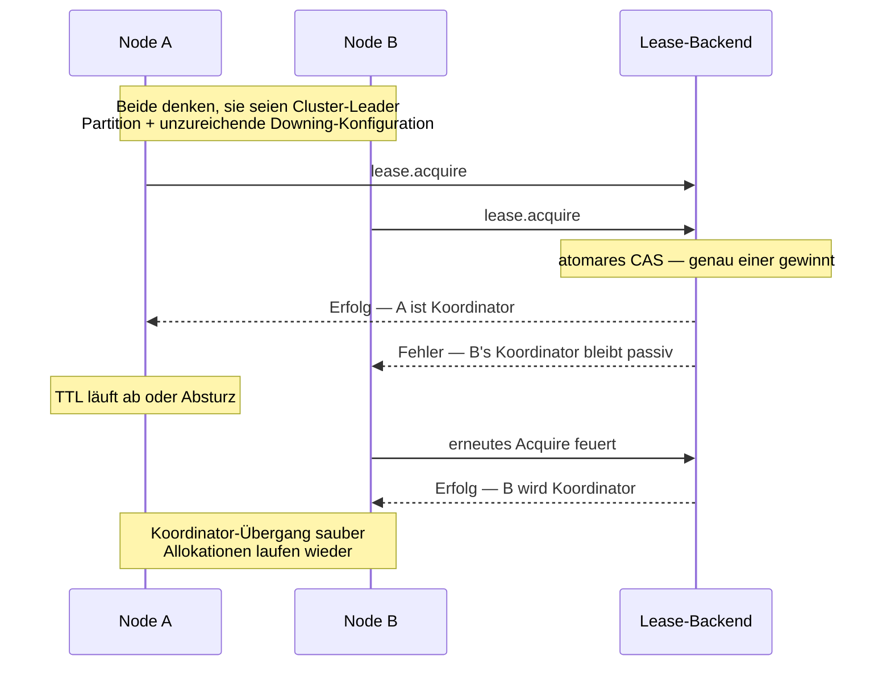

Der Sharding-Koordinator läuft als Cluster-Singleton — nur der
Koordinator des Leaders ist aktiv. Mit einer
[Downing-Strategie](/de/cluster/downing-strategies/) + gesundem
Netzwerk reicht das.

Während einer Netzwerkpartition + fehlerhafter Downing-Konfiguration
könnten **beide Hälften kurz denken, sie seien Leader** → zwei
Koordinatoren → widersprüchliche Shard-Allokationen → Entities
möglicherweise auf beiden Seiten gespawnt.

Die **Single-Writer-Lease** verhindert das:

```ts
import { ClusterSharding, StartShardingOptions } from 'actor-ts/cluster';
import { KubernetesLease, KubernetesLeaseOptions } from 'actor-ts/coordination';

const kubernetesLeaseOptions = KubernetesLeaseOptions.create()
  .withName('order-sharding-coordinator')
  .withOwner(process.env.POD_NAME!)
  .withTtlMs(30_000)
  .withNamespace(process.env.K8S_NAMESPACE!);
const startShardingOptions = StartShardingOptions.create<Command>()
  .withTypeName('order')
  .withEntityActor(OrderEntity)
  .withExtractEntityId((message) => message.id)
  .withLease(new KubernetesLease(
    kubernetesLeaseOptions,
  ));
const sharding = cluster.sharding.start(
  startShardingOptions,
);
```

Selbst wenn zwei Nodes beide denken, sie seien Leader, **hält nur
einer die Lease**. Nur der Koordinator des Lease-Halters
verarbeitet Shard-Allokationen.

## Wie es funktioniert



Das Lease-Backend (K8s-API-Server, etcd) liefert die **atomare
Exactly-One-Holder-Garantie** — die Quelle der Wahrheit jenseits
von Gossip.

## Konfiguration

Die Lease-Felder, neben den Basis-Sharding-Settings:

```ts
type StartShardingOptionsType<TMessage> = {
  lease?:                   Lease;
  useLease?:                boolean;
  acquireRetryIntervalMs?:  number;
};
```

| Feld | Zweck |
| --- | --- |
| `lease` | Die `Lease`-Instanz — typisch `KubernetesLease`.  Gewinnt gegen `useLease`. |
| `useLease` | Baut die Lease des Koordinators stattdessen aus `actor-ts.coordination.lease`.  Default `false`; auch node-weit setzbar als `actor-ts.sharding.use-lease`. |
| `acquireRetryIntervalMs` | Retry-Takt nach fehlgeschlagenem Acquire, Default 5000 ms.  Auch node-weit setzbar als `actor-ts.sharding.acquire-retry-interval`. |

### Aus der Config-Datei

```hocon
actor-ts.coordination.lease {
  backend = kubernetes
  ttl     = 30s
}
actor-ts.sharding {
  use-lease              = on
  acquire-retry-interval = 2s
}
```

`use-lease = on` gibt jedem geshardeten Typ, den dieser Node startet, ein
Koordinator-Lease, das das Framework aus dem Coordination-Block baut — benannt
`<system>-sharding-<type>` und im Besitz dieses Nodes, seiner Cluster-Adresse
und Inkarnation —, die Datei wählt also das Backend und nichts an der
Identität.  Name und Owner sind genau die Werte, die eine von allen Nodes
geteilte Datei nicht tragen kann: Ein Name für den Block würde jeden Typ auf
einen Record legen, und ein Owner auf jedem Node ließe jeden glauben, er halte
das Lease.  Mit `backend = none` wird der Schalter beim Start des Typs
abgelehnt, statt Split-Brain-Schutz zu behaupten, den es nicht gibt.  Ein
`withLease(…)` im Code gewinnt weiterhin, und `withUseLease(false)` nimmt
einen einzelnen Typ aus.  Siehe
[Leases, die das Framework baut](/de/reference/configuration/#leases-die-das-framework-baut).

Das Retry-Intervall lohnt sich zu tunen, weil es die Erholungslatenz einer
heilenden Partition *ist*: Solange kein Acquire gelingt, gibt der Koordinator
kein `AllocateShard` heraus, und alles, was für den Typ geroutet wird, wartet
derweil in den Puffern der Regionen.

Dieselbe `Lease`-Abstraktion wie bei
[Singleton mit Lease](/de/cluster/singleton/with-lease/) —
siehe [Coordination](/de/coordination/overview/) für die
Schnittstelle.

## Was geschützt wird

Die Lease gated **Schreibvorgänge auf den Koordinator-State**:

- **Shard-Allokationen** — Shards an Regionen zuweisen.
- **Rebalance-Entscheidungen** — Shards zwischen Regionen
  bewegen.
- **Handoff-Koordination** — Shard-Handoffs orchestrieren.

Die Lease **gated nicht**:

- Per-Region-Entity-Hosting (Regionen hängen an tatsächlichen
  Cluster-Mitgliedern, nicht am Koordinator).
- Entity-Messaging (Nachrichten routen über die letzte bekannte
  Allokation des Koordinators; die Lease ist nicht im
  Nachrichten-Pfad).

Im schlimmsten Fall sind während einer Partition also **leicht
veraltete Shard-Zuweisungen** möglich — Entities laufen weiter,
nur keine neuen Allokationen, bis Lease-Besitz sich stabilisiert.

## Wann aktivieren

Drei gute Anwendungen:

1. **Produktions-Multi-Region-Cluster**, in denen Partitionen
   plausibel sind.
2. **Finanz-/Inventar-Entities**, bei denen Doppelallokation
   echten Schaden anrichten würde.
3. **Compliance**, die "keine Möglichkeit eines Split-Brain in
   irgendeinem Single-Tenant-Produktionssystem" verlangt.

Für **typische Single-Region-K8s-Deployments** mit einer
[Downing-Strategie](/de/cluster/downing-strategies/) ist die Lease
**paranoid-sicher** — fügt operative Komplexität für Schutz gegen
seltene Edge Cases hinzu.

## Operative Überlegungen

### Verfügbarkeit des Lease-Backends

```
K8s-API-Server-Ausfall → kein Replica kann acquiren → keine Shard-Allokationen
```

Das Lease-Backend wird zum SPOF. Für die meisten Setups ist die
K8s-API-Verfügbarkeit viel höher als die des Clusters selbst —
aber plane den seltenen Fall ein.

### Failover-Latenz

```
Alter Koordinator verliert die Lease (TTL-Ablauf: 30s)
  → neuer Koordinator acquired (typisch sub-Sekunde nach TTL)
  → neuer Koordinator baut State aus Gossip + Journal wieder auf
```

Das Failover-Fenster ist das **Lease-TTL** — typisch ~30 s.
Während dieses Fensters:

- **Keine neuen Shard-Allokationen** finden statt.
- **Existierende Entities laufen weiter** und empfangen
  Nachrichten.
- **Neue Entity-IDs**, die Allokation brauchen, stauen sich; nach
  Failover verarbeitet.

Für die meisten Workloads akzeptabel.

### Kombination mit regulärem Downing

```ts
{
  downingProvider: new KeepMajority(),
  // + die Sharding-Lease
  lease: ...,
}
```

Beide Schichten aktiv. Downing handhabt normale
Cluster-Konvergenz; die Lease garantiert die
Koordinator-Einzigartigkeits-Invariante.

## Das Schutzniveau lesen

| Setup | Koordinator-Einzigartigkeitsgarantie |
| --- | --- |
| Kein Downing, keine Lease | Best-Effort. Partitionen verursachen doppelte Koordinatoren. |
| Nur Downing-Strategie | Stark in stabilen Netzwerken. |
| Downing + Lease | Paranoid-sicher. Beide Invarianten erzwungen. |

Für Singleton- + Sharding-Produktion-Setups in
kritisch-datenrelevanten Szenarien ist **beides** das empfohlene
Muster.

import { Aside } from '@astrojs/starlight/components';

<Aside type="caution" title="Verfügbarkeit des Lease-Backends">
  ```
  Lease-Backend unten → kein Koordinator → keine neuen Shards
  ```
  K8s-API-Ausfälle stauen neue Allokationen. Existierende
  Entities laufen weiter, aber neue werden in Warteschlange
  gestellt. Plane für K8s-API-Zuverlässigkeit.
</Aside>

<Aside type="caution" title="Lease ohne Downing">
  ```ts
  // Nur die Lease, keine Downing-Strategie
  ```
  Die Lease schützt die Einzigartigkeit des Koordinators, **löst
  aber keine Partitionen auf**. Beide Seiten laufen für immer mit
  ihrem Vor-Partitions-State weiter. Kombiniere mit Downing.
</Aside>

## Wohin als Nächstes

- **[Sharding-Überblick](/de/cluster/sharding/overview/)** —
  das Fundament.
- **[Singleton mit Lease](/de/cluster/singleton/with-lease/)** —
  dasselbe Muster für Singletons.
- **[Coordination-Überblick](/de/coordination/overview/)** —
  die Lease-Abstraktion.
- **[KubernetesLease](/de/coordination/kubernetes-lease/)** —
  das Produktions-Backend.
- **[Downing-Strategien](/de/cluster/downing-strategies/)** —
  der ergänzende Partitions-Auflöser.
