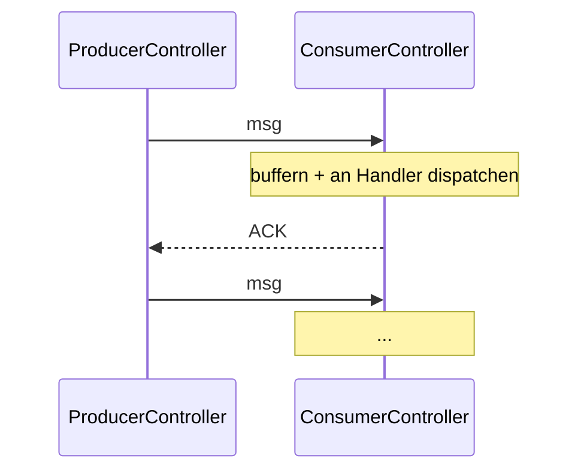

Standardmäßig ist `tell` **Fire-and-Forget**.  Nachrichten können
verloren gehen (gestoppter Empfänger, Mailbox-Overflow,
Netzwerk-Drops in Cluster-Setups).  Für Workloads, in denen
Verluste inakzeptabel sind, liefert das Framework **zuverlässige
Zustellung** über das Paar
**`ProducerController` / `ConsumerController`**.



Ergänzt **Sequence Numbers** + **ACKs** zum einfachen
`tell`-Vertrag.  Der Producer hält unbestätigte Nachrichten;
der Consumer dedupliziert per Sequence Number.

## Wann du dazu greifst

Für Workloads, in denen:

- **Verlust inakzeptabel ist** — Zahlungsinstruktionen,
  Audit-Records, Billing-Events.
- **Duplikate tolerierbar, aber selten sind** — at-least-once mit
  Consumer-seitiger Dedup reicht.
- **Reihenfolge innerhalb eines Streams zählt** — Sequence
  Numbers bewahren sie.

Für Workloads, in denen Verlust akzeptabel ist (Telemetrie,
Metriken, Fire-and-Forget UX Updates), nimm einfaches `tell`.

## at-least-once vs. effectively-once

Die zuverlässige Zustellung des Frameworks ist standardmäßig
**at-least-once** — eine Nachricht kann den Handler mehr als
einmal erreichen, etwa wenn der Consumer neu startet, nachdem er
sie behandelt hat, aber bevor der Producer sein ACK hat: der
Producer retransmittiert, und der neu gestartete Consumer hat
keinen Dedup-State mehr, an dem er sie wiedererkennen könnte.

Für **effectively-once** dedupliziert der Controller eingehende
Duplikate bereits pro `(producerId, Producer-Inkarnation, seq)` — aber nur
innerhalb seiner In-Memory-Lebensdauer und nur innerhalb einer Inkarnation des
Producers.  Wenn Du Dedup brauchst, das den Neustart einer der beiden Seiten
überlebt, persistiere Deine eigene processed-Seq zusammen mit dem
Business-State im Handler:

```ts
new ConsumerController<DeliveryMessage>({
  handler: async (body) => {
    if (await alreadyProcessed(body.id)) return;   // dein Idempotenz-Check
    await this.handle(body);
    await markProcessed(body.id);
  },
});
```

Der In-Memory-Dedup des Controllers fängt den häufigen
Retransmit-vor-ACK-Fall ab; das persistente Dedup Deines Handlers
fängt Consumer-Crashes mitten in der Verarbeitung ab.  Zusammen
ergeben sie **effectively-once** im durable-Sinn.

## Die zwei Controller

| Controller | Rolle |
| --- | --- |
| **[ProducerController](/de/delivery/producer-controller/)** | Umwickelt die Sender-Seite — vergibt Sequence Numbers, hält unbestätigte Nachrichten, retransmittiert. |
| **[ConsumerController](/de/delivery/consumer-controller/)** | Umwickelt die Empfänger-Seite — ordnet Nachrichten nach Seq, dedupliziert, sendet ACKs. |

Paare sie über einen **Producer-Consumer-Link** — jeder
Producer spricht mit genau einem Consumer, und ein Stream
erstreckt sich nie über zwei Consumer.  Um N Consumer zu
versorgen, betreibe N Producer; *Mehrere Consumer* auf der Seite
[ProducerController](/de/delivery/producer-controller/) zeigt
wie, und warum ein Router, der einen Stream aufteilt, stehen
bleibt.

## Ein minimales Beispiel

```ts
import { ProducerControllerOptions, ReliableDelivery } from 'actor-ts/delivery';

// Consumer side — handler function, auto-ack on resolve:
const consumer = ReliableDelivery.consumer<OrderEvent>(system, {
  handler: async (order) => {
    await processOrder(order);
  },
});

// Producer side — wraps outgoing messages in seq + ack tracking:
const producerControllerOptions = ProducerControllerOptions.create<OrderEvent>()
  .withProducerId('order-producer-1')
  .withConsumer(consumer.ref)
  .withWindowSize(16);
const producer = ReliableDelivery.producer<OrderEvent>(system, producerControllerOptions);

producer.tell({ orderId: 'o-1', amount: 100 });
```

Das Framework übernimmt Seq-Vergabe, Retransmission und Dedup —
Dein Code macht nur die Business-Logik im Handler.

`ReliableDelivery` spawnt beide Controller und legt
[`actor-ts.reliable-delivery`](/de/reference/configuration/#actor-tsreliable-delivery)
unter die Optionen, die Du übergibst — deshalb ist es der Weg, zu dem Du
greifst.  Einen `ProducerController` / `ConsumerController` selbst zu
konstruieren und an `system.spawn` zu übergeben, ist nur dann richtig, wenn das
Paar über Cluster-Knoten hinweg reichen muss — die Controller der Fassade leben
unter `/system`, und das kann ein anderer Knoten nicht adressieren —, und dort
übergibst Du jede Stellschraube explizit, weil dieser Weg keine Konfiguration
liest (siehe *Cluster-aware* auf der Seite
[ProducerController](/de/delivery/producer-controller/)).

## Semantik der Sequence Numbers

```
Jeder Producer vergibt strikt aufsteigende Seq-Nummern, beginnend bei 1:
  msg 1, msg 2, msg 3, ...

Der Consumer sieht sie IN ORDER (nachdem Retransmissions sich aufgelöst haben):
  msg 1, msg 2, msg 3, ...

Duplikate (durch Retransmit) erscheinen mit DERSELBEN Seq:
  msg 1, msg 1 (dup), msg 2, ...
  → Consumer dedupliziert per Seq
```

Die Seq ist **pro Producer** — mehrere Producer haben
unabhängige Seq-Räume.

## Mit Persistenz kombinieren

Für Durability über Producer- und Consumer-Crashes hinweg
persistieren beide Seiten, und beide Hälften sind Code, den Du
schreibst — das Framework hat noch keine durable Producer-Queue
([#460](https://github.com/pathosDev/actor-ts/issues/460)):

- **Producer-Seite** — persistiere jeden Body, bevor Du ihn dem
  Producer übergibst, markiere ihn als erledigt, sobald sein
  `confirm` mit `null` feuert, und sende beim Recovery erneut,
  was nicht als erledigt markiert ist.  Der Producer beginnt
  wieder bei Seq 1 unter einer neuen Inkarnation, also kommen
  diese Bodies als neue Nachrichten an, nicht als Retransmits.
- **Consumer-Seite** — persistiere im Handler die Id jedes
  verarbeiteten Bodies zusammen mit dem Business-State, und
  überspringe einen Body, dessen Id schon dort steht.

Zusammen ergeben sie **End-to-End effectively-once**: ein
Producer, der mitten im Send crasht, verliert nichts, was er
nicht bestätigt hatte, und ein Consumer, der mitten in der
Verarbeitung crasht, überspringt, was er schon erledigt hatte —
ob es als Retransmit zurückkommt oder als erneuter Send.  Die Id
muss im Body reisen: ein erneut gesendeter Body bekommt eine
neue Sequence Number, an der Sequence Number lässt er sich also
nicht wiedererkennen.

Ohne Persistenz setzt die Recovery auf beiden Seiten auf null
zurück — der Producer vergisst unbestätigte Sends und der
In-Memory-Dedup des Consumers ist weg.

## Vergleich mit Broker-basierter Zustellung

```
Producer-/ConsumerController:  cluster-interne zuverlässige Zustellung
Kafka / RabbitMQ / NATS:       externe Broker-vermittelte Zustellung
```

Beide erreichen at-least-once + Dedup-via-Seq.  Unterschiede:

| Aspekt | In-Cluster-Controller | Externer Broker |
| --- | --- | --- |
| Operative Komplexität | Niedrig — Teil des Clusters | Hoch — separater Broker zu betreiben |
| Latenz | Sub-Millisekunde | Netzwerk- + Broker-Overhead |
| Durchsatz | Begrenzt durch Single-Actor-Verarbeitung | Höher (Broker skaliert unabhängig) |
| Externe Consumer | Nein (cluster-intern) | Ja |
| Persistenz | Über PersistentActor | In den Broker eingebaut |

Für **cluster-interne** zuverlässige Zustellung nimm die
Controller.  Für **externe Systeme oder Cross-Cluster** einen
Broker (Kafka etc.).

## Wohin als Nächstes

- **[Producer Controller](/de/delivery/producer-controller/)** —
  Sender-seitige Details.
- **[Consumer Controller](/de/delivery/consumer-controller/)** —
  Empfänger-seitige Details.
- **[ACK-Semantik](/de/delivery/ack-semantics/)** — was
  ACKs bedeuten und wann sie feuern.
- **[PersistentActor](/de/persistence/persistent-actor/)** —
  Paarung mit Persistenz für volle Durability.
