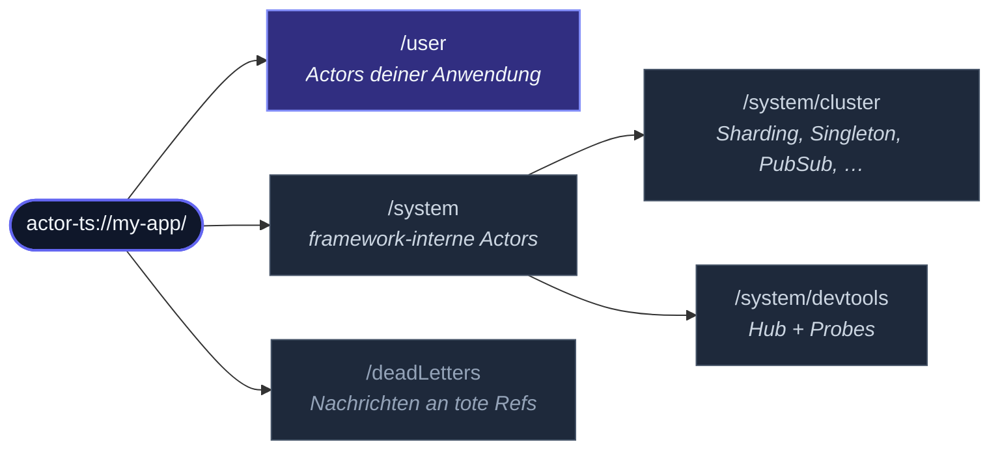

Das `ActorSystem` ist der **Top-Level-Container** für Actors.  Eines
pro logischer Anwendung — manchmal eines pro Prozess, manchmal ein
paar, die nebeneinander laufen (z.B. ein Worker-Thread-Isolations-Setup).
Jeder Actor lebt innerhalb eines Systems; das System besitzt den
Dispatcher (der die Nachrichtenverarbeitung plant), den Scheduler (der
Timer ausführt), den Supervisionsbaum (der Actor-Fehler abfängt), den
Event-Stream und alle Extensions, die du registriert hast.

## Eines erstellen

```ts
import { ActorSystem } from 'actor-ts';

const system = ActorSystem.create('my-app');
```

Der String ist der **Name** des Systems — er erscheint in
Actor-Pfaden (`actor-ts://my-app/user/...`), Log-Zeilen und der
Cluster-Identifikation.  Verschiedene Systeme können mit
verschiedenen Namen koexistieren; derselbe Name in einem Cluster-Setup
bedeutet "ich trete dem bestehenden Cluster bei", ein anderer Name
bedeutet "ich bin ein separater Cluster".

`create` kehrt synchron zurück.  Die Root-Guardians des Systems werden
eifrig erzeugt; User-Actors existieren noch nicht — du spawnst sie
über `spawn` (unten beschrieben).

## Hochfahren

Manche Arbeit gehört zwischen `create` und die erste Anfrage: das
Journal öffnen, eine Migration ausführen, prüfen, ob ein Dienst
antwortet, von dem das System abhängt.  Diese Arbeit führt das System
selbst aus, als **Startup-Graph** — Tasks, die du
`ActorSystemOptions.withCoordinatedStartup` übergibst und die in Phasen
als letzter Schritt von `create` laufen.  Nichts in `main` muss ihn
starten.

```ts
import {
  ActorSystem,
  ActorSystemOptions,
  CoordinatedStartupOptions,
  StartupPhases,
} from 'actor-ts';

const startupOptions = CoordinatedStartupOptions.create().withTasks([
  {
    phase: StartupPhases.BeforeSystemReady,
    name: 'check-inventory-service',
    task: async (signal) => {
      const response = await fetch('https://inventory.internal/health', { signal });
      if (!response.ok) throw new Error(`inventory answered ${response.status}`);
    },
  },
]);
const actorSystemOptions = ActorSystemOptions.create().withCoordinatedStartup(startupOptions);
const system = ActorSystem.create('orders', actorSystemOptions);

await system.whenReady();
```

Zwei Phasen sind vorgegeben und laufen in dieser Reihenfolge:
`persistence-start`, um zu öffnen, was die Persistenz braucht, dann
`before-system-ready` für alles Übrige.  Die Tasks einer Phase laufen
gleichzeitig, und eine Phase beginnt, sobald die vorige fertig ist.
Jede Phase hat ein Budget — 30 Sekunden, sofern
`withDefaultPhaseTimeoutMs` nichts anderes sagt —, und jeder Task
bekommt ein `AbortSignal`, das abbricht, wenn das Budget aufgebraucht
ist oder das System terminiert wird, bevor der Start fertig ist; reich
es also an alles weiter, worauf der Task wartet.  `withPhases` gibt
einer vorgegebenen Phase ein anderes Budget oder deklariert eine
eigene Phase, die nennen muss, nach welcher Phase sie läuft.

Das Framework legt eigene Arbeit in `persistence-start`: Ein System,
das Persistenz verdrahtet, öffnet dort sein ausgewähltes Journal,
seinen Snapshot-Store und seinen Durable-State-Store, also lässt ein
Store, der sich nicht öffnen lässt, den Start scheitern wie jeder
Task — siehe [Stores beim Start
öffnen](/de/persistence/overview/#stores-beim-start-öffnen).

`system.whenReady()` resolved, sobald die letzte Phase gelaufen ist.
Es ist bei jedem Aufruf dasselbe Promise und für ein System ohne
Startup-Tasks sofort resolved.  Warten musst du darauf aber nicht:
Solange der Graph läuft, hält der
[Readiness-Check](/de/observability/management/health-checks/)
`startup` den Endpunkt `/ready` auf false, sodass ein Load Balancer
einem Knoten, der noch hochfährt, keinen Traffic schickt.

**Ein fehlgeschlagener Start fährt das System herunter.**  Ein Task,
der wirft, rejected oder das Budget seiner Phase überschreitet, stoppt
den Lauf: `whenReady()` rejected mit einem Fehler, der Phase und Task
nennt, die späteren Phasen laufen nicht, das System schreibt eine
ERROR-Zeile und führt die Pipeline des [Coordinated
Shutdown](/de/fundamentals/coordinated-shutdown/) mit einem
`StartupFailedReason` aus, und `runUntilTerminated()` rejected danach
mit demselben Fehler — eine `main`, die darauf wartet, endet also von
selbst mit einem Status ungleich null, und der Orchestrator startet
einen neuen Prozess.  Ein `terminate()`, während der Start noch läuft,
bricht ihn dagegen ab: die Signale der laufenden Tasks brechen ab und
`whenReady()` rejected, aber nichts ist fehlgeschlagen, also läuft kein
eigener Shutdown.

Der Graph ist versiegelt, sobald `create` zurückkehrt.
`system.extension(CoordinatedStartupId).addTask(...)` wirft danach und
nennt `withCoordinatedStartup` — ein so später Task könnte seine Phase
schon vorbei finden.

## Konfiguration

`ActorSystem.create` nimmt ein optionales Settings-Objekt als zweites
Argument:

```ts
const actorSystemOptions = ActorSystemOptions.create()
  .withLogLevel(LogLevel.Info)
  .withConfigFile('./application.conf');
const system = ActorSystem.create('my-app', actorSystemOptions);
```

Die vollständige Settings-Form:

| Feld | Zweck |
| --- | --- |
| `logger` | Eigene `Logger`-Instanz.  Standardmäßig ein Console-Logger, der `logLevel` respektiert. |
| `otelLogs` | Baut den System-Logger aus der OpenTelemetry-Logs-API: die `OtelLogsAdapterOptions`, die das System beim Konstruieren an `otelLogger` übergibt, mit `actor-ts.tracing.logger-name` / `logger-version` darunter gelegt — siehe [OTLP-Logs-Pipeline](/de/fundamentals/logging/#otlp-logs-pipeline--withotellogs).  Sein Level ist das der Optionen, sonst `logLevel`, sonst `actor-ts.logger.level`.  Die Logger-Felder werden der Reihe nach geprüft, und das erste gesetzte gewinnt: `logger` > `otelLogs` > `logSinks` > die Sinks, die `actor-ts.logger.sinks` aktiviert > der Console-Logger. |
| `logLevel` | Einer von `debug` / `info` / `warn` / `error` / `off`. |
| `dispatcher` | Eigener `Dispatcher`.  Standardmäßig der, den `actor-ts.dispatcher.default` wählt — `HybridDispatcher`, sofern nichts anderes konfiguriert ist; tausche einen Immediate- oder Throughput-basierten ein oder `Dispatchers.Hybrid(n)` mit einem anderen Budget, um das Scheduling anzupassen. |
| `scheduler` | Eigener `Scheduler`.  Standardmäßig ein Echtzeit-Scheduler; Tests injizieren `ManualScheduler`, um die Zeit zu kontrollieren. |
| `config` | Entweder eine vorgefertigte `Config` oder ein einfaches Objekt mit HOCON-Overrides.  Wird über die Referenz-Defaults + einer eventuellen `application.conf` gelegt. |
| `configFile` | Expliziter Pfad zu einer `application.conf`-Datei.  Überschreibt die `ACTOR_TS_CONFIG`-Env-Variable und das CWD-Lookup. |
| `profile` | Das Konfigurations-[Profil](/de/reference/configuration/#profile) — der Block `profiles.<name>` der `application.conf` und der Secrets-Datei, über die Wurzel jeder Datei gelegt.  Überschreibt die `ACTOR_TS_PROFILE`-Env-Variable; ein Name, den keine Datei definiert, wird beim Start abgelehnt.  Erreicht nur `system.config`, nicht die Komponenten, die ihre Konfiguration selbst laden. |
| `persistence` | Persistenz, beim Erstellen verdrahtet.  `plugins` sind Funktionen, die die `PersistenceExtension` des Systems erhalten und Backends registrieren — `(persistence) => registerSqlitePlugins(persistence)` — und innerhalb von `create` in der angegebenen Reihenfolge laufen, sodass sich das Plugin, das die Konfiguration auswählt, auflösen lässt, sobald `create` zurückkehrt.  Ein Promise, das eines davon zurückgibt, wird in der Phase `persistence-start` des [Startup-Graphen](#hochfahren) abgewartet, wo eine Ablehnung den Start scheitern lässt; eines, das wirft, lässt `create` werfen.  `journal`, `snapshotStore` und `durableStateStore` sind Store-Instanzen, die jeweils Vorrang vor dem Plugin haben, das ihre Achse auswählt.  `behavior` ist das Persistenz-Verhalten, Feld für Feld über `actor-ts.persistence` gelegt; sein `autoStart`, an, solange es nicht auf false gesetzt wird, öffnet die ausgewählten Stores in `persistence-start`, wo eine Auswahl, die niemand registriert hat, oder ein Store, der sich nicht öffnen lässt, den Start scheitern lässt — aus, öffnen sie bei der ersten Verwendung. |
| `coordinatedStartup` | Der Startup-Graph — Tasks, die das System in Phasen als letzten Schritt von `create` ausführt, abzuwarten über `system.whenReady()`.  Siehe [Hochfahren](#hochfahren). |

Konstruktor-Settings gewinnen immer gegenüber allem in der Config —
sie sind die expliziten Code-Level-Overrides.

### HOCON-Config-Dateien

Für größere Anwendungen bevorzuge eine `application.conf`-Datei im
Projekt-Root:

```hocon
actor-ts {
  logger {
    level = "info"
  }
  dispatcher {
    throughput = 100
  }
  cluster {
    gossip-interval = 500ms
    failure-detector.unreachable-after = 1500ms
  }
}
```

Das Framework lädt sie automatisch, wenn vorhanden.  ENV-Substitution
(`${?ENV_NAME}`) funktioniert wie in der HOCON-Spec definiert — aus
der Umgebung gezogene Werte fallen auf den Default zurück, wenn sie
nicht gesetzt sind.  Eine Datei kann mehrere Umgebungen als
[Profile](/de/reference/configuration/#profile) tragen, und Credentials
gehören in die optionale [Secrets-Datei](/de/reference/configuration/#secrets-datei)
daneben.  Siehe [Konfiguration](/de/reference/configuration/)
für jeden Schlüssel, den das Framework liest.

## Actors spawnen

Top-Level-Actors werden über `system.spawn` gespawnt:

```ts

const root = system.spawn(
  MyRootActor,
  'root',   // optionaler Name; Framework wählt einen, wenn weggelassen
);
```

Die zurückgegebene `ActorRef` ist ein Handle, keine Instanz.  Gib es
weiter, speichere es, übergib es an andere Actors.

Innerhalb eines Actors werden **Child-Actors** über `context.spawn`
gespawnt, nicht über `system.spawn`:

```ts
class Parent extends Actor<...> {
  override onReceive(message) {
    const child = this.context.spawn(Child, 'worker');
  }
}
```

Kinder sind an den Lebenszyklus des Parents gebunden — wenn der
Parent stoppt, stoppen zuerst alle Kinder.  Fehler von Kindern
eskalieren an die [Supervisor-Strategie](/de/fundamentals/supervision/)
des Parents.  Top-Level-Actors (aus `system.spawn`) eskalieren
stattdessen an den Root-Guardian des Systems.

## Die Guardian-Hierarchie

Jeder Actor hat einen Pfad unter dem System-Root.  Drei
"Guardian"-Top-Level-Actors sitzen direkt unter dem Root:



Wenn du `system.spawn(actor, name)` aufrufst, wird der Actor unter
`/user` erzeugt.  `/user` enthält nur, was dein Code erzeugt hat; alles,
was das Framework für sich selbst erzeugt, liegt unter `/system` — eine
Gruppe pro Subsystem, siehe [Actor-Pfade](/de/fundamentals/actor-paths/)
für das vollständige Layout.  Es gibt keine öffentliche API, um in
`/system` zu spawnen.

Beim Terminieren gehen die beiden Guardians nacheinander, nicht
gleichzeitig: `/user` wird vollständig geleert, dann `/system`.  Diese
Reihenfolge ist es, die einem `postStop` eines User-Actors erlaubt, die
Framework-Actors zu erreichen, von denen er abhängt — sich beim
PubSub-Mediator abmelden, einen Shard zurückgeben — statt mit ihnen um
Dead Letters zu rennen.

Der `/deadLetters`-"Actor" ist speziell — Nachrichten an ein `tell`
auf einer gestoppten Ref oder an eine nie existierte Ref werden
dorthin geleitet.  Jede davon wird geloggt und als `DeadLetter` auf
dem Event-Stream veröffentlicht und benennt den Empfänger, den sie
nicht erreicht hat.  Die Log-Zeile nennt Empfänger, Sender und die
Klasse der Nachricht — nie die Payload — und ist nach den ersten zehn
gedrosselt, damit ein Zustell-Ausfall kein Log-Ausfall wird.
*Aufbewahrt* wird das Letter aber nicht: ohne Abonnent und ohne Queue
ist die Nachricht weg, sobald die Zeile geschrieben ist.  Abonniere,
um programmatisch zu reagieren, oder schalte die begrenzte — optional
dauerhafte — Queue ein, die sie aufbewahrt und erneut zustellt; siehe
[Dead Letters](/de/operations/dead-letters/).

## Extensions

**Extensions** sind das Plugin-System des Frameworks.  Cluster,
Persistenz, DistributedData, DistributedPubSub, HTTP — sie sind alle
Extensions.  Du registrierst sie einmal auf System-Ebene und erreichst
sie dann über `system.extension(...)`:

```ts
import { Cluster, ClusterOptions } from 'actor-ts/cluster';
import { DistributedDataId } from 'actor-ts/crdt';

const cluster = await Cluster.join(system, ClusterOptions.create() /* ... */);
const dd = system.extension(DistributedDataId).start(cluster);
```

Extensions sind **lazy**: sie initialisieren sich nicht, bis du nach
ihnen greifst.  Eine App, die nie
`system.extension(DistributedDataId)` aufruft, startet nie einen
DD-Replicator.  Das hält Single-Process-Apps klein; übernimm Features,
indem du nach ihnen greifst, lass sie weg, indem du es nicht tust.

### Eine eigene Extension schreiben

```ts
import { extensionId, type Extension, type ExtensionId } from 'actor-ts';

class MetricsCollector implements Extension {
  constructor(private readonly system: ActorSystem) {}
  incCounter(name: string): void { /* ... */ }
}

const MetricsCollectorId: ExtensionId<MetricsCollector> = extensionId(
  'MetricsCollector',
  (system) => new MetricsCollector(system),
);

// Lookup ist idempotent — der erste Aufruf erzeugt, folgende Aufrufe
// geben die gecachte Instanz zurück.
const metrics = system.extension(MetricsCollectorId);
metrics.incCounter('login.success');
```

Extensions sind nützlich, wenn:

- Du übergreifenden Zustand brauchst, der von vielen Actors geteilt
  wird (ein Connection-Pool, ein Metrics-Collector).
- Der Zustand teuer zu initialisieren ist und nicht existieren sollte,
  wenn niemand danach greift (ein Cluster-Join, ein DD-Replicator).
- Du eine saubere Möglichkeit willst, Test-Doubles in Unit-Tests zu
  injizieren (überschreibe den `ExtensionId`-Resolver).

## Terminieren

```ts
await system.terminate();
```

`terminate` führt einen geordneten Shutdown durch:

1. **`/user` leeren** — warten, bis dort kein Actor mehr einen Turn
   laufen oder eine Nachricht in der Queue hat, sodass
   `ref.tell(x); await system.terminate()` das `x` noch verarbeitet.
   Das Warten ist transitiv: eine Zelle gilt in dem Moment als
   beschäftigt, in dem ihr jemand etwas sendet, also halten Antworten,
   Router-Fan-outs und Restarts den Drain am Laufen, statt jede Mailbox
   nur einmal durchzuspülen.
2. `/user` rekursiv stoppen — deine Actors bekommen `postStop`,
   Kinder zuerst.  Actors mit laufenden async `onReceive`s beenden
   ihre aktuelle Nachricht, bevor sie stoppen.
3. `/system` stoppen — Framework-Internas wickeln sich ab.  Das beginnt
   erst, wenn `/user` vollständig geleert ist, sodass ein `postStop` aus
   Schritt 2 noch mit den Sharding-, PubSub- oder Delivery-Actors reden
   kann, von denen es abhängt.
4. Dispatcher und Scheduler schließen — keine neuen Nachrichten,
   keine neuen Timer.
5. Das zurückgegebene Promise resolven.

Mehr tut ein einfaches `terminate()` nicht.  Keine Phase des
Coordinated Shutdown läuft, ein gebundener HTTP-Port wird also nicht
freigegeben, und ein beigetretener Cluster-Knoten verlässt den Cluster
nicht — seine Peers routen weiter zu ihm, bis ihre Failure Detectors
aufgeben.  Der nächste Abschnitt zeigt die Aufrufe, die zuerst die
Pipeline ausführen.

Der Drain in Schritt 1 ist durch
`actor-ts.system.shutdown-drain-timeout` begrenzt (Standard 2 s) und
kehrt sofort zurück, sobald der Baum ruhig ist — ein untätiges System
zahlt einen Tick, nicht das Budget.  Setze ihn auf `0`, um das Leeren
ganz zu überspringen; was beim Ablauf des Budgets noch in der Queue
steht, landet über Schritt 2 in den Dead Letters — genau das passierte
vor dem Drain mit dem gesamten Rückstau.

Auf drei Dinge wird bewusst **nicht** gewartet:

- eine durch [`context.throttle(...)`](/de/fundamentals/throttling/)
  geparkte Mailbox und eine, die suspendiert ist, während ein Supervisor
  entscheidet — keine von beiden leert sich in einem Tempo, auf das ein
  Shutdown warten kann, also gelten beide als ruhig;
- alles unter `/system` — Heartbeats, Failure Detectors und
  Broker-Reconnect-Schleifen sind konstruktionsbedingt nie ruhig;
- Arbeit, die noch in keiner Mailbox liegt — ein noch nicht gefeuerter
  `context.timers`-Tick oder ein `tell` aus einem Promise, das ein
  Handler ohne `await` gestartet hat.

Um **einen** Actor nach dem Leeren seiner Mailbox zu stoppen und
darauf zu warten, nimm `gracefulStop(ref, timeoutMs)` — siehe
[PoisonPill & Kill](/de/fundamentals/poison-pill-and-kill/).

### Laufen, bis der Prozess zum Stoppen aufgefordert wird

Für einen Service ist ein einfaches `terminate()` nichts, was du
aufrufst — es ist das, was am Ende passiert.  Die ganze `main` nach dem
Verdrahten der Actors lautet:

```ts
await system.runUntilTerminated();
```

Das installiert SIGTERM/SIGINT-Handler, löst auf, sobald das System
unten ist, und hängt die Handler auf dem Weg hinaus wieder ab.  Ein
handgeschriebenes `process.on('SIGTERM', () => system.terminate())`
sieht gleichwertig aus und ist es nicht: es stoppt *zuerst* die
Actors und gibt erst danach — falls du daran gedacht hast, es zu
schreiben — den HTTP-Port frei und verlässt den Cluster.
`runUntilTerminated()` führt die Pipeline aus
[Coordinated Shutdown](/de/fundamentals/coordinated-shutdown/) aus,
die Listener abbindet, Broker schließt und den Cluster verlässt,
**bevor** die Actors stoppen — ein Rolling Deploy nimmt den Knoten
also aus der Rotation, während seine Actors noch zu Ende bringen
können, was sie halten.

Es ist außerdem die Variante, die überall funktioniert: Deno stellt
Signale über `Deno.addSignalListener` zu, nicht über `process.on`, und
ein Listener hält dort die Event-Loop am Leben, bis er entfernt wird.

Ist der [Start](#hochfahren) des Systems fehlgeschlagen, rejected das
Promise mit dessen Fehler, sobald das System unten ist — und das
beendet den Prozess.

Wenn der Shutdown eine Entscheidung deines Programms ist und nicht die
eines Signals — ein Admin-Endpoint, das Ende eines Batch-Jobs —, bitte
`terminate()` um dieselbe Pipeline:

```ts
await system.terminate({ runCoordinatedShutdown: true });
```

Zuerst läuft jede Phase, mit `ActorSystemTerminateReason`, und das
Promise resolved, sobald die Pipeline fertig und das System unten ist.
Ein `terminate()`, das eintrifft, während schon ein Lauf unterwegs ist —
etwa aus einem seiner Tasks —, startet nichts und resolved sofort; await
`system.whenTerminated()`, wenn du das System unten brauchst.

import { Aside } from '@astrojs/starlight/components';

<Aside type="caution" title="Ruf `terminate` nicht aus einem Actor heraus auf">
  Innerhalb eines `onReceive` führt `await system.terminate()` zu
  einem Self-Deadlock: die Mailbox des Actors kann die nächste
  Nachricht nicht verarbeiten, bis `onReceive` zurückkehrt, aber
  `terminate` wartet darauf, dass der Actor stoppt, was nicht
  passiert, bis `onReceive` zurückkehrt.  Wenn ein Actor einen
  Shutdown triggern will, sende eine Nachricht an einen
  Top-Level-Supervisor, der `terminate` auf dem System von außerhalb
  der Actor-Welt aufruft (z.B. ein CoordinatedShutdown-Task oder
  `setImmediate`).
</Aside>

## Wie viele Systeme pro Prozess?

Die übliche Antwort ist **eins**.  Ein zweites System im selben
Prozess bedeutet einen separaten Cluster, einen separaten Dispatcher,
einen separaten Supervisionsbaum — typischerweise mehr Overhead, als
der Use Case rechtfertigt.

Zwei Situationen, in denen ein zweites System Sinn macht:

- **Worker-Thread-Isolation**: der Hauptthread läuft mit einem
  System, ein Worker-Thread mit einem anderen, beide spannen
  denselben Cluster über den `MessageChannelTransport` auf.  Das ist
  das [Worker-Mesh](/de/cluster/worker-mesh/)-Pattern — mehrere
  Systeme pro OS-Prozess, alle Teil desselben Clusters.
- **Test-Fixtures**: ein `TestActorSystem` pro Testfall, damit das
  Cleanup garantiert ist.  Siehe [TestKit](/de/testing/testkit/).

## Häufige Fallstricke

<Aside type="caution" title="Spawnen, bevor `await system.extension(...).start(...)` resolved">
  Cluster + DistributedData + DistributedPubSub brauchen alle eine
  kurze Aufwärmphase, bevor sie nutzbar sind.  Wenn du
  `system.spawnAnonymous(...)` einen Actor erzeugst, der sofort auf
  `chat.room.general` publisht, während der PubSub-Mediator noch
  initialisiert, geht der Publish in die Dead Letters.  Entweder
  await die `start(...)` der Extension zuerst oder puffere ausgehende
  Nachrichten, bis du das `MemberUp`-Event des Clusters beobachtest.
</Aside>

<Aside type="caution" title="ActorRefs zwischen System-Instanzen teilen">
  Eine `ActorRef` zeigt auf einen Actor innerhalb **eines bestimmten**
  ActorSystems.  Sie an einen Actor in einem anderen System
  weiterzugeben (z.B. über eine Worker-Thread-Grenze hinweg ohne den
  Cluster-Transport) funktioniert nicht — das empfangende System hat
  keine Möglichkeit, an den fremden Actor zu liefern.
  Cross-System-Kommunikation läuft über den Cluster-Transport, der
  Refs in ein Wire-Format serialisiert, das das empfangende System
  auflösen kann.
</Aside>

<Aside type="caution" title="`await` auf `terminate` vergessen">
  `system.terminate()` gibt ein Promise zurück.  Ohne `await` (oder
  `.then`) kann der Prozess beenden, bevor die Shutdown-Sequenz
  fertig ist — Actors bekommen kein `postStop`, Journals werden
  nicht geflusht, Broker werden nicht gedrained.  Immer `await`en.
</Aside>

## Wie es weitergeht

- **[Actor](/de/fundamentals/actor/)** — die Klasse, die du
  in das System spawnst.
- **[Coordinated Shutdown](/de/fundamentals/coordinated-shutdown/)** —
  Graceful-Shutdown-DSL jenseits eines einfachen `terminate`.
- **[Cluster-Überblick](/de/cluster/overview/)** — wenn du
  von einem System pro Prozess zu vielen Systemen in einem Cluster
  gehst.
- **[Konfiguration](/de/reference/configuration/)** — jeder
  HOCON-Schlüssel, den das Framework liest, gruppiert nach
  Extension.

Die [`ActorSystem`-Klassen-API-Referenz](/api/classes/actorsystem/)
dokumentiert jede hier diskutierte öffentliche Methode.
