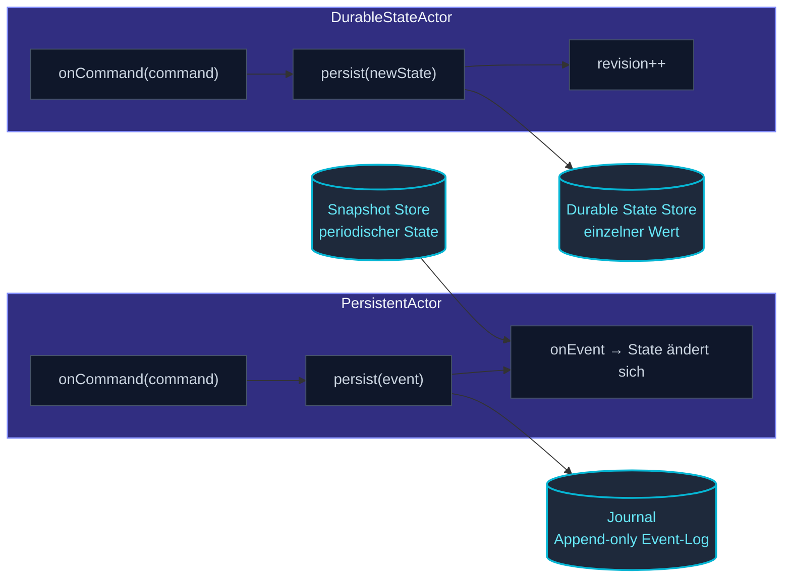
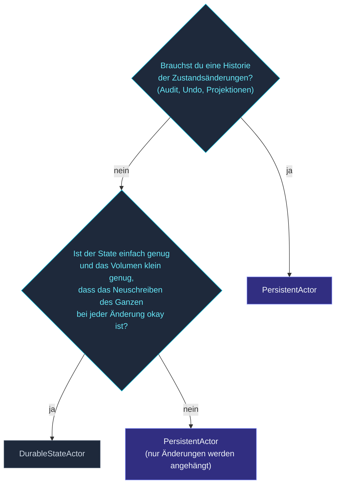

Standardmäßig lebt Actor-State im Speicher.  Wenn ein Actor abstürzt
und neu startet, beginnt jedes Feld bei Null.  Für State, der
überleben soll — Benutzerkonten, Warenkörbe, Bestell-Workflows, alles
jenseits des aktuellen Requests — brauchst du **Persistenz**.

actor-ts bietet zwei komplementäre Modelle:

| Modell | Was du persistierst | Wann |
| --- | --- | --- |
| **Event Sourcing** (`PersistentActor`) | Ein **Log von Events** — jede zustandsändernde Tatsache, die je beobachtet wurde. | Audit-Trails, Time Travel, Projektionen, wenn "wie sind wir hierher gekommen" wichtig ist. |
| **Durable State** (`DurableStateActor`) | Ein **einzelner Snapshot** — der aktuelle State, bei jedem Update überschrieben. | Wenn der aktuelle Wert alles ist, was du brauchst, und die Historie nicht nützlich ist. |

Beide spielen beim Actor-Start ab oder stellen wieder her, sodass
der wiederbelebte Actor dort weitermacht, wo der letzte aufgehört hat.

## Das große Bild



Das Journal und der Durable-State-Store sind **austauschbar**.  Das
Framework liefert mit:

| Backend | Journal | Durable State | Snapshot Store | Indizierte Tag-Query | Über Knoten geteilt | Runtimes |
| --- | --- | --- | --- | --- | --- | --- |
| In-Memory | ✓ | ✓ | ✓ | In-Process-Scan | ✗ (pro Prozess) | alle |
| SQLite | ✓ | ✓ | ✓ | ✓ (Join-Tabelle) | ✗ (pro Knoten) | alle |
| libSQL / Turso | ✓ | ✓ | ✓ | ✓ (Join-Tabelle) | ✓ | alle |
| PostgreSQL | ✓ | ✓ | ✓ | — (Polling-Scan) | ✓ | alle |
| MariaDB / MySQL | ✓ | ✓ | ✓ | — (Polling-Scan) | ✓ | alle |
| Microsoft SQL Server | ✓ | ✓ | ✓ | — (Polling-Scan) | ✓ | alle |
| MongoDB | ✓ | ✓ | ✓ | ✓ (Multikey-Index) | ✓ | alle |
| DynamoDB | ✓ | ✓ | ✓ | — (Polling-Scan) | ✓ | alle |
| Cloudflare D1 | ✓ | ✓ | ✓ | ✓ (Join-Tabelle) | ✓ | alle |
| CockroachDB, YugabyteDB | ✓ | ✓ | ✓ | — (Polling-Scan) | ✓ | alle |
| Cassandra | ✓ | — | ✓ | ✓ (Tag-Index-Tabelle) | ✓ | alle |
| Filesystem / S3 (Object Storage) | — | ✓ | ✓ | n/a | S3 ✓ / Filesystem ✗ | alle |

CockroachDB und YugabyteDB sind keine eigenen Backends — sie sprechen das
PostgreSQL-Wire-Protokoll, die Postgres-Stores bedienen sie also unverändert.
Siehe [wire-kompatible Datenbanken](/de/persistence/journals/wire-compatible/)
für das Zertifizierte und die jeweiligen Vorbehalte.

"Indizierte Tag-Query" beschreibt, was `PersistenceQuery.currentEventsByTag`
in den Storage hinunterdrücken kann: ein Backend mit Tag-Index läuft diesen
ab, die übrigen scannen das Journal und verfeinern im Speicher — korrekt in
beiden Fällen, aber nur mit Index in den Kosten begrenzt.  SQLite läuft auf
jeder Runtime, seit der eingebaute `node:sqlite`-Treiber dazugekommen ist;
`better-sqlite3` brauchst du für die lokale Datei nur, wenn du es auf Node
bevorzugst.

Plus einen Erweiterungspunkt — implementiere die Interfaces `Journal` /
`DurableStateStore` / `SnapshotStore` für deinen eigenen Storage.

## Event Sourcing in fünf Minuten

```ts
import { match } from 'ts-pattern';
import { Actor, ActorSystem } from 'actor-ts';
import { PersistentActor } from 'actor-ts/persistence';

type DepositCommand = { kind: 'deposit'; amount: number };
type WithdrawCommand = { kind: 'withdraw'; amount: number };
type Command = DepositCommand | WithdrawCommand;

type DepositedEvent = { kind: 'deposited'; amount: number; ts: number };
type WithdrawnEvent = { kind: 'withdrawn'; amount: number; ts: number };
type Event = DepositedEvent | WithdrawnEvent;

type State = { balance: number; };

class Account extends PersistentActor<Command, Event, State> {
  readonly persistenceId = 'account-42';

  initialState(): State { return { balance: 0 }; }

  // Rein: state + event → neuer state. Wird während der Recovery abgespielt.
  onEvent(state: State, e: Event): State {
    return match(e)
      .with({ kind: 'deposited' }, (ev) => ({ balance: state.balance + ev.amount }))
      .with({ kind: 'withdrawn' }, (ev) => ({ balance: state.balance - ev.amount }))
      .exhaustive();
  }

  // Validiert das Command, persistiert das Event, führt Seiteneffekte nach dem Persist aus.
  onCommand(state: State, command: Command): void {
    match(command)
      .with({ kind: 'deposit' }, (c) => this.onDeposit(c))
      .with({ kind: 'withdraw' }, (c) => this.onWithdraw(state, c))
      .exhaustive();
  }

  private onDeposit(command: DepositCommand): void {
    this.persist({ kind: 'deposited', amount: command.amount, ts: Date.now() },
      (next) => { /* Seiteneffekte mit dem persistierten-und-angewendeten State */ });
  }

  private onWithdraw(state: State, command: WithdrawCommand): void {
    if (state.balance < command.amount) {
      // Ablehnen — nichts persistieren.
      return;
    }
    this.persist({ kind: 'withdrawn', amount: command.amount, ts: Date.now() },
      () => {});
  }
}
```

Drei Methoden erledigen die ganze Arbeit:

- **`onCommand`** — validiert die Anfrage.  Entscheidet, welche Events
  per `this.persist(event, afterPersist)` persistiert werden.  Seiteneffekte
  gehören in `afterPersist`.
- **`onEvent`** — reine Funktion von State + Event zum neuen State.
  **Keine Seiteneffekte** hier — diese Funktion läuft während der
  Recovery, um das Journal abzuspielen, möglicherweise viele Male.
- **`initialState`** — wie der State aussieht, bevor irgendwelche
  Events da sind.

Beim Start liest das Framework jedes Event für `account-42`
aus dem Journal, spielt sie durch `onEvent` ab, und der
resultierende State ist das, was `onCommand` sieht.  Commands werden
erst verarbeitet, wenn die Recovery abgeschlossen ist.

Siehe [PersistentActor](/de/persistence/persistent-actor/) für
die vollständige Oberfläche.

## Durable State in fünf Minuten

```ts
import { match } from 'ts-pattern';
import { type ActorRef } from 'actor-ts';
import { DurableStateActor, DurableStateOptions } from 'actor-ts/persistence';

type State = { items: string[]; };

type AddCommand = { kind: 'add'; sku: string };
type ViewCommand = { kind: 'view'; replyTo: ActorRef<State> };
type CartCommand = AddCommand | ViewCommand;

class Cart extends DurableStateActor<CartCommand, State> {
  constructor(options: DurableStateOptions<State>) { super(options); }

  override async onCommand(command: CartCommand): Promise<void> {
    await match(command)
      .with({ kind: 'add' }, (c) => this.onAdd(c))
      .with({ kind: 'view' }, (c) => this.onView(c))
      .exhaustive();
  }

  private async onAdd(command: AddCommand): Promise<void> {
    const next: State = { items: [...this.state.items, command.sku] };
    await this.persist(next);   // überschreibt den gespeicherten State
  }

  private onView(command: ViewCommand): void {
    command.replyTo.tell(this.state);
  }
}
```

`persist(newState)` überschreibt den gespeicherten Snapshot.  Bei
einem Neustart lädt `preStart` ihn zurück; `this.state` spiegelt den
geladenen Wert wider.  Kein Event-Log; kein Replay; einfach "speichere
den aktuellen State."

Siehe [DurableStateActor](/de/persistence/durable-state/) für
die vollständige API.

## Event Sourcing vs. Durable State — die richtige Wahl

Der ehrliche Entscheidungsbaum:



Event Sourcing gewinnt, wenn:

- **Die Historie wichtig ist** — Auditing, regulatorische Compliance,
  "zeig mir, wie wir hier gelandet sind", Projektionen.
- **Der State groß ist**, aber die Änderungen klein — ein 100-Byte-Event
  anzuhängen ist billiger als den ganzen State zu schreiben.
- **Du Projektionen willst** — Read-Side-Views über den
  Event-Stream, siehe [Projektionen](/de/persistence/projections/).
- **Schema-Evolution ein langes Spiel ist** — Event-Typen können
  unabhängig vom aktuellen State migriert werden.

Durable State gewinnt, wenn:

- **Die Historie nicht nützlich ist** — der aktuelle Wert ist alles,
  was du brauchst.
- **Der State klein und einfach ist** — Überschreiben ist billig.
- **Du optimistische Concurrency willst** — Durable-State-Stores haben
  einen Revision Counter; gleichzeitige Writes lösen einen
  `DurableStateConcurrencyError` aus.

Viele Produktionssysteme mischen beides — Durable State für die
Konfigurations-artigen "ein aktueller Wert"-Dinge, Event Sourcing
für die Workflow-artigen "Historie-der-Entscheidungen"-Dinge.

## Snapshots

100 000 Events beim Start abspielen ist langsam.  Snapshots kürzen
das Replay-Fenster:

```ts
class Account extends PersistentActor<Command, Event, State> {
  // ...
  override snapshotPolicy() { return everyNEvents(100); }
  // Nach jeweils 100 Events wird der aktuelle State als Snapshot geschrieben.
}
```

Beim Start tut das Framework Folgendes:

1. Lädt den neuesten Snapshot (falls vorhanden).
2. Spielt Events *ab nach der seqNr dieses Snapshots* ab.

Ein 100-Event-Fenster ist schnell.  Wähle das Snapshot-Intervall
basierend auf deiner Event-Rate und akzeptablen Startzeit.

Siehe [Snapshots](/de/persistence/snapshots/) für die
Konfiguration und Per-Actor-Policy-Optionen.

## Projektionen — Read-Side-Views

Ein `PersistentActor` schreibt Events.  Eine **Projektion**
konsumiert sie und baut eine abgeleitete View, die für Queries
zugeschnitten ist:

```ts
import { match } from 'ts-pattern';
import { ProjectionActor, ByTagProjectionOptions } from 'actor-ts/persistence';

const cartViewOptions = ByTagProjectionOptions.create<CartEvent>()
  .withName('view-cart-summary')
  .withTag('cart')
  .withQuery(query)
  .withHandle(async (event) => {
    await match(event.event)
      .with({ kind: 'added' }, () => db.execute('INSERT INTO cart_items ...'))
      // ...
      .otherwise(() => Promise.resolve());
  });
const cartView = ProjectionActor.byTag<CartEvent>(system, cartViewOptions);
```

Die Projektion abonniert Events mit Tag `'cart'` aus dem
Journal, verarbeitet sie in Reihenfolge, persistiert ihren eigenen
Fortschritt (sodass ein Neustart vom richtigen Offset weitermacht).

Das entkoppelt Writes (das Journal des `PersistentActor`) von
Reads (die View der Projektion) — die Read-Seite kann für die
Query-Muster, die sie bedient, denormalisiert werden.

Ein Handler, der wirft, blockiert jedes Event dahinter, weil der
Cursor nur bei Erfolg vorrückt.  `recoveryStrategy` begrenzt das:
mit Backoff wiederholen und dann stoppen (der Default), das Event
auf den Dead-Letter-Stream überspringen, oder beides sofort.

Siehe [Projektionen](/de/persistence/projections/) für das
vollständige Muster.

## Austauschbare Backends

Das Framework definiert drei Interfaces:

```ts
type Journal = {
  // Events anhängen, Events lesen, nach Tag abfragen
};

type DurableStateStore = {
  // Laden, mit Revision persistieren, löschen
};

type SnapshotStore = {
  // Snapshot speichern, neuesten laden, ältere löschen
};
```

Eingebaute Implementierungen leben unter
[`persistence/journals/*`](/de/persistence/journals/in-memory/)
und [`persistence/snapshot-stores/*`](/de/persistence/snapshot-stores/in-memory/).

Ein Backend kommt über den `plugins`-Slot der Optionen des Systems
herein.  Jeder Eintrag ist ein `PersistencePlugin` — eine Funktion, der
das System seine `PersistenceExtension` übergibt — und macht
typischerweise einen `register*Plugins`-Aufruf;
`actor-ts.persistence.<axis>.plugin` in der Konfiguration entscheidet
dann, welches registrierte Plug-in jede Achse verwendet:

```ts
import { ActorSystem, ActorSystemOptions } from 'actor-ts';
import { registerPostgresPlugins } from 'actor-ts/persistence';

const systemOptions = ActorSystemOptions.create().withPersistence({
  plugins: [(persistence) => registerPostgresPlugins(persistence)],
});
const system = ActorSystem.create('orders', systemOptions);
```

Die Plug-ins laufen innerhalb von `ActorSystem.create`, in der
angegebenen Reihenfolge, sodass das Backend, das ein Selektor nennt,
registriert ist, bevor `create` zurückkehrt, und die ausgewählten
Stores als Teil des Starts öffnen — siehe [Stores beim Start
öffnen](#stores-beim-start-öffnen).  Gibt ein Plug-in ein Promise
zurück, wartet der Start auch darauf, sodass eine Registrierung, die
spät scheitert, den Start scheitern lässt statt erst die erste
persistierte Nachricht.

Du schreibst ein eigenes?  `Journal.read()` ist die Methode, deren
Vertrag der Replay einfordert: Die zurückgegebenen Events müssen
nach Sequenznummer aufsteigen, lückenlos sein und im angefragten
Fenster liegen.  `delete()` kompaktiert ein *Präfix*, nie ein Loch
in der Mitte — eine Lücke kann also nur ein Defekt sein: ein
fehlendes `ORDER BY`, ein halb geschriebener Append, ein Store, in
den auch andere schreiben können.  Der Replay wirft dann
`JournalIntegrityError`, statt zu falten; siehe [was der Replay
ablehnt](/de/persistence/persistent-actor/#was-der-replay-ablehnt).

Ein Store, der sich mit etwas verbindet, sollte außerdem das
optionale `start?()` implementieren: jetzt öffnen statt bei der
ersten Operation, damit das Warm-up des Systems beim Booten — siehe
[Stores beim Start öffnen](#stores-beim-start-öffnen) — einen
falschen Connection-String schon beim Start scheitern lässt statt erst
bei der ersten persistierten Nachricht.  Die mitgelieferten Stores halten
sich dabei an eine Regel, und deiner sollte es auch.  `start()` ist
idempotent und teilt sich ein einziges Öffnen mit der ersten
Operation.  Ein Start, der fehlschlägt, wirft, gibt frei, was er
halb geöffnet hatte, und wird nicht gemerkt — der nächste Aufruf
öffnet neu; ein einzelner Datenbank-Aussetzer beim Booten darf
keinen Store hinterlassen, der für die gesamte Laufzeit des Prozesses
scheitert.  Nach `close()` wirft `start()` wie jede Operation, und
ein `close()`, das eintrifft, während ein Start noch läuft, lässt
nichts offen zurück.  Ein Store ohne etwas zu öffnen — die
In-Memory-Stores, Object Storage — lässt `start?()` undefiniert.

Für Produktion deckt die **SQLite**-Kombination aus Journal +
Snapshot Single-Node-Deployments ab; ein geteiltes Backend —
**Cassandra**, **PostgreSQL** oder jede andere Zeile mit ✓ in der
Matrix-Spalte „Über Knoten geteilt" — deckt Multi-Node-Cluster ab,
in denen jeder Knoten *dasselbe* Journal replayen muss.  Was
„dasselbe" heißt und wie das Cluster es prüft, klärt der nächste
Abschnitt.

## Storage-Lokalität & Identität

Persistenter State im Cluster hat eine harte Voraussetzung, die
kein Typsystem ausdrücken kann: **jeder Knoten muss dieselbe
Datenbank lesen und schreiben.**  Sharding verschiebt Entities
zwischen Knoten, und die verschobene Entity replayt das Journal,
das ihr *neuer* Knoten öffnet.  Bei Pro-Knoten-Storage — einer
SQLite-Datei, den In-Memory-Defaults — öffnet jeder Knoten seine
*eigene* Datenbank, und nichts schlägt jemals fehl: der
optimistische Head-Check vergleicht gegen die lokale Datei, also
sammeln sich zwei divergierende Historien unter einer Persistence-Id
an, ohne Fehler auf irgendeiner Seite.  Zwei Knoten, zwei
Historien — und welche Antwort man bekommt, hängt davon ab,
welchen Knoten man fragt.

Das Framework sichert das entlang zweier unabhängiger Linien ab:

**Lokalität — was der Store *ist*.**  Jeder mitgelieferte Store
deklariert `storageLocality: 'node-local' | 'shared'` — eine
SQLite-Datei oder eine In-Memory-Map kann nie geteilt sein, ein
Datenbank-Dienst schon.  Trägt ein `'node-local'`-Store einen
persistenten Actor, während das Cluster Remote-Peers hat (oder
später bekommt), loggt der Knoten eine Warnung pro Store-Art,
greifbar über die Nadel `node-local storage`.  Eine Kombination
verweigert statt zu warnen: `rememberEntities: true` auf dem
automatisch verdrahteten Default-Pfad wirft `StorageLocalityError`,
weil die Sharding-Registry Leader-gehostet ist und beim Failover
nachweislich forkt — siehe
[Remember Entities](/de/cluster/sharding/remember-entities/).

**Identität — welche Datenbank es tatsächlich *ist*.**  Eine
`'shared'`-Deklaration sagt, dass das Backend geteilt sein
*könnte* — nicht, dass zwei Knoten wirklich dieselbe Instanz
erreicht haben: zwei Knoten mit je *ihrem eigenen* PostgreSQL, ein
veralteter Connection-String, ein zurückgespieltes Backup —
gleiche Technologie, andere Datenbank, identische stille
Divergenz.  Deshalb prägt jeder Store beim ersten Kontakt eine
zufällige Identität und persistiert sie *in der Datenbank selbst*
(`storageIdentity()`); die Knoten gossippen die Identitäten der
tatsächlich genutzten Stores auf ihren Member-Records, und jeder
Knoten, der bei einem Peer eine andere Identität für dieselbe
Store-Art sieht, sagt es — einmal pro Art, greifbar über die Nadel
`storage identity differs`.

Beide Prüfungen sind konstruktionsbedingt konservativ.  Ein Store,
der keines der beiden Member deklariert, ist *unbekannt* und
bleibt still — ein Fremd-Backend wird nie an einem Default
gemessen, den es nicht gewählt hat — und [Replicated Event
Sourcing](/de/persistence/replicated-event-sourcing/overview/),
dessen Pro-Knoten-Journale gewollt sind, löst keine von beiden
aus.  Eigener Store?  Deklariere `storageLocality` und
implementiere `storageIdentity()` als: beim ersten Kontakt einen
Zufallswert prägen, in der Datenbank persistieren, fortan den
gespeicherten zurückgeben — die mitgelieferten Stores halten ihn
in einer einzeiligen `storage_identity`-Tabelle (bzw. einem Objekt
unter dem Root-Schlüssel `storage-identity`).

Jedes Backend speichert Payloads im selben getaggten
JSON-Tree-Format, sodass `Date` / `Map` / `Set` / `bigint` /
`Uint8Array` überall round-trippen — siehe
[was Events und State enthalten dürfen](/de/persistence/persistent-actor/#was-events-und-state-enthalten-dürfen).

## Stores beim Start öffnen

Ein System öffnet seine Persistence-Stores als Teil seines Starts,
nicht erst bei der ersten persistierten Nachricht.  Innerhalb von
`ActorSystem.create` löst es Journal, Snapshot-Store und
Durable-State-Store auf — die, die `actor-ts.persistence.<axis>.plugin`
auswählt, oder die Instanzen, die `withPersistence` im Code setzt —
und in der Phase `persistence-start` des Starts ruft es auf jedem
davon `start()` auf.  Das geschieht, nachdem die Promises, die die
Plug-ins zurückgegeben haben, erledigt sind, und die drei öffnen
parallel.  Ein Store, der nichts zu öffnen hat, etwa die
In-Memory-Stores, bleibt, wie er ist; ein System, das Persistence
weder im Code verdrahtet noch in seiner Konfiguration ein Plug-in
auswählt, öffnet überhaupt nichts.

Der Fehler wandert dorthin, wo ein Operator ihn haben will.  Eine
Plug-in-ID, die niemand registriert hat, ein Connection-String mit dem
falschen Host, eine Datenbank, die der Knoten nicht erreicht — jedes
davon lässt den Start mit einem Fehler scheitern, der den Store nennt:
`system.whenReady()` wird abgelehnt, das System fährt herunter, und
`runUntilTerminated()` wird mit demselben Fehler abgelehnt, sodass der
Prozess mit einem Status ungleich null endet, statt Traffic
anzunehmen, den er nicht persistieren kann.  Ein Store, der weder
öffnet noch scheitert, hinter einem Host, der Pakete verwirft, lässt
den Start scheitern, sobald das Budget seiner Phase abläuft (30 s,
sofern `withCoordinatedStartup` kein anderes setzt).  Solange die
Stores öffnen, hält der Readiness-Check `startup` `/ready` auf false.

Die Auswahl wird innerhalb von `create` aufgelöst, also muss das
Plug-in, das sie nennt, ebenfalls dort registriert werden — über den
`plugins`-Slot, wie [Austauschbare Backends](#austauschbare-backends)
zeigt.  Ein `register*Plugins`-Aufruf auf der Extension nach `create`
kommt für einen ausgewählten Store zu spät, und der Start scheitert mit
`Unknown journal plugin`.  Ein Actor, der in der Zeile nach `create`
gespawnt wird, ist kein Problem: Sein erstes Lesen teilt sich das eine
Öffnen des Stores, statt mit ihm um die Wette zu laufen.

Jede Achse, die die Konfiguration auswählt, wird geöffnet, auch eine,
die dieser Service nie nutzt — ein Durable-State-Plug-in, ausgewählt in
einer `application.conf`, die er mit Services teilt, die es nutzen —,
also lässt ein Fehler dort auch diesen Start scheitern: Stell diese
Achse für diesen Service zurück auf den In-Memory-Store, oder schalte
das Öffnen beim Start ab, wie unten gezeigt.

Nichts im Framework schließt die Stores, die es aufgelöst hat
([#388](https://github.com/pathosDev/actor-ts/issues/388)), und ein
gescheiterter Start ist keine Ausnahme — er durchläuft den Coordinated
Shutdown, also wird ein Store, der geöffnet hat, bevor ein anderer
scheiterte, nur von einem Shutdown-Task geschlossen, den die Anwendung
registriert, wie es der `close-persistence`-Task des
[Chat-Beispiels](/de/examples/chat-sample/) tut; einer, der direkt nach
`create` hinzugefügt wird, läuft auch auf diesem Weg.  Ohne ihn kann ein
offener Pool oder Client den Prozess am Leben halten, nachdem sein
Start gescheitert ist.

Um die Stores stattdessen bei der ersten Verwendung zu öffnen, schalte
das Öffnen beim Start im Code ab — `autoStart` im Persistence-Verhalten:

```ts
const persistenceBehavior = PersistenceBehaviorOptions.create().withAutoStart(false);
const systemOptions = ActorSystemOptions.create().withPersistence({ behavior: persistenceBehavior });
```

Abgeschaltet wird nichts aufgelöst oder geöffnet, bis die erste
Operation danach fragt, und ein nach `create` registriertes Plug-in
wird dann noch gefunden.  Die Worker eines `WorkerMesh` laufen immer
mit abgeschaltetem `autoStart` — siehe
[Parallelität](/de/fundamentals/parallelism/).

## Wann NICHT persistieren

import { Aside } from '@astrojs/starlight/components';

<Aside type="caution" title="Cache-artige Actors">
  ```ts
  class Cache extends PersistentActor<...> {
    // ✗ wenn der Cache neu aufgebaut werden kann, nicht persistieren
  }
  ```
  Ein Cache kann per Definition aus einer Source of Truth neu
  aufgebaut werden.  Den Cache zu persistieren bedeutet, dass du die
  Speicherkosten verdoppelt hast, ohne Recovery-Nutzen über "warmer
  Neustart" hinaus.  Verwende dafür einen einfachen Actor + einen
  externen Cache (Redis, Memcached).
</Aside>

<Aside type="caution" title="Winziger State ohne Failover-Anforderung">
  Ein Actor, der 100 Bytes State in einem Prozess hält, dessen
  Neustart du selbst kontrollierst (z. B. ein CLI-Tool), braucht
  wahrscheinlich keine Persistenz.  Persistenz hat Setup-Kosten
  (Journal-Konfiguration, Store-Auswahl, Schema-Management);
  überspringe sie, wenn die Recovery-Anforderung des States "User
  führt den Befehl erneut aus" lautet.
</Aside>

<Aside type="caution" title="Reine Transformations-Actors">
  Ein Actor, dessen Job "Input nehmen, transformieren, Output senden"
  ist, ohne persistenten internen State, hat nichts zu persistieren.
  Einfacher `Actor` ist die richtige Basis; `PersistentActor` fügt
  Maschinerie hinzu, die du nie nutzen würdest.
</Aside>

## Wie geht's weiter

- **[PersistentActor](/de/persistence/persistent-actor/)** —
  die Event-Sourcing-API im Detail.
- **[Durable State](/de/persistence/durable-state/)** —
  die einfachere Snapshot-artige Alternative.
- **[Snapshots](/de/persistence/snapshots/)** —
  Replay-Fenster-Reduktion für Event-sourced Actors.
- **[Projektionen](/de/persistence/projections/)** — Read-Side-Views,
  die aus Event-Streams gebaut werden.
- **[Journals — In-Memory](/de/persistence/journals/in-memory/)** —
  der Tests/Dev-Default.
- **[Journals — SQLite](/de/persistence/journals/sqlite/)** —
  Single-Node-Produktions-Default.
- **[Migration im Überblick](/de/persistence/migration/overview/)** —
  Event/State-Schemas über die Zeit weiterentwickeln.

Die [`PersistentActor`](/api/classes/persistentactor/)- und
[`DurableStateActor`](/api/classes/durablestateactor/)-API-Referenzen
decken die vollständige Basisklassen-Oberfläche ab.
