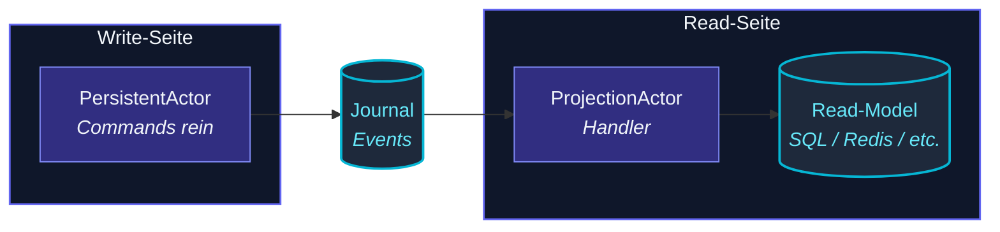

Ein `PersistentActor` schreibt Events.  Eine **Projektion**
konsumiert sie und baut eine **Read-Side-View**, die für Queries
zugeschnitten ist:



Das Journal ist **Append-only und autoritativ**.  Projektionen
sind abgeleitet — sie können von Grund auf neu aufgebaut werden,
indem das Journal abgespielt wird.  Das entkoppelt
Write-Durchsatz (durable, append-only) von Read-Durchsatz
(denormalisiert, query-optimiert).

## Ein minimales Beispiel

```ts
import { match } from 'ts-pattern';
import { ProjectionActor, ByTagProjectionOptions } from 'actor-ts/persistence';
import { SqliteJournal, SqliteJournalOptions, SqliteQuery, InMemoryOffsetStore } from 'actor-ts/persistence';

type AccountEvent =
  | { kind: 'deposited'; amount: number }
  | { kind: 'withdrawn'; amount: number };

// Die Read-Seite fragt dasselbe Journal ab, in das deine PersistentActors
// schreiben — SqliteQuery umschließt eine SqliteJournal-Instanz (keinen Pfad).
const eventsJournal = new SqliteJournal(SqliteJournalOptions.create().withPath('/var/lib/events.db'));

const byTagProjectionOptions = ByTagProjectionOptions.create<AccountEvent>()
  .withName('account-balance-view')
  .withTag('account')
  .withQuery(new SqliteQuery(eventsJournal))
  .withOffsetStore(new InMemoryOffsetStore())
  .withHandle(async (event) => {
    await match(event.event)
      .with({ kind: 'deposited' }, (e) => viewDb.execute(
        'UPDATE balances SET balance = balance + ? WHERE pid = ?',
        [e.amount, event.persistenceId],
      ))
      .otherwise(() => Promise.resolve());
  });
const projection = ProjectionActor.byTag<AccountEvent>(system, byTagProjectionOptions);
```

Der Actor:

1. Lädt seinen **Offset-Cursor** beim `preStart` aus dem
   Offset-Store.
2. Pollt die **Query-Schicht** für Events, die zum `tag` passen,
   ab dem Cursor.
3. Ruft `handle` für jedes Event auf — oder `handleGroup` für jede
   Gruppe von Events, siehe [Gruppierte Handler](#gruppierte-handler).
4. Persistiert den neuen Cursor.
5. Wiederholt.

## Zwei Query-Formen

| Factory | Cursor-Typ | Verwendung |
| --- | --- | --- |
| **`ProjectionActor.byPersistenceId(...)`** | sequenceNr (pro pid) | Lies die vollständige Historie einer Entity. |
| **`ProjectionActor.byTag(...)`** | Offset (Timestamp + Tiebreaker) | Lies alles, was mit `<tag>` getaggt ist, im Journal. |

Tag-basiert ist der häufige Fall — der `PersistentActor` ruft
`tagsFor(event)` auf, um Events zu labeln; die Projektion
abonniert das Tag.  Per-pid ist nützlich für schmale Views (die
Aktivität eines Users).

`tagsFor` wird **pro Event** gefragt, eine Projektion, die auf ein Tag
filtert, sieht also genau die Events, die es tragen — auch dann, wenn
die Events gemeinsam von einem `persistAll` geschrieben wurden.

### Auf mehr als ein Tag filtern

`withTag` nimmt einen **`TagFilter`**, eine Projektion ist also nicht auf
ein einzelnes Tag beschränkt:

```ts
import type { TagFilter } from 'actor-ts/persistence';

const eitherOne: TagFilter = { any: ['debit', 'credit'] };
const bothOfThem: TagFilter = { all: ['account', 'production'] };
const allButCancelled: TagFilter = { all: ['orders'], not: ['cancelled'] };

const byTagProjectionOptions = ByTagProjectionOptions.create<AccountEvent>()
  .withName('open-orders-view')
  .withTag(allButCancelled);
```

Jeder Operator ist optional, verknüpft werden sie mit UND.  Ein leeres
`{}` matcht jedes Event.

**Der Filter gehört zur Cursor-Identität.**  Ein blanker String behält
den Cursor, den er schon hat, aber die beiden Schreibweisen teilen sich
keinen: `.withTag('orders')` legt seinen Offset unter `orders` ab,
`.withTag({ all: ['orders'] })` unter `all(orders)`.  Beide wählen
dieselben Events aus, das Umschreiben der einen in die andere sieht also
harmlos aus — und spielt die Projektion stillschweigend von vorn ab.
Entscheide dich für eine Schreibweise, bevor die Projektion das erste
Mal läuft, und bleib dabei.

## At-least-once Delivery

```ts
// Crash-Recovery-Sequenz:
//   1. Offset-Cursor auf Wert N speichern.
//   2. Handler verarbeitet Event N+1.
//   3. Crash bevor der Cursor gespeichert wird.
//   4. Beim Neustart: Cursor ist immer noch N → Handler erhält Event N+1 erneut.
```

Wenn der Handler läuft, aber der Cursor nicht persistiert wird,
**verarbeitet die Projektion dasselbe Event erneut** beim
Neustart.  Das ist **At-least-once Delivery** — das Framework
garantiert, dass kein Event verpasst wird, aber Duplikate sind
möglich.

Mit [`handleGroup`](#gruppierte-handler) ist die Gruppe die Einheit
der Wiederholung.  Der Cursor wird einmal pro Gruppe persistiert, auf
ihr letztes Event — ein Absturz zwischen dem Aufruf und diesem Save
liefert also **jedes Event der Gruppe** erneut aus, nicht nur das,
das gerade verarbeitet wurde.  Die Idempotenz muss für jedes Event
darin gelten.

Handler müssen **idempotent** sein:

- **UPSERT** in das Read-Model (kein blindes `INSERT`).
- **Verarbeitete Event-IDs verfolgen** im Read-Model selbst für
  Dedup.
- **Die `sequenceNr` des Events als Per-pid-Dedup-Key verwenden**
  — sie nimmt nie ab, ist monoton pro persistenceId.

Wenn du den Handler nicht idempotent machen kannst, muss die
Projektion an einem 2-Phase-Commit mit dem Offset-Save teilnehmen —
viel komplexer, nicht out-of-the-box bereitgestellt.

## Wenn der Handler wirft

Der Cursor rückt erst vor, nachdem `handle` zurückgekehrt ist — ein
fehlschlagender Handler blockiert also **konstruktionsbedingt den
Kopf der Warteschlange**: jedes spätere Event wartet hinter dem, das
fehlgeschlagen ist.  `recoveryStrategy` entscheidet, wie lange das
so bleibt.

| Strategie | Retries | Danach | Wähle sie, wenn |
| --- | --- | --- | --- |
| **`retry-and-fail`** *(Default)* | ja | stoppt die Projektion | Eine still veraltete View schlimmer ist als eine sichtbar gestoppte. |
| **`retry-and-skip`** | ja | überspringt das Event | Verfügbarkeit vor Vollständigkeit geht — ein Dashboard, ein Suchindex. |
| **`fail`** | nein | stoppt sofort | Der Handler bereits intern wiederholt. |
| **`skip`** | nein | überspringt sofort | Manche Events schlicht erwartbar nicht zustellbar sind. |

```ts
const byTagProjectionOptions = ByTagProjectionOptions.create<AccountEvent>()
  .withName('account-balance-view')
  .withTag('account')
  .withRecoveryStrategy('retry-and-skip')
  .withMaxRetries(5)
  .withRetryBackoffMs(2_000)
  .withMaxRetryBackoffMs(60_000)
  .withOnFailure((failure) => {
    console.error(
      `${failure.projection}: ${failure.event.persistenceId}#${failure.event.sequenceNr} `
      + `→ ${failure.action} (attempt ${failure.attempt})`,
      failure.error,
    );
  });
```

Retries erfolgen **nicht sofort**.  Der nächste Versuch wird um
`retryBackoffMs` verzögert und verdoppelt sich jedes Mal, bis
`maxRetryBackoffMs` erreicht ist.  `maxRetries` zählt die Versuche
*nach* dem ersten — der Default von 3 bedeutet also, dass ein
schlechtes Event den Handler viermal erreicht, bevor die Projektion
es aufgibt.

### Dieselben Stellschrauben in HOCON

Fehlerbehandlung ist meist eine *betriebliche* Entscheidung — derselbe
Code will in Produktion `retry-and-fail` und in der Entwicklungsschleife
`skip` — deshalb haben die vier Felder, die Poll-Kadenz und die
Gruppengröße auch prozessweite Defaults unter `actor-ts.projection`:

```hocon
actor-ts.projection {
  recovery-strategy     = "retry-and-skip"
  max-retries           = 5
  retry-backoff         = 2s
  max-retry-backoff     = 60s
  poll-interval         = 1s
  group-after-envelopes = 50   # handleGroup projections only
}
```

Die Präzedenz sind die üblichen drei Ebenen des Projekts, **pro Feld**
angewandt: explizite `ProjectionOptions` > HOCON > eingebauter Default.
Ein Feld, das diese Projektion nicht setzt, fällt auf den Block oben
durch, und eines, das der Block nicht führt, auf den eingebauten Wert —
die Konfiguration erreicht also jede Projektion, die sich zu diesem Feld
nicht selbst festgelegt hat, und keine, die es getan hat.  Ein leeres
`liveOptions` zu übergeben ist *keine* Festlegung: `poll-interval` gilt
weiterhin.

Setze `max-retry-backoff`, wann immer du `retry-backoff` setzt.  Beide
werden gegeneinander auf den *gemergten* Settings geprüft — hebst du nur
das erste über die 60-Sekunden-Grenze, wirft jede Projektion im Prozess
beim Start `OptionsError`, allein wegen einer Konfigurationsdatei und
ohne jede Codeänderung.

`group-after-envelopes` bestimmt die Gruppengröße jeder
[gruppierten Projektion](#gruppierte-handler), die nicht selbst
`withGroupAfterEnvelopes` aufruft, und keiner anderen: eine
`handle`-Projektion bekommt weiterhin ein Event pro Aufruf, was auch
immer im Block steht.  Abgelehnt wird sie wegen des Blatts auch nicht —
der `OptionsError` für eine Größe auf einer `handle`-Projektion gilt
einer Größe, die ihr eigener Code geschrieben hat, und eine Datei, die
jede Projektion im Prozess liest, ist das nicht.

### Was ein Fehlschlag erzeugt

- **`onFailure`** — wird bei jedem Versuch aufgerufen, mit dem
  betroffenen `PersistentEvent`, dem Fehler, der Versuchsnummer und
  der getroffenen Aktion (`retry` / `skip` / `stop`).  Eine
  fehlgeschlagene Gruppe liefert zusätzlich die `group` selbst — siehe
  [Wenn eine Gruppe fehlschlägt](#wenn-eine-gruppe-fehlschlägt).  Das
  ist das strukturierte Signal; häng dein Alerting daran.  Ein Hook,
  der selbst wirft, wird geloggt und verschluckt — ein kaputter
  Reporter darf die Projektion nicht mitreißen.
- **Ein Dead Letter** — ein übersprungenes Event wird, in einen
  `DeadLetter` verpackt, auf dem System-Event-Stream veröffentlicht
  und nennt die Projektion als seinen Empfänger, damit nichts spurlos
  verschwindet:

  ```ts
  import { DeadLetter } from 'actor-ts';

  system.eventStream.subscribe(auditRef, DeadLetter);
  ```

  Publishen ist standardmäßig alles, was passiert — ohne Abonnent ist
  das Event weg.  Schaltet man die
  [Dead-Letter-Queue](/de/operations/dead-letters/) ein, werden
  übersprungene Events stattdessen aufbewahrt, filterbar nach der
  Projektion, die sie übersprungen hat, und erneut zustellbar, sobald
  der Handler repariert ist.

- **Metriken** — `persistence_projection_stalled`,
  `persistence_projection_failures_total` und
  `persistence_projection_events_skipped_total`; siehe
  [Stock-Metriken](/de/observability/metrics/stock-metrics/).
- **Logs** — eine Error-Zeile, wenn eine Fehlerserie beginnt, und
  eine, wenn sie endet.  Die Retries dazwischen gehen nach `debug` —
  eine einen Tag lang festhängende Projektion kostet also zwei
  Error-Zeilen statt einer pro Poll.

`fail` **stoppt den Actor**, statt den Fehler aus dem Tick
entkommen zu lassen.  Das ist Absicht: der Supervisor der
Projektions-Gruppe startet seine Kinder neu, ein entkommender Fehler
würde also denselben Cursor neu laden und am selben Event scheitern
— eine Restart-Schleife, die lauter ist als das ersetzte Drehen und
kein bisschen nützlicher.

Eine gestoppte Projektion behält ihren Cursor: Ursache beheben und
neu starten setzt genau bei dem Event fort, das fehlgeschlagen ist.

## Gruppierte Handler

`handle` läuft einmal pro Event — eine Projektion zahlt ihrem
Read-Model also einen Round Trip pro Event: ein Statement, ein
Request.  Wo genau dieser Round Trip die Kosten sind, nimm die Events
stattdessen in Gruppen entgegen:

```ts
import { ProjectionActor, ByTagProjectionOptions } from 'actor-ts/persistence';

const byTagProjectionOptions = ByTagProjectionOptions.create<AccountEvent>()
  .withName('account-statement-view')
  .withTag('account')
  .withQuery(new SqliteQuery(eventsJournal))
  .withOffsetStore(new InMemoryOffsetStore())
  .withGroupAfterEnvelopes(50)
  .withHandleGroup(async (events) => {
    // One statement per group; the conflict clause makes a replayed group harmless.
    await viewDb.execute(
      'INSERT INTO statement_lines (pid, seq, kind) VALUES '
        + events.map(() => '(?, ?, ?)').join(', ')
        + ' ON CONFLICT (pid, seq) DO NOTHING',
      events.flatMap((event) => [event.persistenceId, event.sequenceNr, event.event.kind]),
    );
  });
const projection = ProjectionActor.byTag<AccountEvent>(system, byTagProjectionOptions);
```

- **Ein Handler, nicht zwei.**  Eine Projektion setzt `withHandle`
  *oder* `withHandleGroup`.  Die Factory wirft `OptionsError` bei
  keinem, bei beiden, bei einem `groupAfterEnvelopes`, das keine
  positive ganze Zahl ist, und bei einem auf einer
  `handle`-Projektion, wo es stillschweigend nichts bewirken würde.
- **Der Poll ist das Fenster.**  Jeder Tick schneidet, was sein Poll
  zurückgegeben hat, in Gruppen von höchstens `groupAfterEnvelopes`
  Events — Default 20 — und liefert jede davon in diesem Tick aus, in
  Journal-Reihenfolge.  Nichts wird zurückgehalten, um eine Gruppe zu
  füllen: ein stark beschriebenes Journal ergibt volle Gruppen, ein
  ruhiges eine kurze Gruppe pro Poll, und kein Event wartet länger als mit
  `handle`.  Für größere Gruppen bei geringerer Rate verlängere das
  Poll-Intervall.
- **Ein Commit pro Gruppe**, auf ihr letztes Event.  Weniger
  Offset-Writes sind Teil dessen, was das Gruppieren bringt, und sie
  machen die Gruppe zur Einheit der Wiederholung — siehe
  [At-least-once Delivery](#at-least-once-delivery).

### Wenn eine Gruppe fehlschlägt

Die Recovery-Strategie gilt zuerst für die Gruppe, mit dem Budget,
das ein Event bekäme.  Ein Retry schickt dieselbe Gruppe nach dem
Backoff erneut; `fail` und `retry-and-fail` stoppen vor dem ersten
Event der Gruppe — der Cursor bleibt stehen, und ein Neustart schickt
die ganze Gruppe noch einmal.

Eine Gruppe wird nie übersprungen, denn das würfe ihre guten Events
mit dem schlechten weg.  Wo die Strategie überspringen würde — `skip`
sofort, `retry-and-skip` nach den verbrauchten Retries — wird die
Gruppe stattdessen **aufgeteilt**: ihre Events gehen einzeln erneut
hinaus, als `handleGroup([event])`, jedes mit eigenem Retry-Budget
und eigenem Commit.  Das fehlschlagende Event wird dann genau wie
unter `handle` wiederholt und übersprungen — ein Dead Letter, ein
Schritt von `persistence_projection_events_skipped_total` —, während
die Events davor committet werden und die danach folgen.  Sobald der
aufgeteilte Bereich durch ist, wird wieder gruppiert ausgeliefert.
Eine Gruppe aus einem einzigen Event, etwa der kurze Rest eines
Polls, ist schon ein Event pro Aufruf und schlägt von Anfang an auf
die Per-Event-Art fehl.

`onFailure` unterscheidet die beiden Arten von Versuch.  Ein
Gruppen-Versuch trägt `group` — jedes Event des fehlgeschlagenen
Aufrufs — mit `event` auf dem ersten davon, dem, auf das der Cursor
wartet.  Der Versuch, der eine Gruppe an die Aufteilung übergibt,
meldet `retry`, weil jedes ihrer Events gleich erneut versucht wird.
Ein Fehlschlag innerhalb der Aufteilung trägt kein `group`, wie ein
Fehlschlag von `handle`.

## OffsetStore

```ts
import { InMemoryOffsetStore, DurableStateOffsetStore } from 'actor-ts/persistence';

// Default (verloren beim Neustart):
new InMemoryOffsetStore();

// Dauerhaft — speichert den Cursor in einem beliebigen DurableStateStore
// (Postgres, MariaDB, libSQL, SQL Server, MongoDB, DynamoDB, Object-Storage), sodass ein Neustart fortsetzt:
new DurableStateOffsetStore(durableStateStore);
```

Der Cursor ist nur eine Zahl (oder ein Compound-Offset) — pro
Projection-Name + Scope gespeichert.  Implementierungen:

- `InMemoryOffsetStore` — okay für Tests, nutzlos in Produktion
  (jeder Neustart verarbeitet vom Anfang neu).
- `DurableStateOffsetStore` — umschließt einen beliebigen `DurableStateStore`
  (Postgres, MariaDB, libSQL, SQL Server, MongoDB, DynamoDB, Object-Storage), sodass Offsets Neustarts überstehen.
- Benutzerdefiniert — implementiere `OffsetStore` gegen deinen
  eigenen Store (Redis, was auch immer dein Read-Model
  verwendet).

Für echte Produktions-Setups **kollokiere den Offset-Store mit
dem Read-Model**, sodass sie zusammen abstürzen — das minimiert
das Re-Processing-Fenster.

Im Cluster braucht der Offset-Store dieselbe Eigenschaft wie das
Journal: **eine Datenbank, nicht eine pro Knoten.**  Ein
`DurableStateOffsetStore` über node-lokalem Storage gibt jedem
Knoten seinen eigenen Cursor — eine Projektion, die zwischen
Knoten wandert, verarbeitet dann Events erneut, die ein Knoten
schon abgearbeitet hat, oder überspringt die, hinter denen der
Cursor des anderen bereits steht.  Siehe [Storage-Lokalität &
Identität](/de/persistence/overview/#storage-lokalität--identität).

### Der zusammengesetzte Schlüssel hat ein Längenbudget

`DurableStateOffsetStore` speichert einen Cursor nicht unter deiner
`persistenceId`.  Er speichert ihn unter einem **zusammengesetzten**
Schlüssel — `projection|seq|persistenceId` bei einer Projektion nach
Persistence-Id, `projection|tag|tag` bei einer nach Tag — und diese
Zeichenkette wird zur `persistenceId` des darunterliegenden
`DurableStateStore`.  Diese Spalte ist `VARCHAR(255)` unter
`MariaDbDialect` und `NVARCHAR(255)` unter `MsSqlDialect`;
`PostgresDialect` und `SqliteDialect` deklarieren sie als `TEXT`.
Also zwei der vier relationalen Dialekte — und ein
`DurableStateStore` muss überhaupt nicht relational sein.

Das Framework kann also einen Schlüssel zusammensetzen, den du nie
geschrieben hast.  Eine `persistenceId` mit 250 Zeichen ist für sich
genommen zulässig (das Limit ist 255), unter einer Projektion namens
`orders-projection` ergibt das aber 272 Zeichen.  Der Store weist das
zurück, statt es weiterzureichen — mit einem Fehler, der **beide
Hälften** benennt, denn keine allein benennt das Problem: dieselbe Id
unter einem kürzeren Projektionsnamen ist in Ordnung.

```text
Projection offset key is 272 characters, over the 255-character
durable_state.persistence_id column: projection "orders-projection" (17)
+ "|seq|" + persistenceId "order-xxx…" (250). Shorten the projection
name or the persistenceId — ...
```

Das Budget der zweiten Hälfte ist **255 − Projektionsname − 5**.
Unter `orders-projection` bleiben 233 Zeichen.  Eine Projektion nach
Tag zahlt aus demselben Budget den gerenderten Tag-Filter
(`all(a,b)+any(c)`) — ein Filter über mehrere Tags kann es also
sprengen, ohne dass ein einzelner Tag ungewöhnlich wäre.

Die Zurückweisung hier statt in der Datenbank ist Absicht, denn die
Datenbanken sind sich uneinig und keine der Antworten ist eine, mit
der du etwas anfangen kannst:

- SQL Server und MariaDB im Strict-Mode (Standard seit 10.2.4) werfen
  einen Truncation-Fehler — laut, aber mit dem Namen einer Spalte, die
  du nie geschrieben hast.
- MariaDB ohne Strict-Mode kürzt auf 255, und zwei Projektionen mit
  gemeinsamem Namenspräfix teilen sich dann eine Cursor-Zeile.  Nichts
  schlägt fehl; die Projektion überspringt einfach Events.
- Postgres und SQLite speichern `TEXT` und behalten alles, derselbe
  Code funktioniert also, bis das Read-Model umzieht.

Die Grenze ist damit eine **Portabilitätsuntergrenze, keine
Spaltenbeschränkung** — sie gilt auch auf den beiden Dialekten, auf
denen nichts reklamiert hätte.  Genau darum geht es: Der Fall, für den
sie existiert, ist der Umzug weg von `TEXT`, wo aus einem Schlüssel,
der auf SQLite passte, auf MariaDB ohne Strict-Mode eine Zeile wird,
die sich zwei Projektionen teilen.  Eine Grenze, die nur dort gälte,
wo die Spalte schmal ist, machte dieselbe Projektion auf einem Backend
zulässig und auf dem anderen unzulässig — das wiederholt die Falle,
statt sie zu schließen.  Und `DurableStateOffsetStore` hat ohnehin
keinen Dialekt, den er fragen könnte: ein `DurableStateStore` ist
genauso gut Object-Storage, das Dateisystem, Cassandra, DynamoDB oder
MongoDB.

Lesezugriffe werden ebenso zurückgewiesen wie Schreibzugriffe: eine
Projektion, die ihren Cursor nie committen könnte, scheitert damit
vor deinem Handler statt danach.  Sichtbar wird das an den
Instrumenten der Projektion selbst und nicht als nackter
Actor-Fehler: `persistence_projection_failures_total` zählt mit
`reason="poll"` hoch, `persistence_projection_stalled` geht auf 1, und
pro Startversuch nennt eine Error-Zeile die Projektion und den
zurückgewiesenen Schlüssel.  Der Actor scheitert danach wie zuvor zu
seinem Supervisor — wird neu gestartet und gestoppt, sobald das
Restart-Budget aufgebraucht ist — sodass am Ende eine gestoppte
Projektion mit stehendem Alarm übrig bleibt statt einer, die es
stillschweigend nie gab.

`InMemoryOffsetStore` hat diese Grenze nicht — seine Schlüssel sind
`Map`-Schlüssel, keine Spaltenwerte.

## Polling

```ts
const byTagProjectionOptions = ByTagProjectionOptions.create()
  .withName('...')
  .withTag('...')
  .withLiveOptions({
    pollIntervalMs: 500,    // Default 1000 ms
  });
ProjectionActor.byTag(system, byTagProjectionOptions
  /* .withQuery(...).withOffsetStore(...).withHandle(...) */);
```

Die Projektion pollt.  Im Idle sind die Poll-Kosten eine
Journal-Query pro `pollIntervalMs`.  Tuning:

- Niedriger (250-500 ms) → schnellere End-to-End-Propagation, mehr
  Datenbank-Last.
- Höher (5-10 s) → langsame Sichtbarkeit, aber billig.

`actor-ts.projection.poll-interval` setzt dieselbe Kadenz für jede
Projektion im Prozess; `withLiveOptions` überschreibt sie für eine
einzelne.

Für sehr niedriglatente Read-Model-Updates siehe
[Push-basierte Query](/de/persistence/push-based-query/), die
Sub-Poll-Intervall-Delivery über den In-Process-Event-Bus erhält.

## Per-pid-Projektionen

```ts
const byPidProjectionOptions = ByPersistenceIdProjectionOptions.create<AccountEvent>()
  .withName('account-42-view')
  .withPersistenceId('account-42')
  .withQuery(query)
  .withOffsetStore(offsetStore)
  .withHandle(async (event) => {
    // ... nur die Events dieses Accounts behandeln
  });
const projection = ProjectionActor.byPersistenceId<AccountEvent>(system, byPidProjectionOptions);
```

Ein Actor pro persistenceId.  Nützlich für **Per-Entity-Views**:

- Eine "User-Activity-Timeline"-Projektion pro User.
- Eine "Per-Order-Audit-Trail"-Projektion pro Order.

Für große Zahlen von pids ist das **nicht** der Weg zu skalieren —
eine Projektion pro pid zu spawnen skaliert nicht auf Millionen
von Usern.  Verwende dafür eine einzelne Tag-basierte Projektion,
die nach pid hasht.

### Fan-out: eine starten, sobald eine Entity auftaucht

Eine Per-pid-Projektion muss ihre pid vorab kennen — passend für
eine feste Menge, nutzlos für eine wachsende.
`allPersistenceIds` schließt diese Lücke: ein Live-Stream jeder Id,
die das Journal gesehen hat, plus jeder neuen, sobald sie zum
ersten Mal auftaucht:

```ts
for await (const persistenceId of query.allPersistenceIds()) {
  const options = ByPersistenceIdProjectionOptions.create<AccountEvent>()
    .withName(`view-${persistenceId}`)
    .withPersistenceId(persistenceId)
    .withQuery(query)
    .withOffsetStore(offsetStore)
    .withHandle(async (event) => { /* ... */ });
  ProjectionActor.byPersistenceId<AccountEvent>(system, options);
}
```

Zwei Vorbehalte, dieselben wie bei der Per-pid-Form — hier nur
sichtbar gemacht:

- Die Schleife **endet nie**, führe sie also in einem eigenen Task
  aus und breake beim Shutdown heraus.
- Ein Actor pro Entity bleibt ein Actor pro Entity.  Fan-out ist
  für hunderte oder tausende langlebige Entities gedacht, nicht
  für Millionen kurzlebiger — dort ist eine Tag-Projektion die
  Antwort.

Für einen **einmaligen** Durchlauf statt eines Live-Streams — ein
Backfill über die Entities, die es jetzt gibt — nimm
`currentPersistenceIdsPaginated`: es endet, sobald das Journal
erschöpft ist, und hält eine Seite auf einmal statt der ganzen
Id-Liste.  Siehe
[Persistence Query](/de/persistence/persistence-query/).

## Mehrere Projektionen, dasselbe Journal

```ts
// Drei Projektionen, drei Offset-Cursors, drei unabhängige Views:
const byTagProjectionOptions = ByTagProjectionOptions.create<E>().withName('balance');
ProjectionActor.byTag<E>(system, byTagProjectionOptions /* .withTag(...).withQuery(...).withHandle(...) */);
const byTagProjection2Options = ByTagProjectionOptions.create<E>().withName('audit-log');
ProjectionActor.byTag<E>(system, byTagProjection2Options /* .withTag(...).withQuery(...).withHandle(...) */);
const byTagProjection3Options = ByTagProjectionOptions.create<E>().withName('monthly-stats');
ProjectionActor.byTag<E>(system, byTagProjection3Options /* .withTag(...).withQuery(...).withHandle(...) */);
```

Jede hat ihren eigenen Offset-Cursor; sie lesen unabhängig vom
Journal.  Das ist die **Stärke** von Event Sourcing — ein
Event-Stream, viele abgeleitete Views, keine an die andere
gekoppelt.

import { Aside } from '@astrojs/starlight/components';

<Aside type="caution" title="Idempotenz ist nicht optional">
  ```ts
  await db.execute('INSERT INTO events (...) VALUES (...)');   // ✗ Duplikate beim Retry
  ```
  Ohne Idempotenz wird **At-least-once zu "gelegentlich
  doppelt."**  Der Retry passiert bei jedem Neustart, der einen
  ausstehenden Handler hat.  Verwende UPSERT oder schließe die
  sequenceNr des Events in die Zeile ein und dedupe zur Schreib-Zeit.
</Aside>

<Aside type="caution" title="Von Grund auf neu aufbauen">
  ```bash
  # Um eine Projektion von vorne neu aufzubauen:
  DELETE FROM offsets WHERE projection_name = 'balance';
  # Oder gib beim nächsten Start einen frischen OffsetStore mit.
  ```
  Das Zurücksetzen des Offsets spielt jedes Event für diesen Tag
  ab.  Für große Journals kann das eine Weile dauern.  Manchmal
  beabsichtigt (Schema-Migration des Read-Models); meist nicht
  das, was du zufällig willst.
</Aside>

<Aside type="caution" title="Langsame Handler bremsen die Projektion">
  ```ts
  async handle(event) {
    await callSlowExternalService();   // 500ms pro Event
  }
  ```
  Die Handler-Latenz begrenzt direkt den Durchsatz.  Bei
  500 ms/Event verarbeitet die Projektion 2 Events/sec — und
  `Promise.all` innerhalb von `handle` hilft nicht, denn `handle`
  bekommt pro Aufruf ein Event.  Nimm die Events stattdessen mit
  [`handleGroup`](#gruppierte-handler) in Gruppen entgegen: schick
  jede Gruppe in einem Request, oder lass die Aufrufe der Gruppe, wo
  der Dienst nur ein Event auf einmal nimmt, mit
  `Promise.all(events.map(...))` nebeneinander laufen, was ihre
  Reihenfolge innerhalb der Gruppe aufgibt.  Ist die Arbeit selbst
  dann noch zu langsam, verteile sie auf mehrere Projektionen.
</Aside>

## Wie geht's weiter

- **[Persistenz im Überblick](/de/persistence/overview/)** —
  das größere Bild.
- **[PersistentActor](/de/persistence/persistent-actor/)** —
  was die Events produziert.
- **[Persistence Query](/de/persistence/persistence-query/)** —
  die Read-Side-API, die die Projektion verwendet.
- **[Push-basierte Query](/de/persistence/push-based-query/)** —
  Sub-Poll-Intervall-Delivery über den Event-Bus.

Die [`ProjectionActor`](/api/classes/projectionactor/)-API-Referenz
deckt alle Settings ab.
