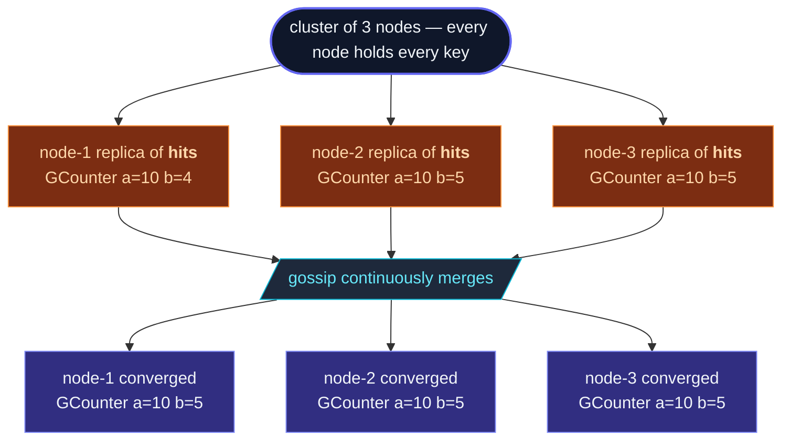

**Distributed data** is the cluster's eventually-consistent
shared-state layer.  Every node holds a **local replica** of every
key.  Updates apply locally first; gossip propagates them; conflicting
concurrent updates merge automatically via the data type's CRDT
semantics.



The shared state is **CRDT** — conflict-free replicated data type.
A handful of carefully-designed types (counters, sets, registers,
maps) whose merge operation is **commutative, associative, and
idempotent**: gossip can deliver updates in any order, repeat
them, or drop them, and replicas still converge on the same value.

## When to use DistributedData

Three patterns:

1. **Cluster-wide counters and gauges** — total request count,
   active session count, current rate limit.  Every node can
   read and write without coordinating; the merged value is the
   global truth.
2. **Membership sets** — "which sessions are active," "which
   feature flags are enabled."  Add and remove items from any
   node; the set's semantics handle concurrent adds correctly.
3. **Configuration registers** — a single value that nodes write
   to and read from, with timestamps deciding the winner on
   concurrent writes.

## A minimal example

```ts
import { ActorSystem } from 'actor-ts';
import { Cluster, ClusterOptions } from 'actor-ts/cluster';
import { DistributedDataId, GCounter } from 'actor-ts/crdt';

const system  = ActorSystem.create('my-app');
const clusterOptions = ClusterOptions.create()
  .withHost(host)
  .withPort(port)
  .withSeeds(seeds);
const cluster = await Cluster.join(system, clusterOptions);
const dd      = system.extension(DistributedDataId).start(cluster);

// Increment a counter — no coordination, just merge into the local replica.
dd.update<GCounter>(
  'request-count',
  GCounter.empty,
  (c) => c.increment(dd.selfReplicaId(), 1),
);

// Read the local view — gives you the latest known merged state.
const counter = dd.get<GCounter>('request-count');
console.log(counter?.value());   // sum across all known replicas
```

The local update is immediate; gossip propagates it to peers over
the next few rounds.  Reads are always local (cheap, no network),
and read what the local replica currently knows — which converges
toward the global state.

## The CRDT types

| Type | What it is | When |
| --- | --- | --- |
| **`GCounter`** | Grow-only counter.  Each replica counts its own contribution; the value is the sum. | Counts that only go up — total impressions, completed jobs. |
| **`PNCounter`** | Increment-and-decrement counter (two `GCounter`s under the hood). | Counts that go both ways — current active sessions. |
| **`GSet`** | Grow-only set.  Adds only, no removes. | Append-only collections — observed event types, encountered users. |
| **`ORSet`** | Observed-Remove set.  Adds and removes; concurrent add+remove resolves to add (the add was observed). | Membership sets where items come and go. |
| **`LWWRegister<T>`** | Last-Writer-Wins register.  A single value, the winner is the most recent timestamp. | Single-value config — feature flag, last-known leader. |
| **`MVRegister<T>`** | Multi-Value register.  Concurrent writes are kept as a set; the caller picks. | When you need to detect "two replicas wrote concurrently." |
| **`LWWMap<K, V>`** | A map of `K` to LWW values. | Per-key single-value config. |
| **`ORMap<K, C>`** | A map where the values are themselves CRDTs. | Per-key counters, per-key sets. |
| **`GCounterMap<K>`** | Convenience: a map of GCounters. | Per-key click counters, per-tenant request counts. |

The CRDT-type deep dives cover `merge()` semantics, when they fit,
and when they don't —
[counters](/distributed-data/crdt-types/counters/),
[registers](/distributed-data/crdt-types/registers/),
[sets](/distributed-data/crdt-types/sets/) and
[maps](/distributed-data/crdt-types/maps/).

## Consistency knobs

Reads and writes both have a **consistency** parameter:

```ts
await dd.updateAsync('hits', GCounter.empty,
  (c) => c.increment(dd.selfReplicaId(), 1),
  { consistency: 'majority', timeoutMs: 2_000 });

const hits = await dd.getAsync<GCounter>('hits',
  { consistency: 'majority' });
```

| Level | What it means |
| --- | --- |
| `'local'` *(default)* | Apply locally; rely on gossip to propagate.  Read returns the local replica's view. |
| `'majority'` | Wait until ⌊N/2⌋+1 replicas have acked.  Read merges majority responses. |
| `'all'` | Wait for every up-member.  Strongest consistency, highest latency. |
| `{ from: 3 }` | Wait for exactly `from` acks (clamped to `[1, N]`). |

Quorum doesn't change the merge semantics — every update still
merges into every replica eventually.  Quorum just gives you a
**guarantee** about *when* enough replicas have seen the write.

For most reads and writes, `'local'` is the right default.  Reach
for `'majority'` when:

- You want a read to reflect a recent write *you* made — `'local'`
  works only if you read on the same node you wrote to; majority
  reads cover the cross-node case.
- You want a write to be "durable" before responding to a client —
  `'majority'` ensures a node failure won't lose it.

## Subscribing to changes

Two kinds of subscriber can be told when a key changes, and both are
told about the same changes: every update or merge that *changes the
local value* — whether it came from a local update, gossip, a quorum
write or read, or an identity repair.  Pick by where the work should
run:

- **An actor** — for anything that does work or touches actor state.
  It is told a `DistributedDataChanged` and handles it on its own
  turn.
- **A callback** — for a cheap synchronous read.  It runs on the
  replicator's turn, so its time is the replicator's.

### An actor subscriber

```ts
import { match, P } from 'ts-pattern';
import { Actor } from 'actor-ts';
import { DistributedDataChanged, DistributedDataId, GCounter } from 'actor-ts/crdt';

type ResetMessage = { readonly kind: 'reset' };
type DashboardMessage = DistributedDataChanged<GCounter> | ResetMessage;

class HitsDashboard extends Actor<DashboardMessage> {
  private hits = 0;

  override preStart(): void {
    this.system.extension(DistributedDataId).get()
      .subscribe<GCounter>('hits', this.self);
  }

  override onReceive(message: DashboardMessage): void {
    match(message)
      .with(P.instanceOf(DistributedDataChanged), (m) => this.onHitsChanged(m))
      .with({ kind: 'reset' }, () => this.onReset())
      .exhaustive();
  }

  private onHitsChanged(changed: DistributedDataChanged<GCounter>): void {
    this.hits = changed.value.value();
  }

  private onReset(): void {
    this.hits = 0;
  }
}
```

The actor subscribes itself and handles the change in its own
`onReceive`, like any other message — so it may touch its own state,
and whatever it does costs the replicator nothing.  A
`DistributedDataChanged` carries the `key` and the new `value`; match
it by its class, as here, or by its `kind`,
`'distributed-data-changed'`.

What the actor is told is the **latest value, not every value**.  The
replicator keeps one slot per subscriber and key: while a notification
still waits in the actor's mailbox, a newer change replaces the value
it carries instead of queueing a second one, and the next notification
is posted only once the actor has been handed the last.  A busy actor
is told less often rather than told every value late — its own mailbox
is the pacing, so there is no timer, and no
`notify-subscribers-interval` to configure.  A bounded mailbox cannot
shed the notification either: it is admitted past the bound, the way a
death-watch `Terminated` is.

If the key already holds a value, the actor is told that too —
through its mailbox, once the replicator has handled the subscription,
rather than before `subscribe` returns.  Subscribing the same actor to
the same key again adds no second subscription.  `subscribe` returns
the function that unsubscribes; a notification already queued still
arrives.

The actor has to live **on this node**.  Subscribing a ref to an actor
on another node throws a `TypeError`: a notification carries the local
replica's live CRDT, and every node holds a replica of its own, so
subscribe on the subscriber's own node.  The replicator **watches** the
actor, so one that stops takes its subscriptions with it, and they
survive a restart of the replicator.  A `TestProbe`, which has no
mailbox to pace, is told every change directly.

### A callback subscriber

```ts
const unsubscribe = dd.subscribe<GCounter>('hits', (counter) => {
  console.log(`hits is now ${counter.value()}`);
});

// ... later
unsubscribe();
```

The callback is called once per changed key per merge.  If the key
already holds a value, `subscribe` calls the new callback with it right
away, on your own stack, before it returns.

The callback runs **synchronously on the replicator's own turn**, so
its time is the replicator's time: while it runs, no merge, gossip
round or quorum reply is processed — for any key.  Twenty calls of a
10 ms callback held a local read queued behind them back by 203 ms.
Keep a callback to a cheap synchronous read — refresh a figure on a
UI, compare a counter against a threshold — and subscribe an actor
for anything more, as [Replication](/distributed-data/replication/)
explains.  A callback that throws is logged as a warning and stays
subscribed.

## Durability

By default, DistributedData is in-memory only.  When the whole
cluster restarts (cold start), every key starts empty again.

For **survive-restart** semantics, use the **durable** variant:

```ts
import { DistributedDataOptions } from 'actor-ts/crdt';
import { InMemoryDurableStateStore } from 'actor-ts/persistence';

const store = new InMemoryDurableStateStore();
const distributedDataOptions = DistributedDataOptions.create().withDurableStore(store);
const dd = system.extension(DistributedDataId).start(
  cluster,
  distributedDataOptions,
);
```

`withDurableStore` takes any [`DurableStateStore`](/persistence/durable-state/)
(InMemory here; a SQL or object-storage backend in production).  The
durable layer persists the replica's **whole view** to the store; on
restart, the state is restored before joining the gossip.

See [Durable storage](/distributed-data/durable-storage/)
for the configuration details.

## When NOT to use DistributedData

import { Aside } from '@astrojs/starlight/components';

<Aside type="caution" title="Strong consistency needed">
  DistributedData is **eventually consistent**.  A read might
  reflect stale state for a few hundred ms after a write on
  another node.  If you need "every read sees every prior write"
  in real time, use a singleton or a persistent actor with
  explicit coordination.
</Aside>

<Aside type="caution" title="High-cardinality keyspace">
  Every node holds every key.  10 000 keys is fine; 10 million is
  not.  For per-key state at scale, use
  [sharding](/cluster/sharding/overview/) — each entity
  is one actor on one node, not replicated.
</Aside>

<Aside type="caution" title="Large per-key values">
  Gossiping a 10 MB blob to every node every gossip round is
  wasteful.  DistributedData is for *small* shared state — counters,
  flags, sets of IDs.  For large data (full configurations,
  documents), use a persistent journal or a dedicated key-value
  store with referenced lookups.
</Aside>

<Aside type="caution" title="Order-sensitive logic">
  CRDT merge is **order-independent** by design.  If your app's
  correctness depends on "increment then decrement then increment"
  vs "increment then increment then decrement," the CRDT will
  produce the same value (`+1` either way) but you've lost the
  intermediate state.  This usually isn't a problem; if it is,
  you need event sourcing, not a CRDT.
</Aside>

## Where to next

- **[Counters](/distributed-data/crdt-types/counters/)** — the first
  of the CRDT-type deep dives; each one links on to registers, sets
  and maps.
- **[Replication](/distributed-data/replication/)** — how
  gossip moves updates between replicas.
- **[Quorum reads/writes](/distributed-data/quorum-reads-writes/)** —
  the consistency-level knobs in detail.
- **[Durable storage](/distributed-data/durable-storage/)** —
  for survive-restart state.
- **[Cluster overview](/cluster/overview/)** — the
  membership underneath.
- **[Sharding overview](/cluster/sharding/overview/)** —
  the per-key alternative when keys are too numerous to replicate.

The [`DistributedData`](/api/classes/distributeddata/)
API reference covers the full extension surface.
