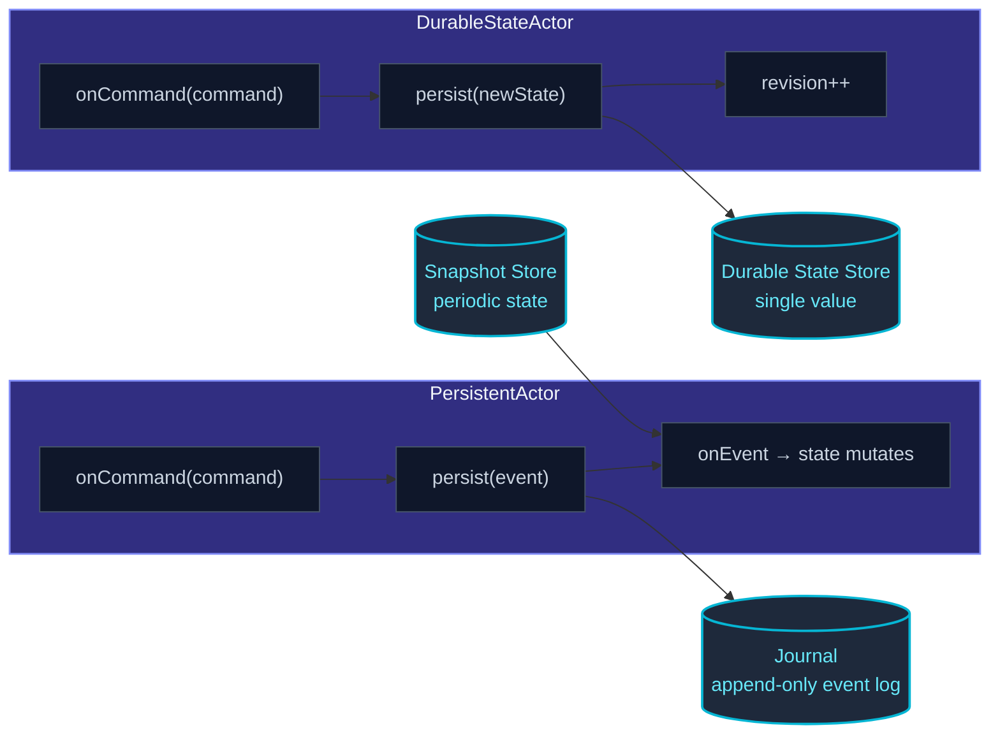
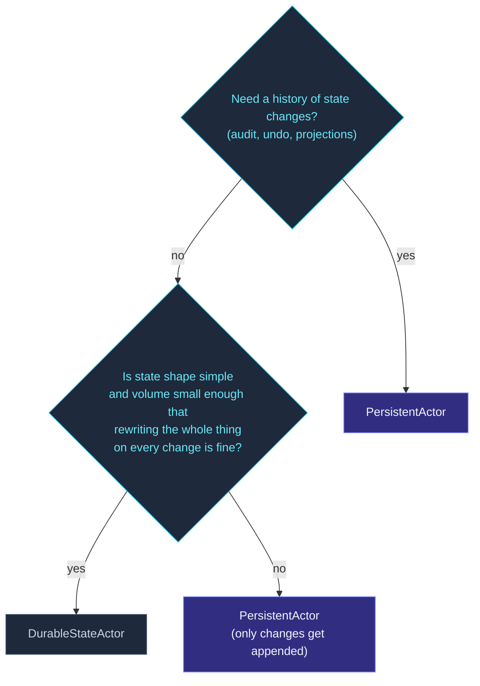

By default, actor state lives in memory.  When an actor crashes
and restarts, every field starts fresh.  For state that should
survive — user accounts, shopping carts, order workflows, anything
beyond the current request — you need **persistence**.

actor-ts offers two complementary models:

| Model | What you persist | When |
| --- | --- | --- |
| **Event sourcing** (`PersistentActor`) | A **log of events** — every state-changing fact ever observed. | Audit trails, time travel, projections, when "how did we get here" matters. |
| **Durable state** (`DurableStateActor`) | A **single snapshot** — the current state, overwritten on each update. | When the current value is all you need and history isn't useful. |

Both replay or restore on actor startup, so the resurrected actor
picks up where the last one left off.

## The big picture



The journal and the durable-state store are **pluggable**.  The
framework ships:

| Backend | Journal | Durable state | Snapshot store | Indexed tag query | Shared across nodes | Runtimes |
| --- | --- | --- | --- | --- | --- | --- |
| In-memory | ✓ | ✓ | ✓ | in-process scan | ✗ (per process) | all |
| SQLite | ✓ | ✓ | ✓ | ✓ (join table) | ✗ (per node) | all |
| libSQL / Turso | ✓ | ✓ | ✓ | ✓ (join table) | ✓ | all |
| PostgreSQL | ✓ | ✓ | ✓ | — (polling scan) | ✓ | all |
| MariaDB / MySQL | ✓ | ✓ | ✓ | — (polling scan) | ✓ | all |
| Microsoft SQL Server | ✓ | ✓ | ✓ | — (polling scan) | ✓ | all |
| MongoDB | ✓ | ✓ | ✓ | ✓ (multikey index) | ✓ | all |
| DynamoDB | ✓ | ✓ | ✓ | — (polling scan) | ✓ | all |
| Cloudflare D1 | ✓ | ✓ | ✓ | ✓ (join table) | ✓ | all |
| CockroachDB, YugabyteDB | ✓ | ✓ | ✓ | — (polling scan) | ✓ | all |
| Cassandra | ✓ | — | ✓ | ✓ (tag-index table) | ✓ | all |
| Filesystem / S3 (object storage) | — | ✓ | ✓ | n/a | S3 ✓ / filesystem ✗ | all |

CockroachDB and YugabyteDB are not separate backends — they speak the
PostgreSQL wire protocol, so the Postgres stores serve them unchanged.  See
[wire-compatible databases](/persistence/journals/wire-compatible/) for what
is certified and the caveats that come with each.

"Indexed tag query" is what `PersistenceQuery.currentEventsByTag` can push
down to storage: a backend with a tag index walks it, while the others scan
the journal and refine in memory — correct either way, but only bounded in
cost where there is an index.  SQLite runs on every runtime since the
built-in `node:sqlite` driver landed; the local file needs `better-sqlite3`
only if you prefer it on Node.

Plus an extension point — implement the `Journal` /
`DurableStateStore` / `SnapshotStore` interfaces for your own
storage.

## Event sourcing in five minutes

```ts
import { match } from 'ts-pattern';
import { Actor, ActorSystem } from 'actor-ts';
import { PersistentActor } from 'actor-ts/persistence';

type DepositCommand = { kind: 'deposit'; amount: number };
type WithdrawCommand = { kind: 'withdraw'; amount: number };
type Command = DepositCommand | WithdrawCommand;

type DepositedEvent = { kind: 'deposited'; amount: number; ts: number };
type WithdrawnEvent = { kind: 'withdrawn'; amount: number; ts: number };
type Event = DepositedEvent | WithdrawnEvent;

type State = { balance: number; };

class Account extends PersistentActor<Command, Event, State> {
  readonly persistenceId = 'account-42';

  initialState(): State { return { balance: 0 }; }

  // Pure: state + event → new state.  Replayed during recovery.
  onEvent(state: State, e: Event): State {
    return match(e)
      .with({ kind: 'deposited' }, (ev) => ({ balance: state.balance + ev.amount }))
      .with({ kind: 'withdrawn' }, (ev) => ({ balance: state.balance - ev.amount }))
      .exhaustive();
  }

  // Validates command, persists event, runs side effects post-persist.
  onCommand(state: State, command: Command): void {
    match(command)
      .with({ kind: 'deposit' }, (c) => this.onDeposit(c))
      .with({ kind: 'withdraw' }, (c) => this.onWithdraw(state, c))
      .exhaustive();
  }

  private onDeposit(command: DepositCommand): void {
    this.persist({ kind: 'deposited', amount: command.amount, ts: Date.now() },
      (next) => { /* side effects with the persisted-and-applied state */ });
  }

  private onWithdraw(state: State, command: WithdrawCommand): void {
    if (state.balance < command.amount) {
      // Reject — don't persist anything.
      return;
    }
    this.persist({ kind: 'withdrawn', amount: command.amount, ts: Date.now() },
      () => {});
  }
}
```

Three methods do all the work:

- **`onCommand`** — validates the request.  Decides what event(s) to
  persist via `this.persist(event, afterPersist)`.  Side effects go in `afterPersist`.
- **`onEvent`** — pure function from state + event to new state.
  **No side effects** here — this function runs during recovery to
  replay the journal, possibly many times.
- **`initialState`** — what the state looks like before any events.

On startup, the framework reads every event for `account-42`
from the journal, replays them through `onEvent`, and the
resulting state is what `onCommand` sees.  Commands aren't
processed until recovery completes.

See [PersistentActor](/persistence/persistent-actor/) for
the full surface.

## Durable state in five minutes

```ts
import { match } from 'ts-pattern';
import { type ActorRef } from 'actor-ts';
import { DurableStateActor, DurableStateOptions } from 'actor-ts/persistence';

type State = { items: string[]; };

type AddCommand = { kind: 'add'; sku: string };
type ViewCommand = { kind: 'view'; replyTo: ActorRef<State> };
type CartCommand = AddCommand | ViewCommand;

class Cart extends DurableStateActor<CartCommand, State> {
  constructor(options: DurableStateOptions<State>) { super(options); }

  override async onCommand(command: CartCommand): Promise<void> {
    await match(command)
      .with({ kind: 'add' }, (c) => this.onAdd(c))
      .with({ kind: 'view' }, (c) => this.onView(c))
      .exhaustive();
  }

  private async onAdd(command: AddCommand): Promise<void> {
    const next: State = { items: [...this.state.items, command.sku] };
    await this.persist(next);   // overwrites the stored state
  }

  private onView(command: ViewCommand): void {
    command.replyTo.tell(this.state);
  }
}
```

`persist(newState)` overwrites the stored snapshot.  On restart,
`preStart` loads it back; `this.state` reflects the loaded value.
No event log; no replay; just "save the current state."

See [DurableStateActor](/persistence/durable-state/) for
the full API.

## Event sourcing vs durable state — picking one

The honest decision tree:



Event sourcing wins when:

- **History matters** — auditing, regulatory compliance, "show me
  how we got here," projections.
- **State is large** but changes are small — appending a 100-byte
  event is cheaper than writing the whole state.
- **You want projections** — read-side views over the event
  stream, see [Projections](/persistence/projections/).
- **Schema evolution is a long game** — event types can be
  migrated independently from current state.

Durable state wins when:

- **History isn't useful** — the current value is all you need.
- **State is small and simple** — overwriting is cheap.
- **You want optimistic concurrency** — durable state stores have
  a revision counter; concurrent writes raise
  `DurableStateConcurrencyError`.

Many production systems mix them — durable state for the
configuration-style "single current value" things, event-sourcing
for the workflow-style "history-of-decisions" things.

## Snapshots

Replaying 100 000 events at startup is slow.  Snapshots cut the
replay window:

```ts
class Account extends PersistentActor<Command, Event, State> {
  // ...
  override snapshotPolicy() { return everyNEvents(100); }
  // After every 100 events, the current state is written as a snapshot.
}
```

On startup, the framework:

1. Loads the latest snapshot (if any).
2. Replays events *from after that snapshot's seqNr onward*.

A 100-event window is fast.  Pick the snapshot interval based on
your event rate and acceptable startup time.

See [Snapshots](/persistence/snapshots/) for the
configuration and per-actor policy options.

## Projections — read-side views

A `PersistentActor` writes events.  A **projection** consumes
them, building a derived view tailored for queries:

```ts
import { match } from 'ts-pattern';
import { ProjectionActor, ByTagProjectionOptions } from 'actor-ts/persistence';

const cartViewOptions = ByTagProjectionOptions.create<CartEvent>()
  .withName('view-cart-summary')
  .withTag('cart')
  .withQuery(query)
  .withHandle(async (event) => {
    await match(event.event)
      .with({ kind: 'added' }, () => db.execute('INSERT INTO cart_items ...'))
      // ...
      .otherwise(() => Promise.resolve());
  });
const cartView = ProjectionActor.byTag<CartEvent>(system, cartViewOptions);
```

The projection subscribes to events tagged `'cart'` from the
journal, processes them in order, persists its own progress
(so a restart resumes from the right offset).

This decouples writes (the `PersistentActor`'s journal) from
reads (the projection's view) — the read side can be denormalized
for the query patterns it serves.

A handler that throws blocks every event behind it, because the
cursor only advances on success.  `recoveryStrategy` bounds that:
retry with backoff and then stop (the default), skip the event onto
the dead-letter stream, or do either immediately.

See [Projections](/persistence/projections/) for the
full pattern.

## Pluggable backends

The framework defines three interfaces:

```ts
type Journal = {
  // append events, read events, query by tag
};

type DurableStateStore = {
  // load, persist with revision, delete
};

type SnapshotStore = {
  // save snapshot, load latest, delete older
};
```

Built-in implementations live under
[`persistence/journals/*`](/persistence/journals/in-memory/)
and [`persistence/snapshot-stores/*`](/persistence/snapshot-stores/in-memory/).

A backend comes in through the `plugins` slot of the system's options.
Each entry is a `PersistencePlugin` — a function the system hands its
`PersistenceExtension` — and typically makes one `register*Plugins`
call; `actor-ts.persistence.<axis>.plugin` in the configuration then
decides which registered plug-in each axis uses:

```ts
import { ActorSystem, ActorSystemOptions } from 'actor-ts';
import { registerPostgresPlugins } from 'actor-ts/persistence';

const systemOptions = ActorSystemOptions.create().withPersistence({
  plugins: [(persistence) => registerPostgresPlugins(persistence)],
});
const system = ActorSystem.create('orders', systemOptions);
```

The plug-ins run inside `ActorSystem.create`, in the order given, so
the backend a selector names is registered before `create` returns and
the selected stores open as part of the startup — see [opening the
stores at startup](#opening-the-stores-at-startup).  A plug-in that
returns a promise is awaited by the startup too, so a registration
that fails late fails the startup rather than the first persisted
message.

Writing your own?  `Journal.read()` is the method replay holds to
its contract: the events it returns must be ascending by sequence
number, contiguous, and inside the requested window.  `delete()`
compacts a *prefix*, never a hole in the middle, so a gap can
only mean a defect — a missing `ORDER BY`, a half-written append,
a store someone else can write.  Replay raises
`JournalIntegrityError` instead of folding it; see [what replay
refuses to
fold](/persistence/persistent-actor/#what-replay-refuses-to-fold).

A store that connects to something should also implement the
optional `start?()`: open now instead of on the first operation, so
the system's warm-up at boot — see [opening the stores at
startup](#opening-the-stores-at-startup) — can make a wrong
connection string fail at startup rather than at the first
persisted message.  The in-repo stores keep
one rule there, and yours should too.  `start()` is idempotent and
shares a single open with the first operation.  A start that fails
rejects, releases whatever it had half-opened, and is not
remembered, so the next call opens afresh — one database blip at
boot must not leave a store that fails for the life of the process.
After `close()`, `start()` rejects like every operation does, and a
`close()` that arrives while a start is still running leaves nothing
open.  A store with nothing to open — the in-memory ones, object
storage — leaves `start?()` undefined.

For production, the **SQLite** journal+snapshot combo
covers single-node deployments; a shared backend — **Cassandra**,
**PostgreSQL**, or any other row with ✓ in the matrix's
"shared across nodes" column — covers multi-node clusters, where
every node must replay the *same* journal.  What "the same" means,
and how the cluster checks it, is the next section.

## Storage locality & identity

A cluster's persistent state has one hard prerequisite the type
system cannot express: **every node must read and write the same
database.**  Sharding moves entities between nodes, and the moved
entity replays whatever journal its new node opens.  With per-node
storage — a SQLite file, the in-memory defaults — each node opens
its *own* database, and nothing ever fails: the optimistic head
check compares against the local file, so two divergent histories
accumulate under one persistence id with no error on either node.
Two nodes, two histories, and the answer you get depends on which
node you ask.

The framework guards this along two independent lines:

**Locality — what the store *is*.**  Every in-repo store declares
`storageLocality: 'node-local' | 'shared'` — a SQLite file or an
in-memory map can never be shared, a database service can.  When a
`'node-local'` store backs a persistent actor while the cluster has
(or later gains) remote peers, the node logs one warning per store
kind, greppable by the needle `node-local storage`.  One
combination refuses outright instead of warning:
`rememberEntities: true` on its default auto-wired path throws
`StorageLocalityError`, because the sharding registry is
leader-hosted and provably forks on failover — see
[remember entities](/cluster/sharding/remember-entities/).

**Identity — which database it actually *is*.**  A `'shared'`
declaration says the backend *could* be shared, not that two nodes
actually reached the same instance of it: two nodes each pointing
at their own PostgreSQL, a stale connection string, a restored
backup — same technology, different database, identical silent
divergence.  So every store mints a random identity on first
contact and persists it *in the database itself*
(`storageIdentity()`); nodes gossip the identities of the stores
they actually use on their member records, and any node that sees
a peer claim a different identity for the same store kind says so —
once per kind, greppable by the needle `storage identity differs`.

Both checks are conservative by construction.  A store that
declares neither member is *unknown* and stays silent — a
third-party backend is never misjudged by a default it did not
choose — and [replicated event
sourcing](/persistence/replicated-event-sourcing/overview/), whose
per-node journals are the intended design, triggers neither.
Writing your own store?  Declare `storageLocality`, and implement
`storageIdentity()` as: mint a random value on first contact,
persist it in the database, return the stored one ever after — the
in-repo stores keep it in a one-row `storage_identity` table (or an
object under the root key `storage-identity`).

Every backend stores payloads in the same tagged JSON tree format,
so `Date` / `Map` / `Set` / `bigint` / `Uint8Array` round-trip
everywhere — see
[what events and state may contain](/persistence/persistent-actor/#what-events-and-state-may-contain).

## Opening the stores at startup

A system opens its persistence stores as part of its startup, not at
the first persisted message.  Inside `ActorSystem.create` it resolves
the journal, the snapshot store and the durable-state store — the ones
`actor-ts.persistence.<axis>.plugin` selects, or the instances
`withPersistence` sets in code — and in the `persistence-start` phase
of the startup it calls each one's `start()`.  That happens after the
promises the plug-ins returned have settled, and the three open in
parallel.  A store with nothing to open, such as the in-memory ones,
is left as it is; a system that neither wires persistence in code nor
selects a plug-in in its configuration opens nothing at all.

The failure moves to where an operator wants it.  A plug-in id nothing
registered, a connection string that names the wrong host, a database
the node cannot reach — each fails the startup with an error naming
the store: `system.whenReady()` rejects, the system shuts down, and
`runUntilTerminated()` rejects with the same error, so the process
exits non-zero instead of taking traffic it cannot persist.  A
relational store reaches its database whether or not it creates its
own tables: with `autoCreateTables: false` it sends a `SELECT 1` where
it would have run its DDL, so behind a schema the operator manages an
unreachable database fails the startup all the same.  A store
that neither opens nor fails, behind a host that drops packets, fails
the startup when its phase's budget runs out (30 s unless
`withCoordinatedStartup` or
[`actor-ts.coordinated-startup`](/reference/configuration/#actor-tscoordinated-startup)
sets another).  While the stores open, the `startup` readiness check
keeps `/ready` false.

The selection is resolved inside `create`, so the plug-in it names has
to be registered there too — through the `plugins` slot, as [pluggable
backends](#pluggable-backends) shows.  A `register*Plugins` call on the
extension after `create` comes too late for a selected store, and the
startup fails with `Unknown journal plugin`.  An actor spawned on the
line after `create` is fine: its first read shares the store's one
open rather than racing it.

Every axis the configuration selects is opened, including one this
service never uses — a durable-state plug-in selected in an
`application.conf` it shares with services that do — so a mistake
there fails this startup too: point that axis back at the in-memory
store for this service, or turn the boot-time open off as shown below.

Nothing in the framework closes the stores it resolved
([#388](https://github.com/pathosDev/actor-ts/issues/388)), and a
failed startup is no exception — it runs coordinated shutdown, so a
store that opened before a sibling failed is closed only by a shutdown
task the application registers, as the
[chat sample](/examples/chat-sample/)'s `close-persistence` task does;
one added right after `create` runs on that path too.  Without one, an
open pool or client can keep the process alive after its startup
failed.

To open the stores on first use instead, turn the boot-time open off
in code — `autoStart` in the persistence behaviour:

```ts
const persistenceBehavior = PersistenceBehaviorOptions.create().withAutoStart(false);
const systemOptions = ActorSystemOptions.create().withPersistence({ behavior: persistenceBehavior });
```

A deployment switches it in its configuration file the same way, with the
leaf `reference.conf` ships as `on`; a setting made in code wins over it:

```hocon
actor-ts.persistence.auto-start = off
```

Off, nothing is resolved or opened until the first operation asks,
and a plug-in registered after `create` is still found then.  The
workers of a `WorkerMesh` always run with it off, whatever the
configuration they inherit says — see
[Parallelism](/fundamentals/parallelism/).

## When NOT to persist

import { Aside } from '@astrojs/starlight/components';

<Aside type="caution" title="Cache-like actors">
  ```ts
  class Cache extends PersistentActor<...> {
    // ✗ if the cache is rebuildable, don't persist it
  }
  ```
  A cache by definition can be rebuilt from a source of truth.
  Persisting the cache means you've doubled the storage cost
  with no recovery benefit beyond "warm restart."  Use plain
  Actor + an external cache (Redis, Memcached) for that.
</Aside>

<Aside type="caution" title="Tiny state with no failover requirement">
  An actor that holds 100 bytes of state in a process you control
  the restart of (e.g. a CLI tool) probably doesn't need
  persistence.  Persistence has setup cost (journal config, store
  selection, schema management); skip it when the state's
  recovery requirement is "user re-runs the command."
</Aside>

<Aside type="caution" title="Pure transformation actors">
  An actor whose job is "take input, transform, send output" with
  no persistent internal state has nothing to persist.  Plain
  `Actor` is the right base; `PersistentActor` adds machinery
  you'd never use.
</Aside>

## Where to next

- **[PersistentActor](/persistence/persistent-actor/)** —
  the event-sourcing API in depth.
- **[Durable state](/persistence/durable-state/)** —
  the simpler snapshot-style alternative.
- **[Snapshots](/persistence/snapshots/)** — replay-window
  reduction for event-sourced actors.
- **[Projections](/persistence/projections/)** — read-side
  views built from event streams.
- **[Journals — In-memory](/persistence/journals/in-memory/)** —
  the tests/dev default.
- **[Journals — SQLite](/persistence/journals/sqlite/)** —
  single-node production default.
- **[Migration overview](/persistence/migration/overview/)** —
  evolving event/state schemas over time.

The [`PersistentActor`](/api/classes/persistentactor/) and
[`DurableStateActor`](/api/classes/durablestateactor/) API
references cover the full base-class surface.
