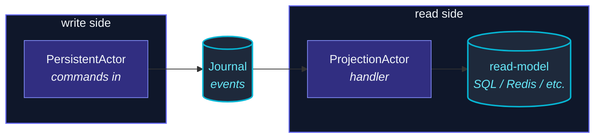

A `PersistentActor` writes events.  A **projection** consumes
them, building a **read-side view** tailored for queries:



The journal is **append-only and authoritative**.  Projections
are derived — they can be rebuilt from scratch by replaying the
journal.  This decouples write throughput (durable, append-only)
from read throughput (denormalized, query-optimized).

## A minimal example

```ts
import { match } from 'ts-pattern';
import { ProjectionActor, ByTagProjectionOptions } from 'actor-ts/persistence';
import { SqliteJournal, SqliteJournalOptions, SqliteQuery, InMemoryOffsetStore } from 'actor-ts/persistence';

type AccountEvent =
  | { kind: 'deposited'; amount: number }
  | { kind: 'withdrawn'; amount: number };

// The read side queries the SAME journal your PersistentActors write to —
// SqliteQuery wraps a SqliteJournal instance (not a path).
const eventsJournal = new SqliteJournal(SqliteJournalOptions.create().withPath('/var/lib/events.db'));

const byTagProjectionOptions = ByTagProjectionOptions.create<AccountEvent>()
  .withName('account-balance-view')
  .withTag('account')
  .withQuery(new SqliteQuery(eventsJournal))
  .withOffsetStore(new InMemoryOffsetStore())
  .withHandle(async (event) => {
    await match(event.event)
      .with({ kind: 'deposited' }, (e) => viewDb.execute(
        'UPDATE balances SET balance = balance + ? WHERE pid = ?',
        [e.amount, event.persistenceId],
      ))
      .otherwise(() => Promise.resolve());
  });
const projection = ProjectionActor.byTag<AccountEvent>(system, byTagProjectionOptions);
```

The actor:

1. Loads its **offset cursor** from the offset store on
   `preStart`.
2. Polls the **query layer** for events matching `tag` from the
   cursor onwards.
3. Calls `handle` for each event — or `handleGroup` for each group
   of events, see [Grouped handlers](#grouped-handlers).
4. Persists the new cursor.
5. Repeats.

## Two query shapes

| Factory | Cursor type | Use |
| --- | --- | --- |
| **`ProjectionActor.byPersistenceId(...)`** | sequenceNr (per pid) | Read one entity's full history. |
| **`ProjectionActor.byTag(...)`** | Offset (timestamp + tiebreaker) | Read everything tagged `<tag>` across the journal. |

Tag-based is the common case — the `PersistentActor` calls
`tagsFor(event)` to label events; the projection subscribes to
the tag.  Per-pid is useful for narrow views (one user's
activity).

`tagsFor` is asked **per event**, so a projection filtering on a tag
sees exactly the events that carry it — including when the events
were written together by one `persistAll`.

### Filtering on more than one tag

`withTag` accepts a **`TagFilter`**, so a projection is not limited to a
single tag:

```ts
import type { TagFilter } from 'actor-ts/persistence';

const eitherOne: TagFilter = { any: ['debit', 'credit'] };
const bothOfThem: TagFilter = { all: ['account', 'production'] };
const allButCancelled: TagFilter = { all: ['orders'], not: ['cancelled'] };

const byTagProjectionOptions = ByTagProjectionOptions.create<AccountEvent>()
  .withName('open-orders-view')
  .withTag(allButCancelled);
```

Each operator is optional and they combine with AND.  An empty `{}`
matches every event.

**The filter is part of the cursor identity.**  A bare string keeps the
cursor it already has, but the two spellings do not share one:
`.withTag('orders')` stores its offset under `orders`, while
`.withTag({ all: ['orders'] })` stores it under `all(orders)`.  Both
select the same events, so rewriting one as the other looks harmless —
and it silently replays the projection from the beginning.  Pick a
spelling before the projection first runs, and keep it.

## At-least-once delivery

```ts
// Crash recovery sequence:
//   1. Save offset cursor at value N.
//   2. Handler processes event N+1.
//   3. Crash before saving cursor.
//   4. On restart: cursor is still N → handler re-receives event N+1.
```

If the handler runs but the cursor isn't persisted, the projection
**re-processes the same event** on restart.  This is **at-least-once
delivery** — the framework guarantees no event is missed, but
duplicates are possible.

With [`handleGroup`](#grouped-handlers) the unit of replay is the
group.  The cursor is persisted once per group, to its last event,
so a crash between the call and that save delivers **every event of
the group** again — not only the one that was being processed.
Idempotency has to hold for each event in it.

Handlers must be **idempotent**:

- **UPSERT** into the read model (not blind `INSERT`).
- **Track processed event IDs** in the read model itself for dedup.
- **Use the event's `sequenceNr` as a per-pid dedup key** — never
  decreases, monotonic per persistenceId.

If you can't make the handler idempotent, the projection has to
participate in a 2-phase commit with the offset save — much more
complex, not provided out of the box.

## When the handler throws

The cursor only advances after `handle` returns, so a failing
handler is **head-of-line blocking** by construction: every later
event waits behind the one that failed.  `recoveryStrategy` decides
how long that lasts.

| Strategy | Retries | Then | Pick it when |
| --- | --- | --- | --- |
| **`retry-and-fail`** *(default)* | yes | stops the projection | A silently stale view is worse than an obviously stopped one. |
| **`retry-and-skip`** | yes | steps past the event | Liveness beats completeness — a dashboard, a search index. |
| **`fail`** | no | stops immediately | The handler already retries internally. |
| **`skip`** | no | steps past immediately | Some events are simply expected to be undeliverable. |

```ts
const byTagProjectionOptions = ByTagProjectionOptions.create<AccountEvent>()
  .withName('account-balance-view')
  .withTag('account')
  .withRecoveryStrategy('retry-and-skip')
  .withMaxRetries(5)
  .withRetryBackoffMs(2_000)
  .withMaxRetryBackoffMs(60_000)
  .withOnFailure((failure) => {
    console.error(
      `${failure.projection}: ${failure.event.persistenceId}#${failure.event.sequenceNr} `
      + `→ ${failure.action} (attempt ${failure.attempt})`,
      failure.error,
    );
  });
```

Retries are **not immediate**.  The next attempt is deferred by
`retryBackoffMs`, doubling each time up to `maxRetryBackoffMs`.
`maxRetries` counts attempts *after* the first, so the default of 3
means a bad event reaches the handler four times before the
projection gives up on it.

### The same knobs in HOCON

Failure handling is usually an *operational* decision — the same code
wants `retry-and-fail` in production and `skip` in a dev loop — so
the four fields, the poll cadence and the group size also have
process-wide defaults under `actor-ts.projection`:

```hocon
actor-ts.projection {
  recovery-strategy     = "retry-and-skip"
  max-retries           = 5
  retry-backoff         = 2s
  max-retry-backoff     = 60s
  poll-interval         = 1s
  group-after-envelopes = 50   # handleGroup projections only
}
```

Precedence is the project's usual three layers, applied **per
field**: explicit `ProjectionOptions` > HOCON > built-in default.  A
field this projection does not set falls through to the block above,
and one the block does not carry falls through to the built-in value
— so the configuration reaches every projection that has not made up
its own mind about that field, and none that has.  Passing an empty
`liveOptions` is *not* making up your mind: `poll-interval` still
applies.

Set `max-retry-backoff` whenever you set `retry-backoff`.  The two
are checked against each other on the *merged* settings, so raising
only the first past the 60 s ceiling makes every projection in the
process throw `OptionsError` when it starts — from a config file
alone, with no code change.

`group-after-envelopes` sizes the groups of every
[grouped projection](#grouped-handlers) that does not call
`withGroupAfterEnvelopes` itself, and of no other: a `handle`
projection is still delivered one event per call, whatever the block
says.  Nor is it refused for the leaf being there — the `OptionsError`
for a size on a `handle` projection is for a size its own code wrote,
and a file that every projection in the process reads is not that.

### What a failure produces

- **`onFailure`** — called on every attempt with the offending
  `PersistentEvent`, the error, the attempt number, and the action
  taken (`retry` / `skip` / `stop`).  A failed group adds the `group`
  itself — see [When a group fails](#when-a-group-fails).  This is
  the structured signal; wire it to your alerting.  A hook that
  throws is logged and swallowed — a broken reporter cannot take the
  projection with it.
- **A dead letter** — a skipped event is published on the system
  event stream wrapped in a `DeadLetter` naming the projection as its
  recipient, so nothing vanishes without a trace:

  ```ts
  import { DeadLetter } from 'actor-ts';

  system.eventStream.subscribe(auditRef, DeadLetter);
  ```

  Publishing is all that happens by default — with no subscriber the
  event is gone.  Turning on the
  [dead-letter queue](/operations/dead-letters/) keeps skipped events
  instead, filterable by the projection that skipped them and
  replayable once the handler is fixed.

- **Metrics** — `persistence_projection_stalled`,
  `persistence_projection_failures_total` and
  `persistence_projection_events_skipped_total`; see
  [Stock metrics](/observability/metrics/stock-metrics/).
- **Logs** — one error line when a failure streak opens and one when
  it ends.  The retries in between go to `debug`, so a projection
  stuck for a day costs two error lines instead of one per poll.

`fail` **stops the actor** rather than letting the error escape the
tick.  That is deliberate: the projection group's supervisor
restarts its children, so an escaping error would reload the same
cursor and fail on the same event — a restart loop, which is louder
than the spin it replaced and no more useful.

A stopped projection keeps its cursor, so fixing the cause and
starting it again resumes at exactly the event that failed.

## Grouped handlers

`handle` runs once per event, so a projection pays its read model one
round trip per event — one statement, one request.  Where that round
trip is the cost, take the events in groups instead:

```ts
import { ProjectionActor, ByTagProjectionOptions } from 'actor-ts/persistence';

const byTagProjectionOptions = ByTagProjectionOptions.create<AccountEvent>()
  .withName('account-statement-view')
  .withTag('account')
  .withQuery(new SqliteQuery(eventsJournal))
  .withOffsetStore(new InMemoryOffsetStore())
  .withGroupAfterEnvelopes(50)
  .withHandleGroup(async (events) => {
    // One statement per group; the conflict clause makes a replayed group harmless.
    await viewDb.execute(
      'INSERT INTO statement_lines (pid, seq, kind) VALUES '
        + events.map(() => '(?, ?, ?)').join(', ')
        + ' ON CONFLICT (pid, seq) DO NOTHING',
      events.flatMap((event) => [event.persistenceId, event.sequenceNr, event.event.kind]),
    );
  });
const projection = ProjectionActor.byTag<AccountEvent>(system, byTagProjectionOptions);
```

- **One handler, not two.**  A projection sets `withHandle` *or*
  `withHandleGroup`.  The factory throws `OptionsError` for neither,
  for both, for a `groupAfterEnvelopes` that is not a positive
  integer, and for one on a `handle` projection, where it would
  silently do nothing.
- **The poll is the window.**  Each tick cuts what its poll returned
  into groups of at most `groupAfterEnvelopes` events — 20 by
  default — and delivers every one of them in that tick, in journal
  order.  Nothing is held back to fill a group: a busy journal yields
  full groups, a quiet one a short group per poll, and no event waits
  longer than it would with `handle`.  For larger groups at a lower
  rate, lengthen the poll interval.
- **One commit per group**, to its last event.  Fewer offset writes
  are part of what grouping buys, and they make the group the unit
  of replay — see [At-least-once delivery](#at-least-once-delivery).

### When a group fails

The recovery strategy applies to the group first, with the budget an
event would get.  A retry sends the same group again after the
backoff; `fail` and `retry-and-fail` stop before the group's first
event, so the cursor stays put and a restart sends the whole group
again.

A group is never skipped, because that would throw its good events
away with the bad one.  Where the strategy would skip — `skip` at
once, `retry-and-skip` once its retries are spent — the group is
**split** instead: its events go out again one per call, as
`handleGroup([event])`, each with its own retry budget and its own
commit.  The event that fails is then retried and skipped exactly as
under `handle` — one dead letter, one step of
`persistence_projection_events_skipped_total` — while the events
before it are committed and the ones after it follow.  Once the split
range is through, delivery is grouped again.  A group of one, such as
the short tail of a poll, already is one event per call and fails the
per-event way from the start.

`onFailure` tells the two kinds of attempt apart.  A group attempt
carries `group` — every event of the failed call — with `event` set
to the first of them, the one the cursor is waiting on.  The attempt
that hands a group over to the split reports `retry`, since each of
its events is about to be tried again.  A failure inside the split
carries no `group`, like a failure of `handle`.

## OffsetStore

```ts
import { InMemoryOffsetStore, DurableStateOffsetStore } from 'actor-ts/persistence';

// Default (lost on restart):
new InMemoryOffsetStore();

// Durable — persist the cursor in any DurableStateStore (Postgres,
// MariaDB, libSQL, SQL Server, MongoDB, DynamoDB, object-storage), so a restart resumes:
new DurableStateOffsetStore(durableStateStore);
```

The cursor is just a number (or compound offset) — stored per
projection name + scope.  Implementations:

- `InMemoryOffsetStore` — fine for tests, useless in production
  (every restart re-processes from the beginning).
- `DurableStateOffsetStore` — wraps any `DurableStateStore` (Postgres,
  MariaDB, libSQL, SQL Server, MongoDB, DynamoDB, object-storage) so offsets survive restarts.
- Custom — implement `OffsetStore` against your own store (Redis,
  whatever your read-model uses).

For real production setups, **co-locate the offset store with
the read model** so they crash together — that minimizes the
re-processing window.

In a cluster, the offset store needs the same property the journal
does: **one database, not one per node.**  A
`DurableStateOffsetStore` over node-local storage gives every node
its own cursor, and a projection that moves between nodes then
re-processes events one node already handled — or skips the ones
the other node's cursor is past.  See [storage locality &
identity](/persistence/overview/#storage-locality--identity).

### The composite key has a length budget

`DurableStateOffsetStore` does not store a cursor under your
`persistenceId`.  It stores it under a **composite** —
`projection|seq|persistenceId` for a by-persistence-id projection,
`projection|tag|tag` for a by-tag one — and that string becomes the
`persistenceId` of the underlying `DurableStateStore`.  That column is
`VARCHAR(255)` under `MariaDbDialect` and `NVARCHAR(255)` under
`MsSqlDialect`; `PostgresDialect` and `SqliteDialect` declare it
`TEXT`.  Two of the four relational dialects, then — and a
`DurableStateStore` need not be relational at all.

So the framework can compose a key you never wrote.  A 250-character
`persistenceId` is legal on its own (the limit is 255), but under a
projection named `orders-projection` the composite is 272 characters.
The store refuses it rather than passing it on, with an error naming
**both halves** — neither alone identifies the trouble, since the same
id under a shorter projection name is fine:

```text
Projection offset key is 272 characters, over the 255-character
durable_state.persistence_id column: projection "orders-projection" (17)
+ "|seq|" + persistenceId "order-xxx…" (250). Shorten the projection
name or the persistenceId — ...
```

The budget for the second half is **255 − the projection name − 5**.
Under `orders-projection` that leaves 233 characters.  A by-tag
projection spends the same budget on the rendered tag filter
(`all(a,b)+any(c)`), so a filter over several tags can outgrow it
without any one tag being unusual.

Refusing here rather than letting the database decide is deliberate,
because the databases disagree and none of the answers is one you can
act on:

- SQL Server, and MariaDB in strict mode (the default since 10.2.4),
  raise a truncation error — loud, but naming a column you never wrote.
- MariaDB with strict mode off truncates to 255, and two projections
  whose names share a prefix then share one cursor row.  Nothing
  fails; the projection simply skips events.
- Postgres and SQLite store `TEXT` and keep the whole thing, so the
  same code works until the read model moves.

The bound is therefore a **portability floor, not a column
constraint** — it holds on the two dialects where nothing would have
complained.  That is the point of it: the case it exists for is the
move off `TEXT`, where a key that fit on SQLite becomes, on MariaDB
with strict mode off, a row two projections share.  A bound that
applied only where the column is narrow would make the same projection
legal on one backend and refused on another, which restates the trap
instead of closing it — and `DurableStateOffsetStore` has no dialect
to ask in any case, since a `DurableStateStore` is just as likely to
be object storage, the filesystem, Cassandra, DynamoDB or MongoDB.

Loads are refused as well as writes, so a projection that could never
commit its cursor fails before it runs your handler rather than after.
What you see when that happens is the projection's own instruments and
not a bare actor failure: `persistence_projection_failures_total`
moves with `reason="poll"`, `persistence_projection_stalled` goes to
1, and one error line per start attempt names the projection and
carries the key it refused.  The actor then fails to its supervisor as
before — restarted, and stopped once the restart budget is spent — so
what you are left with is a stopped projection whose alert is up,
rather than one that was silently never there.

`InMemoryOffsetStore` has no such bound — its keys are `Map` keys, not
column values.

## Polling

```ts
const byTagProjectionOptions = ByTagProjectionOptions.create()
  .withName('...')
  .withTag('...')
  .withLiveOptions({
    pollIntervalMs: 500,    // default 1000 ms
  });
ProjectionActor.byTag(system, byTagProjectionOptions
  /* .withQuery(...).withOffsetStore(...).withHandle(...) */);
```

The projection polls.  At idle, polling cost is one journal query
per `pollIntervalMs`.  Tuning:

- Lower (250-500 ms) → faster end-to-end propagation, more
  database load.
- Higher (5-10 s) → slow visibility but cheap.

`actor-ts.projection.poll-interval` sets the same cadence for every
projection in the process; `withLiveOptions` overrides it for one.

For very-low-latency read-model updates, see
[Push-based query](/persistence/push-based-query/) which
gets sub-poll-interval delivery via the in-process event bus.

## Per-pid projections

```ts
const byPidProjectionOptions = ByPersistenceIdProjectionOptions.create<AccountEvent>()
  .withName('account-42-view')
  .withPersistenceId('account-42')
  .withQuery(query)
  .withOffsetStore(offsetStore)
  .withHandle(async (event) => {
    // ... handle just this account's events
  });
const projection = ProjectionActor.byPersistenceId<AccountEvent>(system, byPidProjectionOptions);
```

One actor per persistenceId.  Useful for **per-entity views**:

- A "user activity timeline" projection per user.
- A "per-order audit trail" projection per order.

For large numbers of pids, this is **not** how to scale —
spawning a projection per pid doesn't scale to millions of users.
For that, use a single tag-based projection that hashes by pid.

### Fan-out: starting one as each entity appears

A per-pid projection has to know its pid up front, which is fine
for a fixed set and useless for a growing one.  `allPersistenceIds`
closes that gap — it is a live stream of every id the journal has
seen, plus each new one as it first appears:

```ts
for await (const persistenceId of query.allPersistenceIds()) {
  const options = ByPersistenceIdProjectionOptions.create<AccountEvent>()
    .withName(`view-${persistenceId}`)
    .withPersistenceId(persistenceId)
    .withQuery(query)
    .withOffsetStore(offsetStore)
    .withHandle(async (event) => { /* ... */ });
  ProjectionActor.byPersistenceId<AccountEvent>(system, options);
}
```

Two caveats, and they are the same ones the per-pid shape already
had, just made visible:

- The loop **never ends**, so run it in its own task and break out
  on shutdown.
- One actor per entity is still one actor per entity.  Fan-out is
  for hundreds or thousands of long-lived entities, not for
  millions of short-lived ones — there, a tag projection is the
  answer.

For a **one-shot** sweep instead of a live one — a backfill over
the entities that exist right now — use
`currentPersistenceIdsPaginated`, which completes when the journal
is exhausted and holds one page at a time rather than the whole id
list.  See [Persistence query](/persistence/persistence-query/).

## Multiple projections, same journal

```ts
// Three projections, three offset cursors, three independent views:
const byTagProjectionOptions = ByTagProjectionOptions.create<E>().withName('balance');
ProjectionActor.byTag<E>(system, byTagProjectionOptions /* .withTag(...).withQuery(...).withHandle(...) */);
const byTagProjection2Options = ByTagProjectionOptions.create<E>().withName('audit-log');
ProjectionActor.byTag<E>(system, byTagProjection2Options /* .withTag(...).withQuery(...).withHandle(...) */);
const byTagProjection3Options = ByTagProjectionOptions.create<E>().withName('monthly-stats');
ProjectionActor.byTag<E>(system, byTagProjection3Options /* .withTag(...).withQuery(...).withHandle(...) */);
```

Each has its own offset cursor; they read independently from the
journal.  This is the **strength** of event sourcing — one event
stream, many derived views, none coupled to the other.

import { Aside } from '@astrojs/starlight/components';

<Aside type="caution" title="Idempotency is not optional">
  ```ts
  await db.execute('INSERT INTO events (...) VALUES (...)');   // ✗ duplicates on retry
  ```
  Without idempotency, **at-least-once becomes "occasionally
  duplicate."**  The retry happens on every restart that has a
  pending handler.  Use UPSERT, or include the event's sequenceNr
  in the row and dedup at write time.
</Aside>

<Aside type="caution" title="Rebuilding from scratch">
  ```bash
  # To rebuild a projection from the start:
  DELETE FROM offsets WHERE projection_name = 'balance';
  # Or pass a fresh OffsetStore on next start.
  ```
  Resetting the offset replays every event for that tag.  For
  large journals, this can take a while.  Sometimes intentional
  (schema migration of the read model); usually not what you
  want at random.
</Aside>

<Aside type="caution" title="Slow handlers stall the projection">
  ```ts
  async handle(event) {
    await callSlowExternalService();   // 500ms per event
  }
  ```
  Handler latency directly limits throughput.  At 500 ms/event,
  the projection processes 2 events/sec — and `Promise.all` inside
  `handle` cannot help, because `handle` receives one event per call.
  Take the events in groups with [`handleGroup`](#grouped-handlers)
  instead: send each group in one request, or, where the service only
  takes one event at a time, run the group's calls side by side with
  `Promise.all(events.map(...))`, which gives up their order within
  the group.  If the work is too slow even then, split it across
  multiple projections.
</Aside>

## Where to next

- **[Persistence overview](/persistence/overview/)** —
  the bigger picture.
- **[PersistentActor](/persistence/persistent-actor/)** —
  what produces the events.
- **[Persistence query](/persistence/persistence-query/)** —
  the read-side API the projection uses.
- **[Push-based query](/persistence/push-based-query/)** —
  sub-poll-interval delivery via the event bus.

The [`ProjectionActor`](/api/classes/projectionactor/) API
reference covers all settings.
