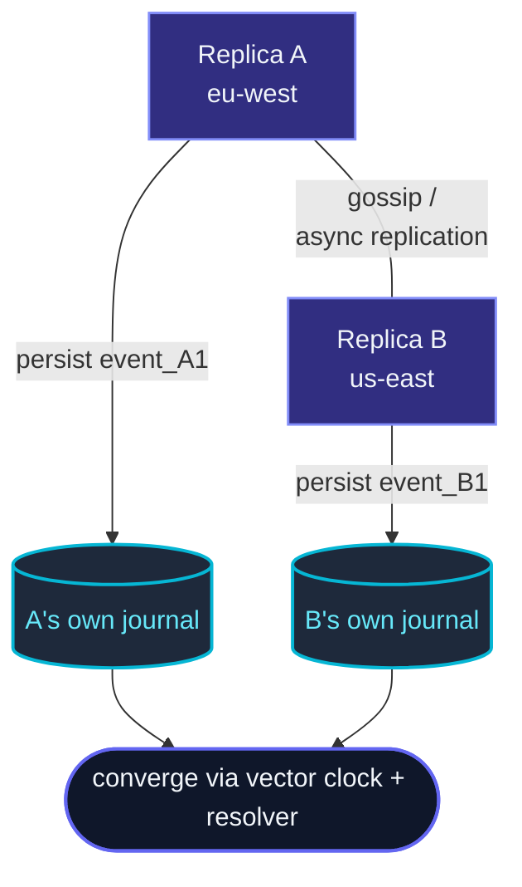

Standard
[event sourcing](/persistence/persistent-actor/) has
**one writer per `persistenceId`** — a single actor instance
appends events; another instance (after failover) replays them.
This is fine for sharded entities where the framework
guarantees one-actor-per-key.

**Replicated event sourcing** removes that constraint.
Multiple replicas of the **same entity** can be active at
once — on different nodes, in different regions — and each
persists independently.  The framework uses **vector clocks** to
detect concurrent edits + **conflict resolvers** to merge them.



## When to use it

This is the **niche** persistence pattern.  Most apps shouldn't
need it.  Use cases:

- **Multi-region active-active** — same entity writable in
  EU + US.  Network partition between regions doesn't stop
  either side.
- **Edge-style replication** — entities replicate close to users,
  reconcile centrally.
- **Cluster-spanning concurrent writers** — same entity edited
  on multiple cluster nodes without singleton coordination.

For typical sharded-entity setups,
[ClusterSharding](/cluster/sharding/overview/) +
[PersistentActor](/persistence/persistent-actor/) gives
exactly-one-writer per key automatically — simpler than this.

## What you give up

Replicated event sourcing trades **simplicity** for
**availability**:

| Single-writer ES | Replicated ES |
| --- | --- |
| Total event order per pid | Partial order — concurrent events can be unordered |
| State is a deterministic fold | State is a fold + conflict resolution |
| Commands are validated against latest state | Commands are validated against local replica's view |
| Restart replays the log | Restart replays the log + reconciles concurrent branches |

The mental model is **CRDT-like for events** — multi-writer
convergence by design.

## A minimal example

```ts
import {
  ReplicatedEventSourcedActor,
  VectorClock,
  type ConflictResolver,
} from 'actor-ts/persistence';

type State = { value: number };
type Event = { kind: 'set'; value: number };

const maxWinsResolver: ConflictResolver<Event> = {
  // When two replicas concurrently set different values, the higher wins:
  resolve(a, b) {
    return a.event.value >= b.event.value ? a.event : b.event;
  },
};

class Counter extends ReplicatedEventSourcedActor<Command, Event, State> {
  readonly persistenceId = 'counter-42';
  protected override resolver(): ConflictResolver<Event> { return maxWinsResolver; }

  initialState() { return { value: 0 }; }
  onEvent(state: State, event: Event) {
    return { value: event.value };
  }
  // ... onCommand etc.
}
```

The actor extends `ReplicatedEventSourcedActor` instead of
`PersistentActor`.  Nothing is passed into the constructor: the base
class reads the `Cluster` off the `ActorSystem` (see
[`this.cluster`](/cluster/overview/#reaching-the-cluster-from-an-actor)).
Two additional things to specify:

- **`resolver()`** — how to merge concurrent events (optional; defaults to last-writer-wins).
- **A journal per replica.**  Each replica writes its own stream: it
  appends every event it observes — its own, and each one a peer
  publishes — to its node's journal, so a restart rebuilds the state
  from that journal alone, with no cross-replica chatter.  Never point
  two replicas at one shared stream: they would race each other's
  appends on one sequence, and every event would land in it once per
  replica.

`replicaId` — this replica's stable identifier, distinct from
`persistenceId` — defaults to this node's cluster address.  Override it
only when the id has to survive a re-address, e.g. a fixed region name:

```ts
override get replicaId(): string { return process.env.REPLICA_ID!; }
```

Two replicas that ever share an id will share a vector-clock
component, so the default is the safe one.

## What a replica trusts from its peers

Cross-replica delivery rides on `DistributedPubSub`, so every field
of an arriving event envelope was written by another node.  Anything
that can complete the cluster handshake can reach a replicated actor
— through the pub-sub mediator, or straight at its actor path — and
membership is not a precondition.  Three properties follow, and all
three matter operationally.

**An envelope is validated whole, before anything is applied.**
`replica` and `eventId` must be non-empty and bounded, `seqAtReplica`
a positive integer, `timestamp` finite, and the vector clock a plain
object of finite non-negative components with a bounded entry count.
A failure drops that one envelope and logs a `WARN` naming the field;
it never fails the actor and never leaves a half-applied event in the
history.

**Event identity comes from entropy, not from the payload's
counters.**  Each event carries an `eventId` minted at `persist` time
— the replica id, a `#`, and 96 bits of randomness — and that is what
deduplication compares.  It has to be unguessable because a
deduplication hit means *silently discard*: an identity derived from
`replica` and `seqAtReplica` is arithmetic to predict, so a peer could
claim identities a replica had not issued yet and its real events
would then be dropped by everyone, permanently, since the identity set
is snapshotted.  `seqAtReplica` is still on the envelope, but only as
the last tie-break in the canonical order.

**An envelope's author is the node that sent it.**  `replica` is a
value the sender chose, so it is held against the node the *connection*
authenticated rather than believed.  A replicated actor subscribes to
its topic asking for the publishing node, and `isAuthorizedAuthor`
decides whether that node may write under the arriving `replica` id;
the default is the equality that the default `replicaId` makes true.
An envelope that reaches the actor without an authenticated origin —
which is what a frame aimed straight at the actor's path produces,
bypassing pub-sub — is refused for that reason alone.

The binding is sound because a replicated event crosses **at most one
hop**: `persist` is the only publisher and no mediator re-forwards what
it received, so the node an arriving envelope came from is the node
that wrote it.

import { Aside } from '@astrojs/starlight/components';

<Aside type="caution" title="A custom replicaId needs a custom author check">
  ```ts
  override get replicaId(): ReplicaId { return 'eu-west'; }

  protected override isAuthorizedAuthor(replica: ReplicaId, origin: NodeAddress): boolean {
    return REPLICA_NODES[replica] === origin.toString();
  }
  ```
  The default check compares `replica` against the sending node's
  address, which is exactly right while `replicaId` *is* that address
  and refuses every honest envelope once it is not.  Override the two
  together: they are the replica-to-node mapping, and the framework
  cannot infer its second half.  A `return true` restores the old
  behaviour in full — a member may then author events under any
  replica's id — and is worth writing only for a cluster whose every
  member is as trusted as this process.
</Aside>

<Aside type="note" title="The event history is bounded by refusal">
  ```ts
  protected override maxObservedEvents(): number { return 10_000; }
  ```
  There is no compaction yet, so the canonical history only grows —
  and every remote event also costs a journal write.  At the ceiling
  (100 000 by default) further *remote* events are **refused**, with one
  `WARN` saying so; local `persist` calls are never refused.  Refusal
  rather than eviction is deliberate: dropping events changes the fold,
  and dropping identities re-opens double-apply.  Lower the hook for an
  entity whose legitimate history is small.

  **The refusal is permanent for that entity.**  The ceiling counts the
  observed history, which includes this replica's own persists — so an
  entirely honest replica reaches it by writing enough of its own events,
  after which it stops accepting any peer's.  And nothing clears it: a
  snapshot stores the whole history rather than a checkpoint, and
  recovery re-seeds the history from it, so neither snapshotting nor
  discarding the journal sheds an event and the refusal comes back with
  the actor.  Raising the hook is the only relief today; compaction is
  tracked as #535.
</Aside>

## When the stores are down

A replicated actor talks to the same journal and snapshot store a
`PersistentActor` does, through the same guards: the five
`actor-ts.persistence` settings described under [When the stores are
down](/persistence/persistent-actor/#when-the-stores-are-down) apply
to its own `persist`, its recovery and its snapshot saves.  The
breakers are the same two as well — the ids `journal-breaker` and
`snapshot-breaker` name — because there is one journal per node and
so one breaker in front of it: an outage either class runs into
fast-fails both.

**`persist` can reject with the breaker's own errors.**  While the
journal breaker is open it throws `CircuitBreakerOpenError` without
asking the journal; past
`actor-ts.circuit-breaker.persistence-journal.call-timeout` it throws
`CircuitBreakerTimeoutError`.  Either way the event is neither folded
nor broadcast, the error leaves your `onCommand`, and the next command
is served — handle both where you handle a journal error.  A refused
`persist` still uses up the `seqAtReplica` it was minted with.  The
gap is harmless, since peers accept gaps already — a publish with no
live subscriber is never retransmitted — and handing the number back
would mint it twice once a timed-out append landed after all.

**A timed-out append may still land.**  The `call-timeout` gives up;
it does not cancel.  If the write reaches the journal anyway, this
replica folds the event at its next restart while no peer ever
receives it, because only a successful `persist` broadcasts.  A store
that commits and loses the answer on the way back does the same
without any breaker involved, and nothing repairs that divergence
yet.

**Recovery is guarded like a `PersistentActor`'s.**  It waits for one
of `max-concurrent-recoveries` permits, reads the snapshot through the
snapshot breaker and the journal after it through the journal breaker,
and gives up after `recovery-timeout` (30 s).  With
`snapshot-is-optional` on, an unreachable snapshot store is logged as
a warning and the replica recovers from its journal alone.  Only the
two reads run under the deadline; what they return is applied after
it, so a read that answers once the deadline has passed changes
nothing.  A recovery that fails fails `preStart` — the class has no
`onRecoveryFailure` — and supervision restarts the actor as it would
any actor that failed to start.

**Snapshot saves go through the snapshot breaker.**  A save the
breaker refuses, or the store fails, is a warning and never fails the
actor: the next recovery starts from the previous snapshot, or replays
the journal.

**Appends of events from peers are not guarded yet.**  The append of an
event received from a peer is fire-and-forget and races itself; #958
gives it a serialized append chain, and the breaker belongs there.
Until then those appends reach the journal even while its breaker is
open, and `call-timeout` does not bound them.

## The pieces

| Component | Purpose |
| --- | --- |
| **[VectorClock](/persistence/replicated-event-sourcing/vector-clocks/)** | Tracks causality across replicas — detects concurrent writes. |
| **[ConflictResolver](/persistence/replicated-event-sourcing/conflict-resolver/)** | Decides how to merge concurrent events into a single state. |
| **[Single-writer lease](/persistence/replicated-event-sourcing/single-writer-lease/)** | Optional — gates writes via a lease for stronger consistency. |
| **[Replicated snapshots](/persistence/replicated-event-sourcing/snapshotting/)** | Snapshots that include the vector clock for full recovery. |

Each gets its own deep-dive page.

## When NOT to use it

<Aside type="caution" title="Sharded entities are simpler">
  ```ts
  // ClusterSharding gives exactly-one-actor-per-key automatically
  ```
  If your only need is "spread entities across nodes,"
  sharding + plain PersistentActor is much simpler.
  Replicated ES is for **concurrent writers to the SAME
  entity**.
</Aside>

<Aside type="caution" title="No natural conflict resolution">
  ```ts
  // "User changes name in EU and US concurrently — which wins?"
  ```
  Replicated ES requires you to define a resolver.  If "what
  wins" doesn't have a sensible answer, replicated ES is the
  wrong shape — use a single-writer pattern (singleton /
  sharding).
</Aside>

<Aside type="caution" title="Strong consistency required">
  ```ts
  // Financial: balance must never reflect divergent state
  ```
  Replicated ES is **eventually consistent**.  For absolute
  consistency (no divergent reads, no merged-after-the-fact
  states), use a singleton or sharding (one writer at a time).
</Aside>

## Comparison

```
                              Sharding + PersistentActor    Replicated ES
Multiple writers per entity?  No (exactly one)             Yes
Conflict resolution needed?    No                           Yes
Cross-region active-active?    Sharding favors one region   Yes
Operational complexity?        Low                          High
Use when                       Default                      You really need it
```

## Where to next

- **[Vector clocks](/persistence/replicated-event-sourcing/vector-clocks/)** —
  how concurrency is detected.
- **[Conflict resolver](/persistence/replicated-event-sourcing/conflict-resolver/)** —
  how concurrent events merge.
- **[Single-writer lease](/persistence/replicated-event-sourcing/single-writer-lease/)** —
  optional stronger-consistency gate.
- **[Replicated snapshots](/persistence/replicated-event-sourcing/snapshotting/)** —
  vector-clock-aware snapshots.
- **[PersistentActor](/persistence/persistent-actor/)** —
  the simpler single-writer alternative.
- **[Sharding overview](/cluster/sharding/overview/)** —
  the usual scale-out pattern.
